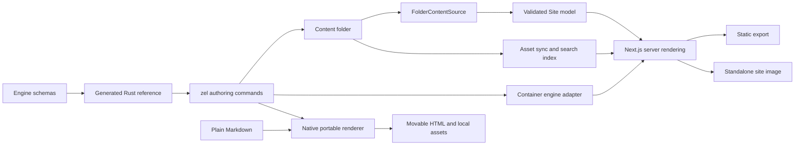

# Zellij — durable project context

Last refreshed: **2026-10-17**. Initial review baseline: local `main` at
`6356b05deaddf5421b24d7c8a1e30f868d4923c0`.

This is the starting point for future Zellij conversations in this checkout.
The companion [audit](specs/zellij-audit-2026-10-16.md) contains reproducible
defects, remaining work, evidence, and verification limits. Recheck dated facts
before acting. The initial review created documentation only; subsequent authorized work is
recorded below.

### Implementation update — 2026-10-16

The user subsequently authorized implementation and the repository setup.
`mylife-inc/Zellij` is now **public**, with **main** as its default branch.
Before the visibility change, Gitleaks 8.30.1 scanned all 134 reachable commits
and reported no detected leaks. No historical rewrite was performed.

The first milestone merged in [PR #1](https://github.com/mylife-inc/Zellij/pull/1)
as `6950589`. Commit `1a2e26b` adds shared output-path/collision
checks, conversion source containment, protected page/guide creation, staged
static exports, and streamed image Dockerfiles. `deda7a0` restores the browser
job's engine-build prerequisite; `bd6b6c6` bounds file-descriptor use during
large conversions and tests the CLI against an image built from its checkout.
See the audit's implementation record for the resolved finding IDs.

Verification established: **99 Rust tests**, warnings-denied Clippy, formatting,
**227 engine tests**, workspace typechecking, and the engine/showcase production
builds pass. Hosted browser run `39000366953` passed **294 tests**, with 114
existing conditional skips across desktop/mobile Chromium and mobile WebKit.
The CI workflow additionally exercises initial static export, failed-build
preservation, and successful replacement using a real container. Consult the
PR's latest checks and merge status before relying on a particular revision.

Compatibility change: conversion requires a new/empty destination outside its
source tree. Static export requires a new/empty directory outside content, or
an export previously created with the `.zellij-output` ownership marker.
Existing unmarked exports need a new/empty output on their first build with the
new CLI; never mark an authored directory as generated output.

A clean `npm ci` restored the missing local packages. `npm audit` also reported
19 advisories (3 critical, 6 high, 6 moderate, 4 low). Next.js and Vitest upgrades
need a separate compatibility-tested change; no automatic audit fix was applied.
This was the dependency baseline before the second milestone below.

### Dependency and template update — 2026-10-16

The user authorized continuing. Commit `17d5a23`, tracked in
[PR #2](https://github.com/mylife-inc/Zellij/pull/2), removes the 19 reported
npm advisories and fixes the invalid section scaffolds (audit R4). The locked
tree and a freshly generated standalone app with all features both report
**zero npm advisories** at this date; this is not a claim that all bugs are gone.

- Next.js is `16.4.2`; Vitest resolves to `4.1.12`, Vite `7.3.7`, Mermaid
  `11.17.2`, KaTeX `0.18.10`, esbuild `0.28.2`, and XML DOM `0.9.12`.
- Scoped dependency overrides keep optional math/diagram chains patched.
  The engine manifest carries the production overrides; `zellij init` and
  feature changes copy them to the app root, where npm actually enforces them.
  Manual wrappers must carry that map too. The repository additionally
  overrides tsup's esbuild. Tests keep the shared constraints in agreement.
- `src/content/frontmatter.ts` replaces gray-matter, using the existing YAML
  package for guides, prose, and search. Metadata must be a YAML mapping with
  a closing delimiter; executable language tags are rejected. BOM, Windows
  newlines, nested values, and multiline scalars are tested.
- `src/cli/section-templates.ts` generates YAML from schema shapes and bounds,
  chooses valid media alternatives, and validates the serialized result with
  the complete Zod schemas. `context --json` embeds `sectionTemplates`; Rust
  copies those strings instead of guessing nested types and list lengths.
  Templates contain TODO text and explicit replaceable media paths. The
  command writes only YAML; authors supply their actual assets.
- CI audits dependencies, validates and statically exports all 23 templates
  emitted by the actual Rust binary, and tests formulas/Mermaid math labels
  in browsers. Browser failures retain traces and the job has a time limit.

Local verification: **260 engine tests**, **99 Rust tests**, formatting,
warnings-denied Clippy, workspace typechecks, engine packaging, all four
example content checks, and all 23 Rust-generated template checks pass.
The showcase production build passes with webpack. Local Turbopack hits the
execution sandbox's helper-process port restriction; the normal Turbopack
build and container/browser acceptance are hosted CI gates. Consult PR #2's
latest checks for their results. No new native CLI release is issued here.

Hosted run `39004471983` at `d8c9f5d` passed all four jobs: engine, schema sync,
CLI/container acceptance, and browsers. The normal Turbopack build and all 23
template static exports passed; **297 browser tests passed**, with **114
conditional skips and no retries**. A minimal (`--features none`) fresh wrapper
also audited clean. Its lockfile still includes Mermaid, remark-math and
rehype-mathjax through the engine's optional dependencies; audit follow-up S11
tracks that feature-selection/package-size defect separately.

CI reliability history: after PR #1, run `39001111736` initially stalled on
repeated mobile-WebKit navigation timeouts. Its fresh-runner retry passed all
294 tests (114 conditional skips). This is not a diagnosed/fixed browser bug.
The separate automated security-review plugin failed its PR #2 commit review
with HTTP 400; that review must not be represented as passed.

### Conversion update — 2026-10-16

The next authorized milestone is [PR #3](https://github.com/mylife-inc/Zellij/pull/3).
Source commit `4196e6b` addresses R5's ordinary Markdown document links and
referenced assets for both MkDocs and Docusaurus. A shared parser-based pass
rewrites links to canonical engine routes, expands reference-style links,
preserves query/fragment text and code examples, and copies binary assets into
`assets/imported/docs/` or `assets/imported/static/`. Docusaurus's default
`static/` paths are supported; unlisted documents remain unpublished.

Assets participate in the same complete output preflight/staging as text.
Escaping references, symlinks, case-only file conflicts, hidden document names,
and duplicate public routes are rejected before writing. Missing or ambiguous
references and HTML/JSX attributes are reported. Markdown images under the
public asset prefix now receive the site's basePath in the MDX component map.

R5 still has explicit migration limits: source-specific/custom heading IDs,
fragments targeting a removed leading H1, HTML/JSX attributes and imports,
custom static folders and source route overrides require manual work. Fragment
text is retained, not universally validated or translated. Do not describe
this milestone as full-fidelity migration of arbitrary MkDocs/Docusaurus sites.

Local verification: **109 Rust tests**, **261 engine tests**, warnings-denied
Clippy, formatting, all workspace typechecks, engine packaging and the updated
documentation content check pass. `scripts/check-conversion.mjs` runs the real
CLI and engine to check routes, an actual heading anchor, rendered image URLs
under `/products/docs`, and copied binary bytes. Hosted CI adds static exports
of both imports and checks actual HTML links, fragments and asset files. Read
PR #3's latest checks before claiming hosted acceptance; no native CLI release
is part of this milestone.

Integration review exposed a separate prefix-configuration gap: generated
Next config does not mirror `site.yaml`'s basePath. The CI fixture configures
both explicitly using `scripts/fixtures/conversion.Dockerfile`. The existing
showcase `verify-basepath.mjs` also replaces strings no longer present in its
configuration, so it must not be trusted as current prefix acceptance (S12).

PR #2 merged as `3408f37`; main run `39005197060` passed all checks, and base
image run `39005197029` published all four feature variants for AMD64/ARM64.

### Scaffolding and discovery update — 2026-10-16

Commits `fe4240c` and `ee68282`, tracked in
[PR #4](https://github.com/mylife-inc/Zellij/pull/4), resolve the reproduced
content-authoring findings **R6–R8**.
Rust content scaffolds and converters share a JSON-backed YAML string scalar
serializer, including explicit escapes for YAML's extra Unicode line breaks and
characters its parsers reject literally.
The Node initializer uses the same representation. Names, copyright text,
page identifiers, section references, guide titles and front matter preserve
punctuation, implicit YAML values and multiline text. This covers generated
content metadata; it does not validate arbitrary npm package names or workflow
inputs as package identifiers, GitHub expressions or shell commands.

Plain/minimal starters omit the guide CTA unless `--guide` creates its target.
All CLI commands that resolve a content root now use `Project::discover`:
`./content`, current root, `./docs`, then `./documentation`. Explicit paths
retain their existing exact-directory behavior. Marker files, a sections
directory, and guide-only roots are recognized; hidden/reserved guide folders
and markers of the wrong filesystem type are excluded. Discovery never walks
upwards. This selects a root; the engine still owns semantic validation.

Local verification: **117 Rust tests**, **262 engine tests**, warnings-denied
Clippy, formatting, workspace typechecks, engine packaging, documentation
content validation, and both conversion fixtures pass. The new
`scripts/check-scaffolds.mjs` checks exact metadata and rendered Hero links
for **40 Rust starters, 10 Node content starters and 10 guide titles**. Hosted
CI additionally exercises four guide-only discovery locations and a menu-only
root through the real container engine. Hosted results are pending at this
record; consult the PR before claiming acceptance. No native release is made.

The separate security-review plugin failed to read its model response during
the source commit, although the commit itself succeeded. That review did not
complete and must not be described as passed.

Prior milestone completion: PR #3 merged as `dd99c2c`. Main CI `39007109533`
and image run `39007109576` passed, publishing all four variants for Linux
AMD64/ARM64. Browser acceptance had 296 initial passes plus one successful
retry, with 114 conditional skips. The retry was a mobile-WebKit navigation
error at `/guide/quickstart`; PR CI had a different FAQ interaction retry.
These flakes remain undiagnosed, not repaired by the conversion changes.

### Header layout and overflow update — 2026-10-17

Source commit `da1c222` implements the requested viewport-wide header: branding
at the left inset and search/theme/actions at the right. The existing
`brand.logo.href` remains the company-site link; `brand.title` can retain a
separate site-home link. No new branding schema or company assets are required
by the engine change. Search continues to open its existing dialog.

Desktop navigation measures the remaining space and inert copies of every
label, including active font weight and icons. Trailing items move into More
and return when space grows; resizing, loaded fonts and theme changes trigger
measurement. Existing `menuOverflowAfter` remains the configured count limit.
The overflow model preserves destinations, group headings, descriptions,
icons and external/new-tab flags. The mobile drawer receives the full resolved
menu, independently of the width-selected desktop prefix.

Keyboard focus follows items that move into/out of overflow; breakpoint changes
close stale panels and release drawer scroll lock. Tall More panels scroll,
and compact More panels stay within the viewport at either edge. Mobile
controls have 44px targets at the default root font size. The header was checked
at widths from 320 to 1600px, including larger menu text and a wide brand.
This is not a full WCAG audit or a claim of manual screen-reader acceptance.

Local evidence: **268 engine tests**, workspace typechecks, engine packaging,
and documentation validation pass. The focused desktop/mobile Chromium
navigation run passed **34 tests** with **26 device-specific skips**. The six
new desktop header cases also pass (the final compact-panel check was rerun
separately after correcting its fixture width). Final engine typechecking and
six focused unit tests pass after the positioning adjustment. Production builds,
the full browser suite and mobile WebKit remain hosted CI gates; consult the
PR containing `da1c222` for their outcomes. No native CLI release is made.

Prior milestone completion: PR #4 merged as `4be61dc`. PR CI `39010124427`
passed with 297 browser passes, 114 conditional skips and no retries. Main CI
`39010596721` passed with 296 initial browser passes, one successful retry and
114 skips. The retry was the previously observed mobile-WebKit FAQ interaction
(answer hidden after clicking the summary); its cause remains undiagnosed.
Image run `39010596751` published all four variants for Linux AMD64/ARM64 and
passed the published-image build/serve smoke test.

### Canonical search and preparation update — 2026-10-17

Source commit `29654d3` resolves **R10–R12** and the interrupted search load
**S2**. `createContentSource` in `src/config/runtime.ts` now supplies the shared
folder/legacy selection and content-path contract for rendering and preparation.
`writeSearchIndex` reads a fresh `loadSite` result, including canonical guide
routes, frontmatter/sidebar overrides, unlisted pages and title-stripped bodies.
Preparation bypasses the global rendering memo; S8 remains a separate issue.

`src/mdx/headings.ts` parses Markdown/MDX without executing authored JavaScript.
Search and the TOC use the renderer's `rehype-slug` semantics, including formatted,
setext, quoted, indented, repeated and mathematical headings. All heading levels
participate in duplicate IDs; only h2/h3 split search passages, so deeper
subsections retain their text. Search stores unprefixed routes for Next's router.
The existing regex-based prose cleanup is not a complete MDX text interpreter.
Optional math loading is shared with rendering and stays external in CLI bundles;
bundling MathJax broke its runtime paths and was caught using Zellij's own docs.

`zellij prepare`, `sync-assets` and `search-index` accept `--content <dir>` and
`--config <legacy-file>`, including inline values with spaces/equals signs.
Helpers still accept an app-root string or now a `ZellijRuntimeOptions` object.
Wrappers must pass the same explicit content root to preparation and rendering;
preparation does not infer TypeScript configuration. Missing roots and malformed
assets directories fail before clearing previous prepared files. Physical-path
overlap checks protect source assets, including public-directory symlinks.
Rerunning asset sync removes stale output even if the source assets folder has
been deleted. Automatic dev watching is still absent: **S9 is only partly fixed**.

Synthetic guide roots and configured home redirects now claim route ownership;
only a guide and its own root page may intentionally share that route. The
search dialog aborts cancelled requests, retries on reopen after cancellation
or failure, and caches completed data for the current deployment prefix.

Local verification: **285 engine tests**, all workspace typechecks, packaging,
all four example preparation/content checks, and the packaged CLI integration
fixture pass. The fixture covers canonical routes, actual optional math loading,
custom paths, legacy config, invalid flags and asset removal. Four focused
Chromium desktop/mobile recovery cases pass without retries. An initial broad
run against the local dev server timed out in the existing `networkidle` check;
production lazy-loading and WebKit acceptance remain hosted CI gates. The new
recovery test's early-hydration click was corrected to use the existing retrying
shortcut pattern. CI additionally exports a real container site and checks that
each indexed route and anchor exists. Consult this commit's PR for hosted results.

R13 documentation now states the fast check's actual limits. Complete prose-link
and asset validation remain open, as do basePath synchronization/acceptance S12,
remaining UI findings and native CLI/platform completion. No native binary
release is made in this milestone.

Prior milestone completion: [PR #5](https://github.com/mylife-inc/Zellij/pull/5)
merged as `7fb5178`. PR CI `39019128511` and main CI `39019556088` passed all four
jobs, including **305 browser passes, 124 conditional skips and no retries**,
268 engine tests and 117 Rust tests. Image run `39019556101` published all four
feature variants for Linux AMD64/ARM64 and passed published-image build/serve
smoke acceptance. Previously recorded FAQ/WebKit flakes remain undiagnosed.

### Deployment prefix and runtime isolation update — 2026-10-17

Source commit `8463720` resolves **S6, S8 and S12**. The shared native
`engine/packages/zellij/deployment-config.cjs` resolves content roots and the
deployment prefix for both `withZellij()` and the runtime. It lives at package
root so source, compiled modules and native Next configuration resolve the same
file; package and container distributions include it.

`site.yaml` supplies Next's basePath automatically. A wrapper may supply it when
content omits it; explicit values must agree, including an explicitly empty
prefix. Values are normalized and malformed prefixes rejected. Next embeds the
effective value as reserved `ZELLIJ_BASE_PATH`; runtime configuration must agree
with that build-time choice. Changing the prefix requires rebuilding. Custom
content paths must match across preparation, runtime factories and the second
argument of `withZellij(config, contentOptions)`.

Runtime memoization is keyed by absolute application/configuration/content
paths, runtime prefix and compiled prefix. Production retains each site's
result; development retains the 250 ms TTL. Failed loads evict their entry so
correcting a missing/invalid file can recover. Social metadata images now receive
the same prefix as canonical URLs and other assets.

The previous in-place showcase prefix script is replaced by an isolated,
production-built wrapper fixture. Only its content declares the prefix; its
custom content directory exercises preparation and rendering together. CI tests
redirects, nested links, ordinary/optimized images, Next resources, metadata,
sitemap, robots and search in Chromium and WebKit. Conversion exports now use
the default CI image without a special Next-config override.

Local evidence: **303 engine tests**, all workspace typechecks, engine packaging,
packaged-CLI integration and all four example preparation/checks pass. The
production prefix fixture passes Chromium with webpack and a local font-response
fixture. One earlier normal-font build succeeded; another failed in Next's Google
Fonts loader (new audit **S13**). Hosted acceptance uses normal fonts, Turbopack
and WebKit and remains a gate; consult the PR containing this commit. The local
font fixture is not shipped and does not resolve S13. No native binary release
is included.

Prior milestone completion: [PR #6](https://github.com/mylife-inc/Zellij/pull/6)
merged as `d115a9a`. PR CI `39022447464` passed all four jobs, with **285 engine
tests, 117 Rust tests, 311 browser passes, 124 conditional skips and no retries**.
Main CI `39022871779` passed with 310 initial browser passes plus one successful
retry of the existing mobile-WebKit FAQ interaction (`sections.spec.ts:191`).
Its cause remains undiagnosed. Image run `39022871680` published all four feature
variants for AMD64/ARM64 and passed published-image build/serve acceptance.

### Deep and strict validation update — 2026-10-17

Source commit `86e5e2d` addresses the static-validation portion of **R13**.
Both `zel check <dir>` and `zellij check <dir>` accept `--deep` and `--strict`.
The default remains the fast content-model check. Deep mode parses MDX without
executing authored JavaScript and checks static prose/section links, heading,
HTML and section anchors, local media and section previews. Strict mode fails
on existing or new warnings. Build/dev/migrate retain fast checks unless the
caller runs an explicit deep/strict gate first.

Reference semantics are Zod metadata in `src/content/reference-schema.ts`, used
by configuration/section schemas and exported in the generated Rust schema.
Do not add a new link/media/inline-prose field without its reference annotation.
`src/cli/deep-check.ts` uses canonical Site routes, redirect targets and the
renderer's heading/GFM anchor pass. Inline prose shares tokenization with
`InlineMarkdown`. Section source paths survive loading for useful diagnostics.
MDX positions refer to the loaded body, after front matter/title removal.

The checker preserves the first Markdown reference definition, follows
home/guide redirects before checking fragments, and validates example references
in their actual rendering page. It detects recursive previews and duplicate IDs.
Asset paths must resolve to files inside the physical content/assets boundary;
raw Markdown/HTML image URLs use `/_zellij/assets/...`, while Screenshot and
schema-declared media use content asset paths. Fast navigation validation now
ignores URL query strings when finding a route.

Limits remain explicit: no component/JavaScript execution or remote HTTP checks;
literal menu `url:` remains unchecked. Dynamic MDX, custom components, component
ID props, srcSet and contextless relative links warn. Wrapper-owned public files
outside the content asset prefix and SVG-internal fragments are not verified.
Optional math parsing depends on the installed environment: use the installed
wrapper for math-enabled deep checking; the bare container checker installs no
optional dependencies. Full build/browser acceptance is still necessary.

The checker exposed four broken showcase anchor links in `pro/tour.yaml` and
`pro/highlights.yaml`; they now target existing highlights/specifications content.
Local evidence: **317 engine tests**, **117 Rust tests**, workspace typechecks,
formatting, warnings-denied Clippy, engine packaging, isolated packaged-checker
and preparation integration, and all four local examples under `--deep --strict`
pass. CI adds deep/strict validation for the three fully tracked examples (PayOS
needs its generated docs), plus the real Rust/container command and static export.
Consult this source commit's PR for hosted results. No native binary release is
included; the new Rust flags require the current CLI source and matching image.

Source review also found **S14**: video-embed omits basePath for local video and
poster URLs. It remains a separate rendering fix, with prefixed browser acceptance
needed. S13 font-build reproducibility and the prior browser flakes remain open.

Prior milestone completion: [PR #7](https://github.com/mylife-inc/Zellij/pull/7)
merged as `ba30f9b`. PR CI `39025935776` and main CI `39026348416` passed all four
jobs, with **303 engine tests, 117 Rust tests, 311 browser passes, 124 conditional
skips and no retries**. Separate Chromium/WebKit prefix acceptance passed with
normal fonts and Turbopack. Image run `39026348423` published all four variants
for AMD64/ARM64 and passed the published-image build/serve smoke test.

### Development preparation update — 2026-10-17

Source commit `8674908` completes the remaining preparation-watching part of
**S9**. The Node helper now provides `zellij dev [--content <dir>] [--config <file>]
-- [Next dev arguments]` and standalone `zellij prepare --watch`. Generated
wrappers and all four examples use the supervised dev command. The base image
uses that same generator, so Rust `zel dev` gets watching through its existing
`npm run dev` invocation; no new Rust flag or native binary release is needed.
Existing wrappers must update their dev script or run the standalone watcher.

`src/cli/watch-preparation.ts` polls filesystem metadata every 500 ms, requires
two stable snapshots, and serializes preparation. This covers bind mounts,
custom/legacy content locations, root removal/recreation and symlinked roots.
Generated output, Next output, node_modules and Git internals are excluded.
Separate content/asset snapshots avoid copying images on prose-only edits and
avoid rebuilding search for asset-only changes. Failed preparations do not
acknowledge pending asset changes. Repeated identical errors are suppressed;
corrected content recovers without restarting. Startup must prepare successfully.

Search/manifest JSON is replaced through a sibling temporary file. Asset trees
are copied and hashed before a short rename swap; failed copies preserve the
old tree. This is not a transaction across the whole site, and an asset rename
swap can briefly leave its directory absent. The dev supervisor owns Next's
process, forwards signals, propagates its exit status, and closes the watcher.
Search clears its loaded data on close and bypasses HTTP caching in development;
production keeps the existing cache behavior.

Local evidence: **324 engine tests** (seven watcher regressions), workspace
typechecks, engine packaging, isolated installed-CLI process/exit acceptance,
existing packaged preparation, and deep/strict docs validation pass. The real
webpack dev server passes Chromium checks for updated search on reopen, rendered
headings/images after reload, added/deleted pages, removed/restored assets,
invalid-MDX recovery and released server port. CI adds the installed-package
fixture, actual Rust/container dev acceptance and Chromium/WebKit dev acceptance
with normal Turbopack. Consult the PR containing this commit for hosted results.

Content edits still require browser reload for page/image changes. Automatic
browser reload is future work; do not equate this watcher with full MkDocs live
reload. Restart after deployment-prefix, wrapper-config or feature changes.
Nested symlinks are not followed by the polling traversal. Portable Markdown
build/serve/view remain unimplemented, as recorded in the portable contract.

Browser verification exposed **S15**: MDX h2/h3/h4 links replace their accessible
names with “Link to this section.” This remains an accessibility follow-up;
S13, S14 and the existing mobile-WebKit flakes also remain open.

PR #9's first normal-Turbopack dev gate exposed S13 again: IBM Plex Sans failed
before browser acceptance with `next/font/google queries have exactly one entry`.
This matches upstream Next issue #99114, whose fix #100158 is merged but was not
in npm's stable 16.4.2 on 2026-10-17. See the audit for links and evidence limits.
A retry does not resolve the build's Google Fonts dependency. Treat a stable
font remedy as the next reliability priority before expanding the CLI surface.

Prior milestone completion: [PR #8](https://github.com/mylife-inc/Zellij/pull/8)
merged as `d4615ca`. PR CI `39036985726` and main CI `39037525173` passed all four
jobs (317 engine tests, 117 Rust tests and the real deep/strict container/export
fixture). Both browser runs had 310 initial passes plus one successful retry of
the known mobile-WebKit FAQ interaction, with 124 conditional skips. Separate
Chromium/WebKit prefix acceptance passed. Image run `39037525149` published all
four feature variants for AMD64/ARM64 and passed published-image build/serve
acceptance. No new native CLI release was made.

### Reproducible theme fonts — 2026-10-17

Source commit `7963587` replaces the build-time Google Fonts loader with a
pinned local snapshot, addressing **S13**. The twelve existing families retain
normal styles, weight ranges, Unicode subsets, swap behavior, CSS variable
names and metric-adjusted fallbacks. There are **75 unmodified WOFF2 files**
(1,539,836 bytes total). Fonts are not preloaded; a browser requests only the
families/subsets used by its page. The generated stylesheet uses namespaced
family names and relative asset URLs that Next processes with the site prefix.

`src/themes/fonts/manifest.json` records URLs, SHA-256, sizes, user agent, pinned
license provenance and fallback metrics. Original CSS and OFL notices are kept.
`prepare-fonts.mjs` verifies the snapshot entirely offline and copies it beside
the compiled modules. Git attributes preserve hashed upstream bytes on Windows.
The stylesheet references a bundled file containing every full license notice. Updates are explicit, reviewed
snapshot changes; normal builds never refresh fonts. Dependency installation
can still require network access. This does not implement portable `file://`
documentation or the requested Rust build/serve/view commands.

Local evidence: **324 engine tests**, workspace typechecks, engine build and
strict/deep documentation checks pass. The npm archive contains all font files
and notices for both source and compiled modules. Real webpack/Chromium
production-prefix and development-watcher acceptance pass, including all font
faces decoding, lazy loading, local prefixed URLs and deployed notices. CI adds
a fresh Turbopack site build with Docker `RUN --network=none` after dependency
installation, plus Chromium/WebKit production and development font checks.
The first hosted run `39053315323` passed the offline Turbopack build,
engine/schema/CLI jobs and 310 production browser tests plus one successful
retry of the known mobile-WebKit FAQ interaction (124 conditional skips).
Its production font gate failed because Turbopack stripped license comments.
Follow-up `21479d3` emits the combined notice as a real CSS URL asset and checks
its deployed response byte-for-byte. Local webpack/Chromium dev acceptance
passed this follow-up. [PR #10](https://github.com/mylife-inc/Zellij/pull/10)
tracks final hosted verification. Run `39054096571` passed all 311 production
browser tests without retries, then exposed a test URL-resolution error:
Turbopack emitted the notice relative to its stylesheet (`../media/...`), while
the test fetched it relative to the page. The trace confirmed the emitted CSS
reference; the check now resolves it against the owning stylesheet and still
requires the complete notice bytes and local deployment prefix. The corrected
license asset also passes local webpack production acceptance. No native CLI
release is made.

Run `39054561760` passed all engine/schema/CLI checks, offline build, and both
Chromium/WebKit production font/prefix checks. Development passed Chromium but
WebKit requested Next's own `/__nextjs_font/geist-latin.woff2` debug-overlay font,
which the test mistakenly treated as a Zellij asset. The installed Next overlay
middleware explicitly serves four local Geist font paths outside basePath.
Development acceptance now recognizes only those exact local framework paths;
all Zellij and remote font requests remain checked, and production has no
exception. That run's main browser suite had 310 initial passes plus one known
FAQ retry and 124 conditional skips. Consult PR #10 for final acceptance.

Prior milestone completion: [PR #9](https://github.com/mylife-inc/Zellij/pull/9)
merged as `bd01bdb`. Main CI `39052261993` passed all four jobs, including **311
browser tests**, 124 conditional skips and **no retries**. Chromium/WebKit
production-prefix and dev-watcher acceptance passed. Image run `39052261989`
passed eight platform/feature builds, four multi-platform publications and the
default-image build/serve smoke test. This successful run does not diagnose the
previous FAQ/WebKit flakes. PR #9's final PR run had one successful FAQ retry.

PR #10 completion: merged as `5a9e12c` after exact-head run `39055211438`
passed all four jobs: **324 engine tests**, **117 Rust tests**, schema sync,
typechecks, warnings-denied Clippy, offline Turbopack build, and **311 browser
passes / 124 conditional skips / no retries**. Main CI `39055788092` passed;
its browser suite had 310 initial passes and one successful known mobile-WebKit
FAQ retry. Both runs passed Chromium/WebKit production and development font,
license and prefix gates. Image run `39055788338` passed eight feature/platform
builds, four AMD64/ARM64 manifest publications and the default-image build/serve
smoke test. This closes S13's hosted acceptance; it does not diagnose the FAQ
flake or constitute a native CLI release.

### Truthful CLI inspection output — 2026-10-17

Source commit `4d659b4` resolves the reproduced **R9** behaviors. Rust `zel
context --json` emits the exact embedded engine JSON; supplying a filename
writes that format to the file with confirmation on stderr. `list themes`
lists all 14 names, labels and descriptions, generated from the engine's config
names and renderer tokens. The catalog is included in schema-sync CI.

JSON is implemented for every `list`, `explain` and `detect` as well. Explain
returns the selected full section schema. Lists return named arrays with stable
identifiers; detect returns the supplied source path and ordered matches with
numeric confidence and strength. Missing/non-directory sources fail instead
of masquerading as no match. Equal-confidence detection and converter listings
are deterministic across inventory registration order. See the CLI spec's
output contract and command docs for exact fields.

Other commands reject `--json` with exit 2 **before execution**. Unimplemented
`--verbose` / `-v` is removed from the parser/help and rejected, rather than
silently ignored. Errors remain human messages on stderr; JSON validation,
conversion/build reports, verbose tracing and config loading remain future work.
The existing Markdown context and human inspection formats are retained.

Local acceptance: **125 Rust tests**, warnings-denied Clippy and formatting,
**325 engine tests**, all workspace typechecks, engine package build and deep/
strict docs validation pass. Eight new binary integration tests run with no
external tools on PATH and cover exact embedded output, file/stdout/stderr
behavior, all section schemas, theme/config agreement, detection, error codes,
and refusal before command actions. A first engine run exposed a missing test
fixture name (corrected); a subsequent default-concurrency run hit two existing
math-rendering timeouts during a full Rust rebuild. The unchanged suite passed
with two local workers and unchanged timeouts. Hosted full acceptance remains
the next gate; no native binary release is part of this milestone.

Hosted completion: [PR #11](https://github.com/mylife-inc/Zellij/pull/11)
merged as `0a89131` after final source/help head `c411317` passed CI
`39059091256`. Main CI `39059796288` also passed all four jobs: 125 Rust tests,
325 engine tests, typechecks/schema sync, zero npm advisories, and **311 browser
passes with 124 conditional skips and no retries**. Container/scaffold/conversion,
font/license, production-prefix and development-watcher acceptance passed.
Image run `39059796306` passed all 13 jobs, publishing all four feature variants
for Linux AMD64/ARM64 and passing the default-image smoke test. No native binary
release was issued.

### Native portable Markdown build — 2026-10-17

Source commit `8f72022` adds the native `zellij-docs` crate and
`zel build --target portable`. A plain Markdown folder selects it automatically;
discovered structured Zellij content retains the hosted static default. The
renderer parses Markdown with pulldown-cmark, highlights code with syntect, and
writes full HTML pages with ordinary relative links. Embedded local scripts
provide search, theme selection and mobile navigation without fetch/router data.
The 14 themes are generated from engine tokens; the same pinned 75-font snapshot
and license notices are embedded by Cargo. Building needs no Node, Docker or
network. Source checkout builds do require the engine font snapshot in this repo.

Output defaults to a sibling `<input-name>-site`; `--out`, `--name` and `--theme`
configure publication. Index/README home selection, optional front-matter title/
description/order, directory links, heading/footnote fragments, referenced
assets, synthetic home, breadcrumbs and previous/next are implemented. The
shared staged publisher moved from `zellij-engine` to `zellij-core::output`
without changing the ownership/failed-build-preservation contract. Source and
output are disjoint; nested symlinks, missing references, duplicate outputs and
Windows-incompatible names fail before replacing output. URL paths normalize
Windows separators at the filesystem boundary.

Current limits: raw HTML is displayed literally with a warning; MDX is rejected.
Math rendering, Mermaid execution, custom navigation/config, portable watch/reload,
`serve` and `view` remain unfinished. External media is not downloaded. The
[portable contract](specs/zel-portable-docs.md) and CLI build docs carry the exact
behavior and capability comparison. This is not complete MkDocs compatibility.

Local acceptance: **137 Rust tests**, formatting, warnings-denied Clippy,
generated-theme parity, deep/strict docs checks and Chromium file acceptance
pass. The browser fixture builds without tools on PATH, preserves an old export
on failure, moves output to a space/Unicode path, opens home and deep links with
networking blocked, and checks search/anchors, local fonts/media, keyboard,
themes, mobile layout and JavaScript-disabled content. Review caught and fixed
Escape clearing the search field instead of closing its dialog. CI now includes
native portable build/CLI/browser jobs on Linux, macOS and Windows, each with
Chromium and WebKit. Hosted results are pending at this record; these jobs do
not establish full native Windows container support or release/install coverage.

## 1. Product and user's intentions

Zellij turns an authored folder of YAML, Markdown, MDX, and assets into a
product website with marketing pages and documentation. A shared Next.js engine
owns rendering, themes, components, navigation, and validation. A product's
content should not contain a fork of the engine or hand-maintained React for
ordinary content. The Rust binary is **`zel`**; the engine's Node helper is
**`zellij`**. Neither is the unrelated Zellij terminal multiplexer.

The user's outstanding intentions, stated on 2026-10-16:

- Give the sticky top bar more menu space: company logo at the left, search and
  theme controls at the right. The logo should link to the owner's website.
- Finish `zel`, including the desired operating-system coverage, explicitly
  including Linux, macOS, and Windows.
- Develop using a public `mylife-inc/Zellij` repository to avoid the current
  private-repository Actions billing constraint. Do not use `Zellij-Sealed`:
  its code is old and encrypted, and development should avoid encryption steps.
- Eventually use CodeSeal for long-term encrypted GitHub storage after the
  product is finished. The final distribution/secrecy model needs a separate
  decision: current public engine images intentionally carry source.
- The current request was research and brainstorming, not implementation.
  This restriction describes that request; future explicit implementation
  requests can authorize work.

### Additional CLI requirements — 2026-10-17

The user requires MkDocs-equivalent documentation workflows, with command syntax
free to differ: build a plain Markdown folder into a site that also works by
double-clicking `index.html`, serve an existing static site over HTTP, and a
`view` operation combining build, serve and browser launch. This is new required
product scope. The first portable build milestone is implemented above;
serve/view remain planned. The [portable documentation contract](specs/zel-portable-docs.md)
records plain-folder discovery, direct-file navigation/search/assets, offline
acceptance and cross-platform serve/view requirements. Keep a core MkDocs
capability comparison when implementing the Rust CLI. Today's Next static export
assumes HTTP and must not be advertised as satisfying direct-file viewing.

## 2. Read these sources in this order

1. This file and the [dated audit](specs/zellij-audit-2026-10-16.md).
2. [Content-model design](specs/zellij-content-model-design.md): current folder
   model, names, routing, ownership of navigation, and migration decisions.
3. [Engine specification](specs/zellij-engine-spec.md): architecture and quality
   bar. Some inventory counts and milestone text are historical.
4. [CLI specification](specs/zellij-cli-spec.md): desired surface, not a reliable
   statement that each command exists.
5. [Product documentation](examples/zellij-docs/content): authoring guide,
   quickstart labs, CLI reference, and section examples. Read status callouts,
   but check implementation: some pages contradict the current code.
6. Source paths below. Schemas and command dispatch are stronger evidence of
   current behavior than prose claiming a feature is available.

Root [README](README.md), [engine README](engine/packages/zellij/README.md), and
the generated [CLI content reference](cli/crates/zellij-core/generated/context.md)
are useful supporting material. `zel context` describes how to author content;
it does not replace this architectural and development-status context.

## 3. Repository map

| Location | Responsibility |
| --- | --- |
| `engine/packages/zellij` | `@shebka/zellij`: Next/React rendering engine, schemas, build-time tools |
| `cli/crates/zellij-cli` | Clap command surface and orchestration; binary `zel` |
| `cli/crates/zellij-core` | Errors, project discovery, embedded schemas and reference |
| `cli/crates/zellij-scaffold` | Content/section/page/guide/project and GitHub workflow generators |
| `cli/crates/zellij-convert` | Converter registry, MkDocs and Docusaurus readers, MDX/Material normalization |
| `cli/crates/zellij-docs` | Native portable Markdown rendering, relative links, embedded offline assets/search |
| `cli/crates/zellij-engine` | Container runtime detection, check/dev/build, Dockerfile and image operations |
| `docker/base.Dockerfile` | Distributable wrapper/engine builder image |
| `scripts/install.sh`, `scripts/publish.sh` | POSIX binary installation and release/image publishing |
| `.github/workflows` | CI, base-image publishing, tagged releases |
| `examples/showcase` | Visual demonstration and Playwright browser suite |
| `examples/zellij-docs` | Zellij's own documentation website |
| `examples/payos`, `examples/codeseal-docs` | Real product integration examples |
| `specs` | Product contracts, design history, and audit |

There are **six Rust crates, four example apps, 23 section types, 14 themes,
and four page layouts**. Older references to 12/18/19 sections, 10 themes, or
three apps should not guide new work.

## 4. Architecture and execution



Rendering and preparation share content-source resolution. Search reads the
canonical Site model and uses parsed heading IDs shared with the TOC/rendering
pipeline. Preparation reads fresh data; rendering caches separately by content
and deployment configuration. The implemented development watcher refreshes
derived assets/search after content edits; automatic browser reload for every
prepared-file change still requires further acceptance.

- npm workspaces: `engine/packages/*` and `examples/*`; committed npm lockfile.
- Engine package version `0.1.0`; Rust workspace version `0.1.3`.
- Examples now pin Next `16.4.2`, React/React DOM `19.2.8`; TypeScript
  `5.9.3` range. Engine peer ranges are Next `~16.4.2`, React `19.2.x`.
- Manifests declare Node `^20.19.0 || >=22.12.0`; `.nvmrc`, CI and Docker use Node 24. Audit used Node
  `24.19.0`. Rust declares edition 2024 / minimum 1.85; audit used Rust 1.99.0.
  Minimum-version compatibility was not tested.
- Local package exports point at source, consumed through Next's
  `transpilePackages`. tsup also emits ESM/CJS/types and bundles the Node CLI.
  Build verification checks that client directives survive packaging.
- React Server Components are the default. Interactive leaves include the nav,
  search, theme controls, tabs/accordions, carousels, and motion.
- Static export and standalone server/image are the principal outputs.
  `withZellij()` configures Next; the wrapper delegates to the engine factories.

### Key source entry points

| Concern | Start here |
| --- | --- |
| Public API | `engine/packages/zellij/src/index.ts` |
| Next configuration | `engine/packages/zellij/next-config.mjs` |
| Shared content/prefix bootstrap | `engine/packages/zellij/deployment-config.cjs` |
| Runtime loading/cache | `src/config/runtime.ts` |
| Config and content schemas | `src/config/schema.ts`, `src/content/model-schema.ts` |
| Folder/legacy loaders | `src/content/folder-source.ts`, `src/content/legacy-source.ts` |
| Site assembly and validation | `src/content/site.ts` |
| Names/routes/assets | `src/content/naming.ts`, `paths.ts`, `asset-href.ts` |
| Route factories/metadata | `src/render/page.tsx`, `root-layout.tsx`, `seo.ts` |
| Section registry/schemas | `src/sections/registry.ts`, `schemas.ts` |
| Section rendering/layout | `src/render/section-renderer.tsx`, `sections-page.tsx` |
| Guide rendering | `src/render/guide-page.tsx`, `src/guide`, `src/mdx` |
| Header and branding | `src/chrome/nav-bar.tsx`, `nav-bar-client.tsx`, `nav-overflow.ts`, `use-nav-overflow.ts`, `src/styles/chrome.css` |
| Themes/motion | `src/themes`, `src/motion`, `src/styles/sections.css` |
| Search and heading IDs | `src/search`, `src/cli/write-search-index.ts`, `src/mdx/headings.ts` |
| Build-time operations | `src/cli/check.ts`, `sync-assets.ts`, `context.ts`, `init.ts` |
| Development preparation | `src/cli/dev.ts`, `watch-preparation.ts`, `write-prepared-file.ts`; packaged/browser/container fixtures in `scripts/check-dev-*.mjs` |
| Static reference validation | `src/cli/deep-check.ts`, `src/content/reference-schema.ts`, `src/content/inline-markdown.ts` |
| Rust command truth | `cli/crates/zellij-cli/src/main.rs` — enum AND dispatch |
| Release truth | `.github/workflows/release.yml`, `scripts/install.sh` |

Paths beginning `src/` above are relative to `engine/packages/zellij`.

## 5. Content model and invariants

```text
content/
  site.yaml              identity, brand, theme, behavior, footer
  menu.yaml              optional explicit top navigation
  pages.yaml             section-composed pages
  sections/              reusable YAML or Markdown/MDX sections
  assets/                authored media
  01-guide/
    _sidebar.yaml        ordering, title, optional route override
    index.mdx
    installation.mdx
  02-reference/           another independent guide tree
    _sidebar.yaml
  examples/              optional YAML for SectionPreview
```

- These top-level files are optional; a guide-only site is valid to the engine.
- Numeric prefixes establish order and are stripped from public routes.
  `_sidebar.yaml` and page frontmatter can customize routes. A guide without
  an index redirects its root to its first listed page.
- `pages.yaml` references section files. Presentation overrides are limited to
  `background`, `id`, `motion`, `padding`, and `titleGradient`.
- `home` selects the home destination. Menus derive from content when absent;
  explicit menus can contain ordinary links, dropdowns, or mega-menu groups.
- `menuOverflowAfter` sets the count limit; the desktop client additionally
  measures available width and moves trailing entries into More as needed.
- Menu `page:` and footer references are resolved/validated. Literal `url:`
  entries deliberately bypass content lookup. Do not accidentally remove that
  deliberate escape hatch while expanding link validation.
- Unlisted guide pages still generate routes, with warnings; do not assume
  removing a sidebar entry hides or unpublishes a document.
- A `marketing/` directory selects the legacy loader. Compatibility remains,
  despite the design's original one-release migration window.
- Runtime memoization lasts for the process in production, 250 ms in dev.
  Entries are keyed by content/configuration paths and deployment prefix;
  failed loads are evicted. Content changes still require a production rebuild.

### Rendering inventory

Sections: `bento-grid`, `card-carousel`, `code-cards`, `cta-banner`, `faq`,
`feature-grid`, `gallery`, `hero`, `hero-split`, `logo-strip`, `markdown-prose`,
`matrix`, `media-panel`, `pricing-table`, `promo-grid`, `showcase`, `stats-band`,
`steps-panel`, `team-grid`, `testimonial`, `timeline`, `video-embed`, `zigzag`.

Themes: `midnight`, `paper`, `terracotta`, `mono`, `aurora`, `slate`, `forest`,
`sunburst`, `carbon`, `porcelain`, `cupertino`, `studio`, `iris`, `meridian`.
Layouts: `stack`, `stack-narrow`, `stack-sidebar`, `landing`.
Motion: `none`, `subtle`, `expressive`, with reduced-motion overrides.

MDX uses next-mdx-remote/RSC, GFM, Shiki, and heading slugs. Built-in components
include Callout, Steps, Tabs, CodeGroup, Card/CardGrid, Screenshot,
SectionPreview, Theorem, and Proof. Optional math renders MathJax SVG at build
time; Mermaid loads in the browser; YAML mindmaps render through D3 at build
time. Do not conflate installed optional packages with implemented Rust feature
selection: the latter is incomplete.

Assets are copied to `public/_zellij/assets` with fingerprint query hashes.
Guide search is a static FlexSearch index fetched when search first opens;
marketing sections are intentionally not indexed.

## 6. What `zel` actually does

An implemented dispatch branch does not imply all flags or edge cases are
complete; see the audit before using writers on valuable content.

| Status | Commands |
| --- | --- |
| Implemented native operations | `new docs`, `new section`, `new page`, `new guide`, `new project`, `explain`, `list sections/themes/formats/targets`, `context` (Markdown/JSON), `detect`, `convert`, `doctor` |
| Implemented container orchestration | `check` (optional `--deep`/`--strict`), `dev`, `build` static/image; `image build/run/push/dockerfile` |
| Implemented workflows | `migrate` = detect/convert/check; `ci init github`; `ci publish` dispatches an existing workflow |
| Declared but returns “not implemented yet” | `new app`, `deploy`, `serve`, `fmt`, `publish`, `ship` |
| Specified but not registered | `watch`, `eject`, `pull`, `upgrade`, `completions`, `version` subcommand (`--version` works) |
| Output options | `--json` works for `context`, every `list`, `explain`, `detect`; other commands reject it before execution. `--verbose` / `-v` is rejected, not a successful no-op. |

Converters: MkDocs and a limited Docusaurus implementation. Computed JS/TS
sidebar configurations are not executed. Other formats in the spec are plans.
`new page` prints the `pages.yaml` entry for a person to paste; preserving
comments by avoiding a rewrite is deliberate.

No CLI config-file loader, deployment-provider crate, complete machine-readable
diagnostics, or broad feature/build-option plumbing exists. Docs disagree on
`zel.toml` versus the spec's `zellij.toml`; settle the name before implementation.
Generated GitHub workflows support validation, GHCR images, and Netlify through
its own CLI, despite the separate `zel deploy` command being a stub.

Docker, Podman, and nerdctl are probed; Colima socket handling exists.
`ZELLIJ_IMAGE` overrides the default `ghcr.io/mylife-inc/zellij-base:latest`.
Build/dev install app dependencies inside the container. A pulled base image
alone is therefore not a guarantee of offline builds. Dev watches and prepares
assets/search after content edits; the browser still needs a manual reload.

## 7. Where development stopped at the initial audit

The following is the historical baseline, superseded where indicated by the
implementation update above.

Local `main` is three commits ahead of both the tracking ref and the live remote
`main` observed on 2026-10-16:

| Commit | Work |
| --- | --- |
| `e97099f` | Reject successful-looking static builds that wrote no output, including Colima mount failures |
| `5001c37` | More faithful MkDocs/Material conversion, MDX escaping, generated React version constraints, clearer build-failure classification |
| `6356b05` | Apply `menuOverflowAfter` to authored menus as well as derived menus |

The last commit, dated 2026-09-25, explicitly leaves width-aware menu overflow
unfinished. The local `content-model` branch is contained in `main`; its one
commit ahead of its own tracking branch is not additional unmerged work.

Live repository facts on the audit date:

- `origin`: `git@github-mylife-inc:mylife-inc/Zellij.git`.
- **`mylife-inc/Zellij` already exists and is private**; default branch is
  `content-model`. Remote main is `70fc7c3`; remote content-model is `b34a8c3`.
- Recent Actions jobs were blocked before execution by billing/spending limits.
  That is separate from the local Clippy failure.
- Public binary releases live in `mylife-inc/releases`; latest observed release
  is `zellij-v0.1.3`, with macOS and GNU/Linux, each x86_64 and arm64.
- Native Windows was deliberately removed in commit `6a44d37`; WSL is the
  current documented Windows route. User's desired native support reopens that
  decision. No native Windows installer/release target currently exists.
- The live **base image `latest` contains both linux/amd64 and linux/arm64**.
  Do not repeat the older publishing-script comment saying it is amd64-only.
  Feature-tag variants and the relationship to unpublished local changes were
  not independently verified.

In the follow-up discussion on 2026-10-16, the user accepted reusing the existing
`mylife-inc/Zellij` repository and changing it to public during development.
Creating a replacement repository is no longer the proposed path. The user
then authorized work to begin; the implementation update above records the
resulting repository changes. Standard public GitHub-hosted runners avoid
minute charges, but normal usage/concurrency limits still apply. Later
encryption cannot retract plaintext copies already obtained while public.

## 8. Verification baseline and next work

At the audited commit: 227 engine unit tests passed, 82 Rust unit tests passed,
workspace typechecking passed, engine package build passed, Rust formatting
passed, and generated schema/reference matched their committed versions.
All four local example content roots passed the engine check.

Clippy with `-D warnings` failed at `zellij-convert/src/material.rs:29`.
Showcase production build was blocked by the local missing
`@tailwindcss/postcss` dependency; browser tests, Lighthouse, and current
production visual acceptance were not completed. Passing content validation
does not prove MDX compiles or all links/images work.

Remaining order after the font and inspection-output changes, subject to the user's v1 scope decision:

1. Complete hosted cross-platform acceptance of the portable Markdown build.
   Preserve the offline/browser/font/CLI gates; PR #11 inspection acceptance passed.
2. Finish the agreed CLI subset and configuration, including
   static serve, composed view and the remaining portable rendering capabilities
   workflows in [the portable contract](specs/zel-portable-docs.md).
3. Exercise releases and installers on every supported platform, including
   native Windows. Repository visibility/default branch are settled; the
   restored CI baseline must remain green. No new native CLI binary has yet
   been released for the completed source fixes.
4. Close the other browser findings (S4/S5/S14/S15), accessibility, SEO and
   performance acceptance. Investigate automatic
   browser reload, and the recorded browser flakes. R5 retains advanced migration
   limits; R13's static gate does not execute arbitrary MDX components. Define a
   finite release gate: no known blocking defects, rather than a promise that
   undiscovered bugs cannot exist.

Versioned docs, i18n, remote content, CMS, comments, and A/B testing are explicit
v1 non-goals in the engine spec; do not turn them into release blockers without
a new product decision.

### Useful checks for the next session

```sh
git status --short
git log -6 --oneline
npm run typecheck
npm test
npm run build -w @shebka/zellij
cargo fmt --manifest-path cli/Cargo.toml --all --check
cargo clippy --manifest-path cli/Cargo.toml --workspace --all-targets -- -D warnings
cargo test --manifest-path cli/Cargo.toml --workspace
```

Then perform clean dependency installation/build/browser/release checks in an
appropriate environment. Do not claim a green full suite based on unit tests.
On the audit machine, `/usr/local/bin/node` was broken by a missing dynamic
library. Verification used Codex's bundled runtime; discover its path afresh
with `load_workspace_dependencies` if necessary. Do not silently repair the
user's system Node as part of an unrelated project task.

When returning to this project, refresh the dated repository/release facts,
read the relevant audit finding, inspect its source, and then implement only
the work the user has authorized.
