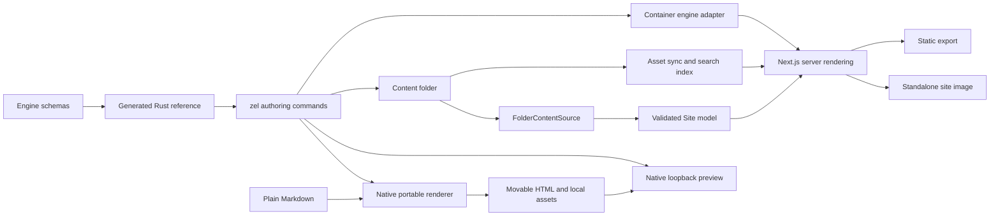

# Zellij — durable project context

Last refreshed: **2026-10-18**. Initial review baseline: local `main` at
`6356b05deaddf5421b24d7c8a1e30f868d4923c0`.

Latest CLI work: explicit hosted rendering selection and optional-peer installs
on `codex/hosted-feature-selection`. Eject/features merged in PR #40; maintenance
commands merged in PR #39.
Portable development and hosted static preview merged in PR #38.
Formatting and validation watch merged in PR #37.
Editable Next.js wrappers merged in PR #36, configured import/ship in PR #35,
CI generation in PR #34 and Netlify delivery in PR #33. Current source is ahead
of public native release `zellij-v0.1.3`.

This is the starting point for future Zellij conversations in this checkout.
The companion [audit](specs/zellij-audit-2026-10-16.md) contains reproducible
defects, remaining work, evidence, and verification limits. Recheck dated facts
before acting. The initial review created documentation only; subsequent authorized work is
recorded below.

### Implementation update — 2026-10-16

The user subsequently authorized implementation and the repository setup.
`mylife-inc/Zellij` is now **public**, with **main** as its default branch.
Before the visibility change, Gitleaks 8.30.1 scanned all 134 reachable commits
and reported no detected leaks. No historical rewrite was performed.

The first milestone merged in [PR #1](https://github.com/mylife-inc/Zellij/pull/1)
as `6950589`. Commit `1a2e26b` adds shared output-path/collision
checks, conversion source containment, protected page/guide creation, staged
static exports, and streamed image Dockerfiles. `deda7a0` restores the browser
job's engine-build prerequisite; `bd6b6c6` bounds file-descriptor use during
large conversions and tests the CLI against an image built from its checkout.
See the audit's implementation record for the resolved finding IDs.

Verification established: **99 Rust tests**, warnings-denied Clippy, formatting,
**227 engine tests**, workspace typechecking, and the engine/showcase production
builds pass. Hosted browser run `39000366953` passed **294 tests**, with 114
existing conditional skips across desktop/mobile Chromium and mobile WebKit.
The CI workflow additionally exercises initial static export, failed-build
preservation, and successful replacement using a real container. Consult the
PR's latest checks and merge status before relying on a particular revision.

Compatibility change: conversion requires a new/empty destination outside its
source tree. Static export requires a new/empty directory outside content, or
an export previously created with the `.zellij-output` ownership marker.
Existing unmarked exports need a new/empty output on their first build with the
new CLI; never mark an authored directory as generated output.

A clean `npm ci` restored the missing local packages. `npm audit` also reported
19 advisories (3 critical, 6 high, 6 moderate, 4 low). Next.js and Vitest upgrades
need a separate compatibility-tested change; no automatic audit fix was applied.
This was the dependency baseline before the second milestone below.

### Dependency and template update — 2026-10-16

The user authorized continuing. Commit `17d5a23`, tracked in
[PR #2](https://github.com/mylife-inc/Zellij/pull/2), removes the 19 reported
npm advisories and fixes the invalid section scaffolds (audit R4). The locked
tree and a freshly generated standalone app with all features both report
**zero npm advisories** at this date; this is not a claim that all bugs are gone.

- Next.js is `16.4.2`; Vitest resolves to `4.1.12`, Vite `7.3.7`, Mermaid
  `11.17.2`, KaTeX `0.18.10`, esbuild `0.28.2`, and XML DOM `0.9.12`.
- Scoped dependency overrides keep optional math/diagram chains patched.
  The engine manifest carries the production overrides; `zellij init` and
  feature changes copy them to the app root, where npm actually enforces them.
  Manual wrappers must carry that map too. The repository additionally
  overrides tsup's esbuild. Tests keep the shared constraints in agreement.
- `src/content/frontmatter.ts` replaces gray-matter, using the existing YAML
  package for guides, prose, and search. Metadata must be a YAML mapping with
  a closing delimiter; executable language tags are rejected. BOM, Windows
  newlines, nested values, and multiline scalars are tested.
- `src/cli/section-templates.ts` generates YAML from schema shapes and bounds,
  chooses valid media alternatives, and validates the serialized result with
  the complete Zod schemas. `context --json` embeds `sectionTemplates`; Rust
  copies those strings instead of guessing nested types and list lengths.
  Templates contain TODO text and explicit replaceable media paths. The
  command writes only YAML; authors supply their actual assets.
- CI audits dependencies, validates and statically exports all 23 templates
  emitted by the actual Rust binary, and tests formulas/Mermaid math labels
  in browsers. Browser failures retain traces and the job has a time limit.

Local verification: **260 engine tests**, **99 Rust tests**, formatting,
warnings-denied Clippy, workspace typechecks, engine packaging, all four
example content checks, and all 23 Rust-generated template checks pass.
The showcase production build passes with webpack. Local Turbopack hits the
execution sandbox's helper-process port restriction; the normal Turbopack
build and container/browser acceptance are hosted CI gates. Consult PR #2's
latest checks for their results. No new native CLI release is issued here.

Hosted run `39004471983` at `d8c9f5d` passed all four jobs: engine, schema sync,
CLI/container acceptance, and browsers. The normal Turbopack build and all 23
template static exports passed; **297 browser tests passed**, with **114
conditional skips and no retries**. A minimal (`--features none`) fresh wrapper
also audited clean. Its lockfile still includes Mermaid, remark-math and
rehype-mathjax through the engine's optional dependencies; audit follow-up S11
tracks that feature-selection/package-size defect separately.

CI reliability history: after PR #1, run `39001111736` initially stalled on
repeated mobile-WebKit navigation timeouts. Its fresh-runner retry passed all
294 tests (114 conditional skips). This is not a diagnosed/fixed browser bug.
The separate automated security-review plugin failed its PR #2 commit review
with HTTP 400; that review must not be represented as passed.

### Conversion update — 2026-10-16

The next authorized milestone is [PR #3](https://github.com/mylife-inc/Zellij/pull/3).
Source commit `4196e6b` addresses R5's ordinary Markdown document links and
referenced assets for both MkDocs and Docusaurus. A shared parser-based pass
rewrites links to canonical engine routes, expands reference-style links,
preserves query/fragment text and code examples, and copies binary assets into
`assets/imported/docs/` or `assets/imported/static/`. Docusaurus's default
`static/` paths are supported; unlisted documents remain unpublished.

Assets participate in the same complete output preflight/staging as text.
Escaping references, symlinks, case-only file conflicts, hidden document names,
and duplicate public routes are rejected before writing. Missing or ambiguous
references and HTML/JSX attributes are reported. Markdown images under the
public asset prefix now receive the site's basePath in the MDX component map.

R5 still has explicit migration limits: source-specific/custom heading IDs,
fragments targeting a removed leading H1, HTML/JSX attributes and imports,
custom static folders and source route overrides require manual work. Fragment
text is retained, not universally validated or translated. Do not describe
this milestone as full-fidelity migration of arbitrary MkDocs/Docusaurus sites.

Local verification: **109 Rust tests**, **261 engine tests**, warnings-denied
Clippy, formatting, all workspace typechecks, engine packaging and the updated
documentation content check pass. `scripts/check-conversion.mjs` runs the real
CLI and engine to check routes, an actual heading anchor, rendered image URLs
under `/products/docs`, and copied binary bytes. Hosted CI adds static exports
of both imports and checks actual HTML links, fragments and asset files. Read
PR #3's latest checks before claiming hosted acceptance; no native CLI release
is part of this milestone.

Integration review exposed a separate prefix-configuration gap: generated
Next config does not mirror `site.yaml`'s basePath. The CI fixture configures
both explicitly using `scripts/fixtures/conversion.Dockerfile`. The existing
showcase `verify-basepath.mjs` also replaces strings no longer present in its
configuration, so it must not be trusted as current prefix acceptance (S12).

PR #2 merged as `3408f37`; main run `39005197060` passed all checks, and base
image run `39005197029` published all four feature variants for AMD64/ARM64.

### Scaffolding and discovery update — 2026-10-16

Commits `fe4240c` and `ee68282`, tracked in
[PR #4](https://github.com/mylife-inc/Zellij/pull/4), resolve the reproduced
content-authoring findings **R6–R8**.
Rust content scaffolds and converters share a JSON-backed YAML string scalar
serializer, including explicit escapes for YAML's extra Unicode line breaks and
characters its parsers reject literally.
The Node initializer uses the same representation. Names, copyright text,
page identifiers, section references, guide titles and front matter preserve
punctuation, implicit YAML values and multiline text. This covers generated
content metadata; it does not validate arbitrary npm package names or workflow
inputs as package identifiers, GitHub expressions or shell commands.

Plain/minimal starters omit the guide CTA unless `--guide` creates its target.
All CLI commands that resolve a content root now use `Project::discover`:
`./content`, current root, `./docs`, then `./documentation`. Explicit paths
retain their existing exact-directory behavior. Marker files, a sections
directory, and guide-only roots are recognized; hidden/reserved guide folders
and markers of the wrong filesystem type are excluded. Discovery never walks
upwards. This selects a root; the engine still owns semantic validation.

Local verification: **117 Rust tests**, **262 engine tests**, warnings-denied
Clippy, formatting, workspace typechecks, engine packaging, documentation
content validation, and both conversion fixtures pass. The new
`scripts/check-scaffolds.mjs` checks exact metadata and rendered Hero links
for **40 Rust starters, 10 Node content starters and 10 guide titles**. Hosted
CI additionally exercises four guide-only discovery locations and a menu-only
root through the real container engine. Hosted results are pending at this
record; consult the PR before claiming acceptance. No native release is made.

The separate security-review plugin failed to read its model response during
the source commit, although the commit itself succeeded. That review did not
complete and must not be described as passed.

Prior milestone completion: PR #3 merged as `dd99c2c`. Main CI `39007109533`
and image run `39007109576` passed, publishing all four variants for Linux
AMD64/ARM64. Browser acceptance had 296 initial passes plus one successful
retry, with 114 conditional skips. The retry was a mobile-WebKit navigation
error at `/guide/quickstart`; PR CI had a different FAQ interaction retry.
These flakes remain undiagnosed, not repaired by the conversion changes.

### Header layout and overflow update — 2026-10-17

Source commit `da1c222` implements the requested viewport-wide header: branding
at the left inset and search/theme/actions at the right. The existing
`brand.logo.href` remains the company-site link; `brand.title` can retain a
separate site-home link. No new branding schema or company assets are required
by the engine change. Search continues to open its existing dialog.

Desktop navigation measures the remaining space and inert copies of every
label, including active font weight and icons. Trailing items move into More
and return when space grows; resizing, loaded fonts and theme changes trigger
measurement. Existing `menuOverflowAfter` remains the configured count limit.
The overflow model preserves destinations, group headings, descriptions,
icons and external/new-tab flags. The mobile drawer receives the full resolved
menu, independently of the width-selected desktop prefix.

Keyboard focus follows items that move into/out of overflow; breakpoint changes
close stale panels and release drawer scroll lock. Tall More panels scroll,
and compact More panels stay within the viewport at either edge. Mobile
controls have 44px targets at the default root font size. The header was checked
at widths from 320 to 1600px, including larger menu text and a wide brand.
This is not a full WCAG audit or a claim of manual screen-reader acceptance.

Local evidence: **268 engine tests**, workspace typechecks, engine packaging,
and documentation validation pass. The focused desktop/mobile Chromium
navigation run passed **34 tests** with **26 device-specific skips**. The six
new desktop header cases also pass (the final compact-panel check was rerun
separately after correcting its fixture width). Final engine typechecking and
six focused unit tests pass after the positioning adjustment. Production builds,
the full browser suite and mobile WebKit remain hosted CI gates; consult the
PR containing `da1c222` for their outcomes. No native CLI release is made.

Prior milestone completion: PR #4 merged as `4be61dc`. PR CI `39010124427`
passed with 297 browser passes, 114 conditional skips and no retries. Main CI
`39010596721` passed with 296 initial browser passes, one successful retry and
114 skips. The retry was the previously observed mobile-WebKit FAQ interaction
(answer hidden after clicking the summary); its cause remains undiagnosed.
Image run `39010596751` published all four variants for Linux AMD64/ARM64 and
passed the published-image build/serve smoke test.

### Canonical search and preparation update — 2026-10-17

Source commit `29654d3` resolves **R10–R12** and the interrupted search load
**S2**. `createContentSource` in `src/config/runtime.ts` now supplies the shared
folder/legacy selection and content-path contract for rendering and preparation.
`writeSearchIndex` reads a fresh `loadSite` result, including canonical guide
routes, frontmatter/sidebar overrides, unlisted pages and title-stripped bodies.
Preparation bypasses the global rendering memo; S8 remains a separate issue.

`src/mdx/headings.ts` parses Markdown/MDX without executing authored JavaScript.
Search and the TOC use the renderer's `rehype-slug` semantics, including formatted,
setext, quoted, indented, repeated and mathematical headings. All heading levels
participate in duplicate IDs; only h2/h3 split search passages, so deeper
subsections retain their text. Search stores unprefixed routes for Next's router.
The existing regex-based prose cleanup is not a complete MDX text interpreter.
Optional math loading is shared with rendering and stays external in CLI bundles;
bundling MathJax broke its runtime paths and was caught using Zellij's own docs.

`zellij prepare`, `sync-assets` and `search-index` accept `--content <dir>` and
`--config <legacy-file>`, including inline values with spaces/equals signs.
Helpers still accept an app-root string or now a `ZellijRuntimeOptions` object.
Wrappers must pass the same explicit content root to preparation and rendering;
preparation does not infer TypeScript configuration. Missing roots and malformed
assets directories fail before clearing previous prepared files. Physical-path
overlap checks protect source assets, including public-directory symlinks.
Rerunning asset sync removes stale output even if the source assets folder has
been deleted. Automatic dev watching is still absent: **S9 is only partly fixed**.

Synthetic guide roots and configured home redirects now claim route ownership;
only a guide and its own root page may intentionally share that route. The
search dialog aborts cancelled requests, retries on reopen after cancellation
or failure, and caches completed data for the current deployment prefix.

Local verification: **285 engine tests**, all workspace typechecks, packaging,
all four example preparation/content checks, and the packaged CLI integration
fixture pass. The fixture covers canonical routes, actual optional math loading,
custom paths, legacy config, invalid flags and asset removal. Four focused
Chromium desktop/mobile recovery cases pass without retries. An initial broad
run against the local dev server timed out in the existing `networkidle` check;
production lazy-loading and WebKit acceptance remain hosted CI gates. The new
recovery test's early-hydration click was corrected to use the existing retrying
shortcut pattern. CI additionally exports a real container site and checks that
each indexed route and anchor exists. Consult this commit's PR for hosted results.

R13 documentation now states the fast check's actual limits. Complete prose-link
and asset validation remain open, as do basePath synchronization/acceptance S12,
remaining UI findings and native CLI/platform completion. No native binary
release is made in this milestone.

Prior milestone completion: [PR #5](https://github.com/mylife-inc/Zellij/pull/5)
merged as `7fb5178`. PR CI `39019128511` and main CI `39019556088` passed all four
jobs, including **305 browser passes, 124 conditional skips and no retries**,
268 engine tests and 117 Rust tests. Image run `39019556101` published all four
feature variants for Linux AMD64/ARM64 and passed published-image build/serve
smoke acceptance. Previously recorded FAQ/WebKit flakes remain undiagnosed.

### Deployment prefix and runtime isolation update — 2026-10-17

Source commit `8463720` resolves **S6, S8 and S12**. The shared native
`engine/packages/zellij/deployment-config.cjs` resolves content roots and the
deployment prefix for both `withZellij()` and the runtime. It lives at package
root so source, compiled modules and native Next configuration resolve the same
file; package and container distributions include it.

`site.yaml` supplies Next's basePath automatically. A wrapper may supply it when
content omits it; explicit values must agree, including an explicitly empty
prefix. Values are normalized and malformed prefixes rejected. Next embeds the
effective value as reserved `ZELLIJ_BASE_PATH`; runtime configuration must agree
with that build-time choice. Changing the prefix requires rebuilding. Custom
content paths must match across preparation, runtime factories and the second
argument of `withZellij(config, contentOptions)`.

Runtime memoization is keyed by absolute application/configuration/content
paths, runtime prefix and compiled prefix. Production retains each site's
result; development retains the 250 ms TTL. Failed loads evict their entry so
correcting a missing/invalid file can recover. Social metadata images now receive
the same prefix as canonical URLs and other assets.

The previous in-place showcase prefix script is replaced by an isolated,
production-built wrapper fixture. Only its content declares the prefix; its
custom content directory exercises preparation and rendering together. CI tests
redirects, nested links, ordinary/optimized images, Next resources, metadata,
sitemap, robots and search in Chromium and WebKit. Conversion exports now use
the default CI image without a special Next-config override.

Local evidence: **303 engine tests**, all workspace typechecks, engine packaging,
packaged-CLI integration and all four example preparation/checks pass. The
production prefix fixture passes Chromium with webpack and a local font-response
fixture. One earlier normal-font build succeeded; another failed in Next's Google
Fonts loader (new audit **S13**). Hosted acceptance uses normal fonts, Turbopack
and WebKit and remains a gate; consult the PR containing this commit. The local
font fixture is not shipped and does not resolve S13. No native binary release
is included.

Prior milestone completion: [PR #6](https://github.com/mylife-inc/Zellij/pull/6)
merged as `d115a9a`. PR CI `39022447464` passed all four jobs, with **285 engine
tests, 117 Rust tests, 311 browser passes, 124 conditional skips and no retries**.
Main CI `39022871779` passed with 310 initial browser passes plus one successful
retry of the existing mobile-WebKit FAQ interaction (`sections.spec.ts:191`).
Its cause remains undiagnosed. Image run `39022871680` published all four feature
variants for AMD64/ARM64 and passed published-image build/serve acceptance.

### Deep and strict validation update — 2026-10-17

Source commit `86e5e2d` addresses the static-validation portion of **R13**.
Both `zel check <dir>` and `zellij check <dir>` accept `--deep` and `--strict`.
The default remains the fast content-model check. Deep mode parses MDX without
executing authored JavaScript and checks static prose/section links, heading,
HTML and section anchors, local media and section previews. Strict mode fails
on existing or new warnings. Build/dev/migrate retain fast checks unless the
caller runs an explicit deep/strict gate first.

Reference semantics are Zod metadata in `src/content/reference-schema.ts`, used
by configuration/section schemas and exported in the generated Rust schema.
Do not add a new link/media/inline-prose field without its reference annotation.
`src/cli/deep-check.ts` uses canonical Site routes, redirect targets and the
renderer's heading/GFM anchor pass. Inline prose shares tokenization with
`InlineMarkdown`. Section source paths survive loading for useful diagnostics.
MDX positions refer to the loaded body, after front matter/title removal.

The checker preserves the first Markdown reference definition, follows
home/guide redirects before checking fragments, and validates example references
in their actual rendering page. It detects recursive previews and duplicate IDs.
Asset paths must resolve to files inside the physical content/assets boundary;
raw Markdown/HTML image URLs use `/_zellij/assets/...`, while Screenshot and
schema-declared media use content asset paths. Fast navigation validation now
ignores URL query strings when finding a route.

Limits remain explicit: no component/JavaScript execution or remote HTTP checks;
literal menu `url:` remains unchecked. Dynamic MDX, custom components, component
ID props, srcSet and contextless relative links warn. Wrapper-owned public files
outside the content asset prefix and SVG-internal fragments are not verified.
Optional math parsing depends on the installed environment: use the installed
wrapper for math-enabled deep checking; the bare container checker installs no
optional dependencies. Full build/browser acceptance is still necessary.

The checker exposed four broken showcase anchor links in `pro/tour.yaml` and
`pro/highlights.yaml`; they now target existing highlights/specifications content.
Local evidence: **317 engine tests**, **117 Rust tests**, workspace typechecks,
formatting, warnings-denied Clippy, engine packaging, isolated packaged-checker
and preparation integration, and all four local examples under `--deep --strict`
pass. CI adds deep/strict validation for the three fully tracked examples (PayOS
needs its generated docs), plus the real Rust/container command and static export.
Consult this source commit's PR for hosted results. No native binary release is
included; the new Rust flags require the current CLI source and matching image.

Source review also found **S14**: video-embed omits basePath for local video and
poster URLs. It remains a separate rendering fix, with prefixed browser acceptance
needed. S13 font-build reproducibility and the prior browser flakes remain open.

Prior milestone completion: [PR #7](https://github.com/mylife-inc/Zellij/pull/7)
merged as `ba30f9b`. PR CI `39025935776` and main CI `39026348416` passed all four
jobs, with **303 engine tests, 117 Rust tests, 311 browser passes, 124 conditional
skips and no retries**. Separate Chromium/WebKit prefix acceptance passed with
normal fonts and Turbopack. Image run `39026348423` published all four variants
for AMD64/ARM64 and passed the published-image build/serve smoke test.

### Development preparation update — 2026-10-17

Source commit `8674908` completes the remaining preparation-watching part of
**S9**. The Node helper now provides `zellij dev [--content <dir>] [--config <file>]
-- [Next dev arguments]` and standalone `zellij prepare --watch`. Generated
wrappers and all four examples use the supervised dev command. The base image
uses that same generator, so Rust `zel dev` gets watching through its existing
`npm run dev` invocation; no new Rust flag or native binary release is needed.
Existing wrappers must update their dev script or run the standalone watcher.

`src/cli/watch-preparation.ts` polls filesystem metadata every 500 ms, requires
two stable snapshots, and serializes preparation. This covers bind mounts,
custom/legacy content locations, root removal/recreation and symlinked roots.
Generated output, Next output, node_modules and Git internals are excluded.
Separate content/asset snapshots avoid copying images on prose-only edits and
avoid rebuilding search for asset-only changes. Failed preparations do not
acknowledge pending asset changes. Repeated identical errors are suppressed;
corrected content recovers without restarting. Startup must prepare successfully.

Search/manifest JSON is replaced through a sibling temporary file. Asset trees
are copied and hashed before a short rename swap; failed copies preserve the
old tree. This is not a transaction across the whole site, and an asset rename
swap can briefly leave its directory absent. The dev supervisor owns Next's
process, forwards signals, propagates its exit status, and closes the watcher.
Search clears its loaded data on close and bypasses HTTP caching in development;
production keeps the existing cache behavior.

Local evidence: **324 engine tests** (seven watcher regressions), workspace
typechecks, engine packaging, isolated installed-CLI process/exit acceptance,
existing packaged preparation, and deep/strict docs validation pass. The real
webpack dev server passes Chromium checks for updated search on reopen, rendered
headings/images after reload, added/deleted pages, removed/restored assets,
invalid-MDX recovery and released server port. CI adds the installed-package
fixture, actual Rust/container dev acceptance and Chromium/WebKit dev acceptance
with normal Turbopack. Consult the PR containing this commit for hosted results.

Content edits still require browser reload for page/image changes. Automatic
browser reload is future work; do not equate this watcher with full MkDocs live
reload. Restart after deployment-prefix, wrapper-config or feature changes.
Nested symlinks are not followed by the polling traversal. Portable Markdown
build/serve/view remain unimplemented, as recorded in the portable contract.

Browser verification exposed **S15**: MDX h2/h3/h4 links replace their accessible
names with “Link to this section.” This remains an accessibility follow-up;
S13, S14 and the existing mobile-WebKit flakes also remain open.

PR #9's first normal-Turbopack dev gate exposed S13 again: IBM Plex Sans failed
before browser acceptance with `next/font/google queries have exactly one entry`.
This matches upstream Next issue #99114, whose fix #100158 is merged but was not
in npm's stable 16.4.2 on 2026-10-17. See the audit for links and evidence limits.
A retry does not resolve the build's Google Fonts dependency. Treat a stable
font remedy as the next reliability priority before expanding the CLI surface.

Prior milestone completion: [PR #8](https://github.com/mylife-inc/Zellij/pull/8)
merged as `d4615ca`. PR CI `39036985726` and main CI `39037525173` passed all four
jobs (317 engine tests, 117 Rust tests and the real deep/strict container/export
fixture). Both browser runs had 310 initial passes plus one successful retry of
the known mobile-WebKit FAQ interaction, with 124 conditional skips. Separate
Chromium/WebKit prefix acceptance passed. Image run `39037525149` published all
four feature variants for AMD64/ARM64 and passed published-image build/serve
acceptance. No new native CLI release was made.

### Reproducible theme fonts — 2026-10-17

Source commit `7963587` replaces the build-time Google Fonts loader with a
pinned local snapshot, addressing **S13**. The twelve existing families retain
normal styles, weight ranges, Unicode subsets, swap behavior, CSS variable
names and metric-adjusted fallbacks. There are **75 unmodified WOFF2 files**
(1,539,836 bytes total). Fonts are not preloaded; a browser requests only the
families/subsets used by its page. The generated stylesheet uses namespaced
family names and relative asset URLs that Next processes with the site prefix.

`src/themes/fonts/manifest.json` records URLs, SHA-256, sizes, user agent, pinned
license provenance and fallback metrics. Original CSS and OFL notices are kept.
`prepare-fonts.mjs` verifies the snapshot entirely offline and copies it beside
the compiled modules. Git attributes preserve hashed upstream bytes on Windows.
The stylesheet references a bundled file containing every full license notice. Updates are explicit, reviewed
snapshot changes; normal builds never refresh fonts. Dependency installation
can still require network access. This does not implement portable `file://`
documentation or the requested Rust build/serve/view commands.

Local evidence: **324 engine tests**, workspace typechecks, engine build and
strict/deep documentation checks pass. The npm archive contains all font files
and notices for both source and compiled modules. Real webpack/Chromium
production-prefix and development-watcher acceptance pass, including all font
faces decoding, lazy loading, local prefixed URLs and deployed notices. CI adds
a fresh Turbopack site build with Docker `RUN --network=none` after dependency
installation, plus Chromium/WebKit production and development font checks.
The first hosted run `39053315323` passed the offline Turbopack build,
engine/schema/CLI jobs and 310 production browser tests plus one successful
retry of the known mobile-WebKit FAQ interaction (124 conditional skips).
Its production font gate failed because Turbopack stripped license comments.
Follow-up `21479d3` emits the combined notice as a real CSS URL asset and checks
its deployed response byte-for-byte. Local webpack/Chromium dev acceptance
passed this follow-up. [PR #10](https://github.com/mylife-inc/Zellij/pull/10)
tracks final hosted verification. Run `39054096571` passed all 311 production
browser tests without retries, then exposed a test URL-resolution error:
Turbopack emitted the notice relative to its stylesheet (`../media/...`), while
the test fetched it relative to the page. The trace confirmed the emitted CSS
reference; the check now resolves it against the owning stylesheet and still
requires the complete notice bytes and local deployment prefix. The corrected
license asset also passes local webpack production acceptance. No native CLI
release is made.

Run `39054561760` passed all engine/schema/CLI checks, offline build, and both
Chromium/WebKit production font/prefix checks. Development passed Chromium but
WebKit requested Next's own `/__nextjs_font/geist-latin.woff2` debug-overlay font,
which the test mistakenly treated as a Zellij asset. The installed Next overlay
middleware explicitly serves four local Geist font paths outside basePath.
Development acceptance now recognizes only those exact local framework paths;
all Zellij and remote font requests remain checked, and production has no
exception. That run's main browser suite had 310 initial passes plus one known
FAQ retry and 124 conditional skips. Consult PR #10 for final acceptance.

Prior milestone completion: [PR #9](https://github.com/mylife-inc/Zellij/pull/9)
merged as `bd01bdb`. Main CI `39052261993` passed all four jobs, including **311
browser tests**, 124 conditional skips and **no retries**. Chromium/WebKit
production-prefix and dev-watcher acceptance passed. Image run `39052261989`
passed eight platform/feature builds, four multi-platform publications and the
default-image build/serve smoke test. This successful run does not diagnose the
previous FAQ/WebKit flakes. PR #9's final PR run had one successful FAQ retry.

PR #10 completion: merged as `5a9e12c` after exact-head run `39055211438`
passed all four jobs: **324 engine tests**, **117 Rust tests**, schema sync,
typechecks, warnings-denied Clippy, offline Turbopack build, and **311 browser
passes / 124 conditional skips / no retries**. Main CI `39055788092` passed;
its browser suite had 310 initial passes and one successful known mobile-WebKit
FAQ retry. Both runs passed Chromium/WebKit production and development font,
license and prefix gates. Image run `39055788338` passed eight feature/platform
builds, four AMD64/ARM64 manifest publications and the default-image build/serve
smoke test. This closes S13's hosted acceptance; it does not diagnose the FAQ
flake or constitute a native CLI release.

### Truthful CLI inspection output — 2026-10-17

Source commit `4d659b4` resolves the reproduced **R9** behaviors. Rust `zel
context --json` emits the exact embedded engine JSON; supplying a filename
writes that format to the file with confirmation on stderr. `list themes`
lists all 14 names, labels and descriptions, generated from the engine's config
names and renderer tokens. The catalog is included in schema-sync CI.

JSON is implemented for every `list`, `explain` and `detect` as well. Explain
returns the selected full section schema. Lists return named arrays with stable
identifiers; detect returns the supplied source path and ordered matches with
numeric confidence and strength. Missing/non-directory sources fail instead
of masquerading as no match. Equal-confidence detection and converter listings
are deterministic across inventory registration order. See the CLI spec's
output contract and command docs for exact fields.

Other commands reject `--json` with exit 2 **before execution**. Unimplemented
`--verbose` / `-v` is removed from the parser/help and rejected, rather than
silently ignored. Errors remain human messages on stderr; JSON validation,
conversion/build reports, verbose tracing and config loading remain future work.
The existing Markdown context and human inspection formats are retained.

Local acceptance: **125 Rust tests**, warnings-denied Clippy and formatting,
**325 engine tests**, all workspace typechecks, engine package build and deep/
strict docs validation pass. Eight new binary integration tests run with no
external tools on PATH and cover exact embedded output, file/stdout/stderr
behavior, all section schemas, theme/config agreement, detection, error codes,
and refusal before command actions. A first engine run exposed a missing test
fixture name (corrected); a subsequent default-concurrency run hit two existing
math-rendering timeouts during a full Rust rebuild. The unchanged suite passed
with two local workers and unchanged timeouts. Hosted full acceptance remains
the next gate; no native binary release is part of this milestone.

Hosted completion: [PR #11](https://github.com/mylife-inc/Zellij/pull/11)
merged as `0a89131` after final source/help head `c411317` passed CI
`39059091256`. Main CI `39059796288` also passed all four jobs: 125 Rust tests,
325 engine tests, typechecks/schema sync, zero npm advisories, and **311 browser
passes with 124 conditional skips and no retries**. Container/scaffold/conversion,
font/license, production-prefix and development-watcher acceptance passed.
Image run `39059796306` passed all 13 jobs, publishing all four feature variants
for Linux AMD64/ARM64 and passing the default-image smoke test. No native binary
release was issued.

### Native portable Markdown build — 2026-10-17

Source commit `8f72022` adds the native `zellij-docs` crate and
`zel build --target portable`. A plain Markdown folder selects it automatically;
discovered structured Zellij content retains the hosted static default. The
renderer parses Markdown with pulldown-cmark, highlights code with syntect, and
writes full HTML pages with ordinary relative links. Embedded local scripts
provide search, theme selection and mobile navigation without fetch/router data.
The 14 themes are generated from engine tokens; the same pinned 75-font snapshot
and license notices are embedded by Cargo. Building needs no Node, Docker or
network. Source checkout builds do require the engine font snapshot in this repo.

Output defaults to a sibling `<input-name>-site`; `--out`, `--name` and `--theme`
configure publication. Index/README home selection, optional front-matter title/
description/order, directory links, heading/footnote fragments, referenced
assets, synthetic home, breadcrumbs and previous/next are implemented. The
shared staged publisher moved from `zellij-engine` to `zellij-core::output`
without changing the ownership/failed-build-preservation contract. Source and
output are disjoint; nested symlinks, missing references, duplicate outputs and
Windows-incompatible names fail before replacing output. URL paths normalize
Windows separators at the filesystem boundary.

Current limits: raw HTML is displayed literally with a warning; MDX is rejected.
Math rendering, Mermaid execution, custom navigation/config, portable watch/reload,
`serve` and `view` remain unfinished. External media is not downloaded. The
[portable contract](specs/zel-portable-docs.md) and CLI build docs carry the exact
behavior and capability comparison. This is not complete MkDocs compatibility.

Local acceptance: **137 Rust tests**, formatting, warnings-denied Clippy,
generated-theme parity, deep/strict docs checks and Chromium file acceptance
pass. The browser fixture builds without tools on PATH, preserves an old export
on failure, moves output to a space/Unicode path, opens home and deep links with
networking blocked, and checks search/anchors, local fonts/media, keyboard,
themes, mobile layout and JavaScript-disabled content. Review caught and fixed
Escape clearing the search field instead of closing its dialog. CI now includes
native portable build/CLI/browser jobs on Linux, macOS and Windows, each with
Chromium and WebKit. Hosted results are pending at this record; these jobs do
not establish full native Windows container support or release/install coverage.

Browser follow-up: the first hosted run passed Chromium but WebKit rejected
its initial file navigation with offline emulation enabled. A minimal local
file containing only an H1 reproduced that failure; HTTP-blocked file loading
without emulation passed. WebKit acceptance therefore blocks HTTP requests
explicitly and asserts that every observed request uses file/data URLs; Chromium
also retains offline emulation. Both JavaScript and no-JavaScript contexts use
these guards. No file-security flags or HTTP fallback are used. Both engines
now pass locally. WebKit additionally exposed missing focus restoration after
pointer-opened search; the runtime now records and restores the opening control.

Portable-build completion: [PR #12](https://github.com/mylife-inc/Zellij/pull/12)
merged as `680779f` after final head `99c0f54` passed all seven jobs in
`39063380795`. Native Linux/macOS/Windows portable checks passed in Chromium
and WebKit. PR browser acceptance had 310 initial passes plus one successful
retry of the existing mobile-WebKit FAQ test, with 124 conditional skips.
Main CI `39064011730` passed all seven jobs, including 138 Linux Rust tests,
325 engine tests and **311 browser passes, 124 skips, no retries**. Image run
`39064011643` passed all 13 jobs and published four AMD64/ARM64 variants. The
local debug binary was rebuilt from main; no native release was issued.

### Native serve and view — 2026-10-17

Source commit `e33cd92` implements `zel serve` and `zel view`.
`zellij-docs::server` uses tiny_http to serve existing static exports on IPv4
loopback. It supports selected and ephemeral ports, MIME types, GET/HEAD,
extensionless HTML, directory indexes/redirects, query preservation, custom
404 responses and an explicit `--base-path` mount. It serves bytes unchanged,
disables caching for preview and requires a regular root index.html. Traversal,
malformed encodings, metadata paths, nested symlinks and Windows junctions are
rejected; foreign Host headers are refused. There is no directory listing,
home-page fallback, or automatic prefix rewriting.

`zellij-cli/src/preview.rs` orchestrates the workflow. `view` reserves its port
before building and calls the same portable helper as `build --target portable`.
It builds plain Markdown only, prints the actual URL, and launches the system
opener in a separate thread. `--no-open` suppresses launch; `--browser` selects
one executable receiving the URL as one argument, without a shell. Missing or
failing launchers warn while HTTP keeps running. Source files remain unchanged;
build failures preserve owned output, and port conflicts fail before rebuilding.

Ctrl-C (plus POSIX termination signals) stops normally with exit 0 and releases
the listener. Response writers are bounded and do not block the control loop;
shutdown can interrupt in-flight responses and retains all exported files.
Neither serve nor view watches/rebuilds/reloads on edits. Portable raw HTML/MDX,
math/Mermaid, richer navigation/config, and native release/installer work remain
open. This preview server is not a public-hosting/TLS/authentication service.

Local evidence: **143 Rust tests**, warnings-denied Clippy, formatting and
updated deep/strict docs validation pass. Six new real-HTTP tests cover routing,
MIME/HEAD/methods, port and prefix behavior, path/symlink containment and shutdown.
`scripts/check-preview.mjs` checks the actual CLI without external tools on PATH,
both browsers under a URL prefix, launch readiness/errors/no-open, source and
failed-build preservation, and Ctrl-C with slow/incomplete requests. A compiled
browser substitute requests the ready URL before recording launch; automated
acceptance does not claim to exercise each machine's actual default GUI browser.
Windows CI uses `scripts/fixtures/preview-console.rs` to create a private console
for the tested child and send a real Ctrl-C event, rather than Node's force-kill.
Cross-platform hosted acceptance is pending at this record.

Native-preview completion: [PR #13](https://github.com/mylife-inc/Zellij/pull/13)
merged as `bc95346` after head `4b4da4c` passed all seven jobs in
`39066025208`. Main CI `39066685507` also passed all seven jobs: 144 Linux
Rust tests, 325 engine tests, 311 website browser passes, 124 conditional skips,
and no retries. Both Chromium and WebKit passed native direct-file and HTTP
preview on Linux/macOS/Windows, including launcher failure recovery and real
Ctrl-C. Image run `39066685512` passed all 13 jobs and published all four
AMD64/ARM64 feature variants. No native binary release was issued.

### Portable watch and live reload — 2026-10-17

Source commit `2c44098` implements `zel view --watch`. Ordinary `view` remains
one-time build/serve/open; `serve` remains unchanged-file preview. The watcher
captures the resolved source before the initial build, polls streamed file-byte
hashes, waits for two matching scans, and serializes full rebuilds. Hidden entries
and node_modules are ignored. Same-size/preserved-timestamp edits are detected.
Nested links, Windows junctions, special files and replacement root links are
refused. Missing roots and invalid documents/assets recover on subsequent edits.
Large trees require full scans/builds; no incremental compiler is implemented.

`zellij-docs::prepare` returns a staged `PreparedBuild`; ordinary `build` publishes
it immediately. Watch mode publishes under the shared `LiveReload` write lock,
while HTTP holds a read lock through file resolution/opening and revision
attachment. Responses do not hold it while streaming to clients. This excludes
the publication rename gap from preview reads, without making multiple HTTP
requests a single generation transaction. Failed builds retain the last export
and revision and report their error in the terminal and a browser notice.

Only watch HTTP responses receive `_zellij/preview.js` and revision polling.
The version embedded in each HTML response detects updates even before its
first poll. Success reloads the current URL, preserving query/fragment; deleted
page 404 previews can recover on restoration. Files on disk receive no preview
client or endpoint and remain movable/offline. Ctrl-C joins the worker and
cleans staged work before reporting completion; exported files remain. Name,
theme, output and port changes require restarting the command.

Local evidence: **147 Rust tests**, formatting, warnings-denied Clippy, strict/
deep docs validation, and actual CLI acceptance in Chromium and WebKit pass.
Four added Rust regressions cover snapshots (including preserved timestamps and
links), staged publication, HTTP revisions/endpoints/HEAD and unchanged output.
The browser/process fixture additionally exercises the first-poll race, atomic
saves, added/deleted pages, changed/missing assets, search refresh, error notice
and recovery, temporary source loss, symlinks/junctions, ignored trees, continuous
HTTP availability during publication, Ctrl-C, and moved offline exports. CI
uses the same native Linux/macOS/Windows matrix and real Windows console helper.
Hosted acceptance is pending at this record. No native release is issued.


Hosted follow-up: run `39068473117` exposed a race-fixture deadlock on Linux
and macOS. The test held the first preview-status response but awaited the
page's full load before allowing that response to continue. It now waits for
DOMContentLoaded plus the actual intercepted request before editing, then
releases the response only after publication. Reload assertions and timeouts
are unchanged; production code is unchanged. Final hosted status belongs to
[PR #14](https://github.com/mylife-inc/Zellij/pull/14).


Run `39068818910` passed the corrected race on Chromium, but Linux WebKit also
held DOMContentLoaded while a network request was intercepted. The final fixture
therefore delays only the first fetch initiation in the page. It waits for the
client to attempt that poll, changes the source, observes actual publication,
and then permits the real HTTP response. A session marker removes the delay on
reloaded documents. Production code, reload assertions and timeouts are unchanged.


Run `39069154907` passed Linux/macOS native acceptance, all broader checks,
and Windows Chromium watch acceptance (including real Ctrl-C). Windows WebKit
still timed out awaiting DOMContentLoaded in the deliberately paused first-poll
scenario. The fixture now waits for navigation commit, then explicitly requires
the rendered heading and attempted poll before editing. Failed watch runs retain
Playwright traces plus browser readiness and CLI output for diagnosis. Full
post-reload navigation, search, image and offline assertions remain in place.


The trace from `39069833700` confirmed successful publication and browser reload:
the page contained the updated heading and the new revision. It exposed an early
search shortcut sent before deferred page enhancements initialized. The fixture
now waits for the controls that site.js reveals before pressing the shortcut;
static heading visibility alone is not JavaScript readiness. Production code is
unchanged, and the first-poll race still must complete before these search checks.


HTTP transport correction: traces from `39070119126` showed requests for
site.js/search.js receiving no response, so the browser could not start its
first poll. The earlier lifecycle/interception explanations above were
provisional and did not explain the underlying failure. A standalone local
64-connection burst reproduced missing responses in ordinary `serve`; closing
answered keep-alive sockets immediately released the stuck requests. Inspection
of tiny_http's task queue found that queued connections can outnumber idle
workers, leaving connections unprocessed while those workers wait on persistent
clients. This affects PR #13's server as well as watch mode.

Source commit `6f14500` replaces the transport with Hyper HTTP/1 and Tokio:
idle sockets are async tasks, file
lookups use a bounded 16-thread blocking pool, and file bodies stream with
backpressure. A maximum of 256 connections, a 10-second header-read timeout and
cancellation on shutdown bound the preview service. Existing routing, host/path
checks, byte-preserving serving, HEAD lengths and watch publication locks remain.
The new regression queues 64 persistent requests plus idle preconnections,
requires all responses without closing other clients, then reuses the sockets
and shuts down with them open (eight bursts). Its initial 64-client version
failed against tiny_http after five seconds; the replacement passed the server
suite. Full local validation now passes: **148 Rust tests**, warnings-denied
Clippy, formatting, deep/strict docs checks, and Chromium/WebKit actual CLI
HTTP/watch plus moved direct-file acceptance. Cross-platform hosted CI remains
pending at this entry; see PR #14 for the final exact revision and results.

Watch/reload completion: [PR #14](https://github.com/mylife-inc/Zellij/pull/14)
merged as `142965f` from final head `4f20092`. PR CI `39071150585` and merged-main
CI `39071818383` each passed all seven jobs. Native Linux/macOS/Windows passed
both Chromium and WebKit offline/HTTP/watch acceptance, including real Windows
Ctrl-C. The CLI job passed 149 Linux Rust tests; engine tests remained 325, and
website browser acceptance passed 311 tests with 124 conditional skips and no
retries. Image run `39071818346` passed all 13 jobs and published all four
AMD64/ARM64 variants. Native release packages were not issued.

### Portable configuration, navigation and branding — 2026-10-17

Source commit `4ba149f` adds optional `<Markdown-root>/zel.yaml` for site name,
initial theme, local company logo/link and nested navigation. It has no parent
search. A present file selects portable automatic build dispatch before hosted
marker discovery; explicit targets still win. CLI name/theme flags override
file values, then folder-name/cupertino defaults apply. The entire file must
remain valid even when some settings are overridden.

Navigation entries contain exactly one of `page`, `children`, or HTTP(S) `href`.
Source-relative page filenames are exact and retain literal spaces/Unicode.
Groups/links require labels; duplicate or missing pages, empty groups, traversal,
unknown/duplicate keys and incorrectly typed values fail. Nesting is bounded at
16 groups. Configured order and aliases drive sidebar and previous/next links;
unlisted pages are still rendered, validated and searched, but have no paging.
Omitting nav keeps automatic ordering; an empty list intentionally hides links.
A synthetic home lists authored navigation. Folder breadcrumbs stay unchanged.

Logo paths are checked for containment, image type and symlinks/junctions, copied
locally, and linked with encoded relative URLs. The company logo can open its
HTTP(S) website while the adjacent title links to documentation home. Mobile
controls occupy a separate row to preserve title/logo space. Navigation and
branding remain usable without JavaScript and after moving a direct-file export.

Watch mode rereads configuration on creation, edit and deletion. Invalid settings
preserve the last export and show the existing preview error notice; recovery
rebuilds/reloads. Browser preferences now save only explicit visitor choices,
so new project defaults take effect until overridden. The new versioned storage
format may reset an older saved choice once. General `zel.toml` defaults remain
planned; this portable format is distinct from hosted `site.yaml`.

Local verification: 154 Rust tests, warnings-denied Clippy, formatting, deep/strict
documentation validation and a fresh CLI build passed. Chromium/WebKit passed
moved file://, HTTP and watch acceptance, including config addition/removal,
error recovery, theme precedence, logo loading, nested navigation, alias paging,
unlisted search, mobile layout and no-JavaScript use. Visual inspection caught
mobile brand compression; the fixed layout and geometry assertions pass in both
browsers. The existing three-platform CI matrix runs these added checks. Hosted
acceptance is pending at this dated entry; consult the PR containing `4ba149f`
for its final revision/results. No new native release packages are issued.

Configuration completion: [PR #15](https://github.com/mylife-inc/Zellij/pull/15)
merged as `7b7222f` from head `92f2d10`. PR CI `39075396282` and main CI
`39076012865` each passed all seven jobs, including Chromium/WebKit portable,
HTTP and configuration/watch acceptance on native Linux/macOS/Windows. PR CI
passed 155 Linux Rust tests and 311 website browser tests (124 conditional skips,
no retries). Image run `39076012860` passed all 13 jobs and published all four
AMD64/ARM64 variants. The local binary was rebuilt; no native release issued.

### Portable publication paths — 2026-10-17

Source commit `90befda` fixes a publication/watch inconsistency found during
final review. At `7b7222f`, a configured `node_modules/logo.svg` was successfully
copied into an export, but watch snapshots exclude that directory and would not
notice edits. Explicit Markdown asset links also bypassed hidden/dependency
exclusions. Discovery, watch snapshots, logo configuration and referenced assets
now share the same excluded-name rule. Hidden paths and `node_modules` cannot be
published through those references. Authors must move published assets into a
normal source folder such as `assets/`.

Local verification: 18 configuration/portable/watch tests, warnings-denied Clippy,
formatting and deep/strict docs validation passed. Regression fixtures contain
real excluded files and check image/download references, logo configuration,
source preservation and preservation of the previous export. Hosted acceptance
is pending at this dated entry; consult the PR containing `90befda` for results.

Publication-path completion: [PR #16](https://github.com/mylife-inc/Zellij/pull/16)
merged as `a6a9a7d` from head `e188a13`. PR CI `39076533168` and main CI
`39077026320` each passed all seven jobs; image run `39077026408` passed all
13 jobs and published all four AMD64/ARM64 variants. Linux ran 156 Rust tests.
Native Linux/macOS/Windows Chromium/WebKit file, HTTP and watch checks passed.
The website suites each had 310 initial passes, 124 conditional skips and one
successful mobile-Safari retry: the PR's testimonial-carousel slide did not
become active within 5 seconds; main's FAQ answer remained hidden after its
first click. These are recorded flakes, not diagnosed or fixed by this work.
No native package release was issued.

### Native portable validation — 2026-10-17

Source commit `7457daf` adds `zel check [dir] --target portable|static`, native
strict warnings and portable JSON reports. Automatic selection shares build's
helper: a root `zel.yaml` entry wins, then hosted discovery, otherwise portable.
The existing hosted engine checker remains available; explicit static is useful
for unmarked hosted folders. Hosted JSON is rejected before container execution.

`zellij-docs::check` and build now share a complete in-memory compiler. Check
performs configuration/discovery/Markdown/navigation/reference/render/output-path
validation without staging or writing files. Build then stages/publishes as
before. Virtual file/directory output collisions are caught before filesystem
writes, so checks can detect them too. Existing output ownership is irrelevant
to a check; it does not promise output permissions, disk capacity or publication.

Errors are collected per document during read/parse, then across references
when parsing succeeds. Fatal config/discovery/render/output errors stop their
phase. Raw HTML stays a warning; strict makes it fail without changing severity.
`--deep` is accepted but redundant for portable content, whose local references
are always checked. MDX and external URL availability remain outside this target.

Portable JSON emits one stdout report on validation success/failure with no
stderr diagnostics. Schema version 1 includes target/root/strict/ok, nullable
HTML page count and diagnostics with severity/code/nullable source-relative file/
message. No guessed line/column fields. Codes: source, configuration, markdown,
reference, output-path, rendering, raw-html. Exit 0 success, 3 content/strict,
1 returned I/O failure; first fatal error controls status. Usage errors use
stderr and exit 2. See the portable contract and `zel check` documentation.

Local verification: **164 Rust tests**, warnings-denied Clippy, formatting,
updated deep/strict docs checks, and fresh binary build passed. Chromium/WebKit
passed moved file:// navigation/search/branding/no-JS, HTTP preview and full
watch/configuration/recovery/Ctrl-C acceptance with the refactored compiler.
Nine new library/CLI tests verify check/build parity, multi-file errors,
structured output/exit behavior, target selection, strict warnings, collision
failures, and byte-preservation of source and existing output. The CLI tests
remove external tools from PATH. All-platform CI includes native checker tests.
Hosted acceptance is pending at this dated entry; consult the PR containing
`7457daf` for its final head/results. No native package release is issued.

Native validation completion: [PR #17](https://github.com/mylife-inc/Zellij/pull/17)
merged as `c391dc3` from head `df82cdf`. PR CI `39078577656` and main CI
`39079171966` each passed all seven jobs, including native Linux/macOS/Windows
portable validation and Chromium/WebKit acceptance. Linux ran 165 Rust tests;
the engine ran 325. PR website acceptance had 310 initial passes, 124 skips and
one successful mobile-Safari FAQ retry; main passed 311 tests with 124 skips and
no retries. Image run `39079171941` passed all 13 jobs and published all four
AMD64/ARM64 variants. Local main/binary were updated; no native release issued.

### Hosted reveal and FAQ interaction — 2026-10-17

Source commit `9acd934` fixes the audit's **S4** entrance-content visibility
failure and a reproduced FAQ scrolling race. The changes affect the hosted
engine; native portable rendering is unchanged.

The browser investigation distinguishes established defects from the earlier CI symptom. At `c391dc3`, 30 instrumented ordinary mobile-WebKit FAQ trials and 60 original FAQ/keyboard/carousel repetitions all passed locally. The earlier CI first-click FAQ/carousel failures therefore have not been reproduced exactly or conclusively attributed to one cause.

A related lost-click race is reproducible with a 200 ms pointer-down/up interval: 4 of 20 mobile-WebKit FAQ trials failed to close the answer. Event traces show the summary moving hundreds of pixels during a press and the click being retargeted to a surrounding section/div. A comparison changing only document scroll-behavior from smooth to auto passed 20/20. The product now uses immediate document scrolling to prevent default focus/scroll-into-view movement continuing through a press; entrance effects and horizontal carousel rules remain. The existing FAQ test now uses a real 200 ms press without action retries.

The audit's S4 is independently confirmed: the new actual JavaScript-disabled browser regression fails against the baseline because entrance wrappers have opacity zero. Reveal now emits visible `pending` server markup, installs its observer before arming offscreen entrances, and never hides content already in view when hydration arrives. The six new cross-project browser cases verify visible wrappers with JavaScript disabled and native FAQ operation, plus opening a FAQ while Next scripts are held and preserving that state when scripts are released.

CI now retains first-failure traces rather than tracing only a retry, and uploads failure traces/error context even when a later retry succeeds. This enables evidence-based diagnosis if the historical first-click flake recurs. Passing current acceptance is not proof that every prior flaky failure had the same cause.

Local verification: **325 engine tests**, all workspace typechecks, engine
packaging, a normal Turbopack production build, and deep/strict documentation
validation passed. Full production browser acceptance passed **317 tests**,
with **124 conditional skips and no retries**, across desktop/mobile Chromium
and mobile WebKit. The corrected product passed **20/20** instrumented 200 ms
press trials with its actual styles (no injected scrolling override). The six
new no-JS/delayed-hydration cases also passed directly. No-JS coverage asserts
computed opacity/transform, not only Playwright's visibility check, which allows
opacity zero. See [Playwright's definition](https://playwright.dev/docs/actionability#visible).

Baseline failure traces and experiment logs were captured under
`/private/tmp/zellij-faq-*` and `zellij-reveal-*` on this machine. The important
reproduction and limits are recorded here because temporary evidence may expire.
Hosted acceptance is pending at this dated entry; consult the PR containing
`9acd934` for its final revision/results. Native installers, S5/S14/S15 and the
remaining portable capabilities are still open; the original sporadic CI
first-click failures must not be marked conclusively diagnosed by this evidence.

### Native portable starter — 2026-10-17

Source commit `6af6a48` adds `zel new portable [dir]`, defaulting to `docs`.
The full starter supplies `zel.yaml`, a home page, a nested getting-started
page and its local SVG. `--minimal` emits just config and home. `--name`
defaults to the resolved destination's name, including `.`, and `--theme`
defaults to cupertino. The 14-theme catalog and nonempty/control-free names
are validated before writing. Display names use quoted metadata, never raw
Markdown or shell interpolation. Instructions use commands from inside the folder.

This is a native Markdown scaffold, distinct from hosted `new docs/page/guide/section`.
It needs no Node, Docker or network. Shared scaffold preflight refuses nonempty
folders and generated-file collisions; existing dotfiles and fresh Git metadata
are preserved. No overwrite option is offered. Both starters pass native strict
checking and build without warnings. Their configuration carries working ordered
navigation; authors may remove `nav` for automatic discovery. MDX, raw HTML
execution, math rendering and Mermaid remain unsupported by the native target.

Local verification: **169 Rust tests**, formatting and warnings-denied Clippy
passed. The full native offline browser fixture passed Chromium and WebKit,
including actual full/minimal starter output moved to paths with spaces/Unicode,
literal unusual display names, fragments, local images, search and JavaScript-disabled
navigation. CLI tests run without external programs on PATH, cover every theme,
invalid arguments, collision/source preservation, current-directory naming and
dotfiles. Deep/strict validation of the updated product documentation passed.
The cross-platform CI matrix now runs these starter tests and browser acceptance.
Hosted acceptance is pending at this dated entry; consult the PR containing
`6af6a48` for the exact checked revision and final results. No native binary
release or installer is published by this milestone.

Prior milestone completion: [PR #18](https://github.com/mylife-inc/Zellij/pull/18)
merged as `ec0394a`. PR CI `39080731998` and main CI `39081222627` passed all seven
jobs, each with **317 browser passes, 124 conditional skips and no retries**.
Main native acceptance passed Linux/macOS/Windows. Image run `39081222598` passed
all 13 jobs, publishing four variants for linux/amd64 and linux/arm64 plus the
published-image smoke test. This does not conclusively attribute every historical
first-click flake to the reproduced scrolling race. Live repository/release facts
were refreshed: public/default-main; latest native release remains `zellij-v0.1.3`.

### Native packages and installers — 2026-10-17

[PR #20](https://github.com/mylife-inc/Zellij/pull/20), source `94b2d8d` and
compatibility correction `489ad35`, adds one release packaging path and a reusable CI matrix for
x64/ARM64 on GNU/Linux, macOS and native Windows. Each runner builds the locked
release profile, packages the executable and checksum, installs that actual
archive through a loopback HTTP mirror, and exercises the installed binary.
Windows ZIPs use a static MSVC runtime; `install.ps1` supports Windows PowerShell
5.1 and PowerShell 7. Ordinary CI uploads artifacts without publishing a release.
Tagged releases call the same workflow after requiring a tag matching the
committed Rust workspace version. Both installers accompany release assets.

The Unix installer now validates the candidate's executable version before
replacement and stages in a unique destination file. Previously it replaced the
installation before checking execution and used an unsafe fixed `zel.new` name.
Both installers test checksums, malformed archives, version mismatches, upgrades,
existing destination conflicts and preservation of prior/unrelated files.
Neither edits PATH. Installed portable starter/check/build/serve/view acceptance
runs without external tools on PATH and verifies real Ctrl-C, including Windows.
See [the distribution contract](specs/zel-native-distribution.md) for exact OS
baselines, artifact conventions, installer options and limitations.

Local verification: the actual x86_64 macOS release archive passed all installer
and installed-command tests. Combined checksum generation, shellcheck, actionlint,
JavaScript/shell syntax and deep/strict product-documentation checks passed.
The first hosted run built both Windows binaries but found that PowerShell 5.1
could not resolve `Get-FileHash`. `489ad35` uses built-in .NET SHA-256 instead,
passes an explicit .NET null for replacement backup paths, and strengthens mirror
URL/token-isolation regression checks. Linux x64/ARM64 and Apple Silicon package
acceptance passed that initial run. Subsequent run `39084948928` passed all six
package/install targets, including both Windows shells on both architectures.
Its separate macOS watch test exposed an image-property evaluation losing its
execution context during an expected reload. The test now uses reload-aware
locator property assertions without weakening the required image widths.
Consult PR #20 for the final exact revision and complete hosted results. The separate
portable browser matrix remains the evidence for real offline browser behavior.
This milestone does not tag or publish binaries, sign/notarize packages, establish
all historical OS versions, or validate every Windows container integration.
The existing public `zellij-v0.1.3` assets must not be overwritten.

Prior milestone completion: [PR #19](https://github.com/mylife-inc/Zellij/pull/19)
merged as `4735144`. PR/main CI `39082442519` / `39082937391` passed all seven jobs,
with **317 browser passes, 124 conditional skips and no retries**. Image run
`39082937383` passed all 13 jobs, publishing four variants for both Linux
architectures and passing the published-image smoke test. The repository remains
public/default-main; the latest native release remains `zellij-v0.1.3`.

### Theme preferences, prefixed video and guide accessibility — 2026-10-17

Source `f35cc92` fixes audit S5/S14/S15 in the hosted engine. The root layout
restores mode and theme independently, according to the enabled controls. It
accepts only known modes/themes, preserves configured defaults for disabled
controls, and tolerates unavailable storage. A shared ordinary module owns the
fixed initialization script; configuration reaches it through escaped data
attributes. The mode button also follows changes to the system color preference
when computing its accessible action label.

Local video sources and posters now receive `site.config.basePath`; external
video/embed URLs remain intact. Guide h2/h3/h4 permalinks derive their accessible
names from the visible, potentially formatted title. The decorative hash is
hidden from assistive technology and appears on hover or keyboard focus.

Local verification: **329 engine tests**, workspace typechecks, engine packaging
and deep/strict documentation validation passed. The production prefix gate
passed Chromium and WebKit, including four independent theme-control settings
before hydration and after navigation/reload, invalid/blocked storage, system
preference changes, formatted heading names and keyboard permalinks, and actual
decoding of a prefixed local video/poster. The new video unit regression failed
on the old local-media renderer and passes with the fix. This does not establish
manual screen-reader acceptance or exhaustive accessibility/SEO/performance.
The first hosted run passed the new production checks but found an old watcher
assertion comparing raw heading text, which now includes the decorative hash.
That check now verifies visibility and the exact accessible name; the corrected
development watcher acceptance passed locally in Chromium and WebKit. Consult
[PR #21](https://github.com/mylife-inc/Zellij/pull/21) for its final checked head
and hosted results.

Prior milestone completion: [PR #20](https://github.com/mylife-inc/Zellij/pull/20)
merged final head `434f5eb` as `937331c`. PR CI `39085300006` and main CI
`39085863182` passed all 13 jobs, including all six native package/install targets
and both PowerShell versions on Windows. Each showcase run passed **317 tests,
124 conditional skips and no retries**. Image run `39085863219` passed all 13
jobs, publishing four variants for both Linux architectures and verifying the
published-image build/serve smoke test. No native binary release was published;
the latest public release remains `zellij-v0.1.3`.

### Page themes and Plausible analytics — 2026-10-17

Source `2823164` implements the two accepted-but-inactive settings in audit S3.
A sections page's `theme` now emits server-rendered tokens scoped to its main
content. Shared chrome and guides keep the site theme. The page follows global
light/dark/system mode and site token overrides; an explicit page theme wins
over the visitor's site-theme choice within that page and never changes storage.
Its anchor offsets retain the real header height. Theme-specific presentation
uses CSS `@scope` boundaries so a parent theme's rules cannot leak into an override.

Production hosted sites with `analytics.provider: plausible` lazily initialize
the official `@plausible-analytics/tracker` package, pinned to 0.4.6, once per
document. Its native history integration counts initial/path/history pageviews;
fragment navigation is not a new pageview. Default `none` and dev builds do not
initialize it. The provider's localhost/file and localStorage opt-out exclusions
remain intact. All requests use the default Plausible event endpoint. No user
site was switched to analytics, and tests intercept all events rather than send
them to Plausible. Custom endpoints/providers and native portable analytics are
not part of this contract.

Plausible now requires a nonempty domain. The schema represents its conditional
requirement as a union; the generated Rust JSON reference and Markdown context
include both choices. The context renderer now expands object-union branches
instead of documenting only the first. Documentation clarifies page-theme
precedence and analytics behavior, removes the unsupported Umami claim and fixes
the invalid footer-social example.

Local evidence: **338 engine tests**, all workspace typechecks, final engine
packaging, deep/strict product-documentation validation and **10 Rust core tests**
passed. Four regressions failed against the old source (three missing/empty-domain
cases and absent server-rendered page themes). Production Chromium/WebKit checks
passed real page styles/fonts, independent picker settings, token overrides,
mode changes, client navigation/reload, unthemed/guide destinations and disabled
JavaScript. The real Plausible library passed intercepted request-count/domain
checks, client navigation/history, disabled/ignored/local visits and blocked
requests. Both dev browser engines confirmed analytics remains uninitialized.
Initial new-fixture failures were an invalid four-CTA hero and reloading before
navigation completed; they were corrected without weakening product assertions.
No live Plausible dashboard receipt, exhaustive legacy-browser support, or broad
accessibility/SEO/performance acceptance is established. Consult the PR containing
`2823164` for its final revision and hosted results.

Prior milestone completion: [PR #21](https://github.com/mylife-inc/Zellij/pull/21)
merged head `1cb9d9a` as `8f10224`. PR/main CI `39088215253` / `39088773090` passed
all 13 jobs; both showcase runs had **317 passes, 124 conditional skips and no
retries**, plus production-prefix and development-watcher acceptance in Chromium
and WebKit. Image run `39088773074` passed all 13 jobs, published all four variants
for both Linux architectures and passed the published-image build/serve smoke test.
Repository facts were refreshed: public/default-main; latest native release is
still `zellij-v0.1.3`. No new native binary version is published by this milestone.

### Portable mathematics — 2026-10-17

Source `80174ac` adds opt-in native math through `markdown: {math: true}` in
portable `zel.yaml`. The default remains false. Pulldown-cmark recognizes inline
and display equations; pinned `math-core` 0.9.0 renders MathML during the shared
check/build compiler. No browser typesetter, Node, TeX installation or download
is required. Titles, TOC/slugs, search and image alt text retain equation source.
The font and styling load only on math pages, and sites without equations omit
the math assets entirely. The embedded official STIX Two Math 2.13b171 font and
licenses have pinned provenance/checksums in `cli/crates/zellij-docs/assets/math/`.

Invalid syntax, unsupported commands and unresolved equation references fail
with a source-file `rendering` diagnostic and expression ordinal; failed builds
preserve the last export. Each expression has local definitions, numbering and
references, with separate reserved ID namespaces. Cross-expression references,
full TeX/hosted MathJax parity and Mermaid execution remain unsupported. Raw HTML
policy is unchanged; generated math escapes text/annotations. Display math can
scroll horizontally by keyboard on small screens. `view --watch` rereads the
setting and recovers from invalid formulas using the existing publication path.

The CLI and `zellij-docs` now declare Rust 1.96 for source builds because of the
renderer dependency; helper crates retain 1.85. Three existing nested conditionals
were simplified to satisfy the Clippy checks enabled by the newer minimum.
CI now checks the whole workspace with Rust 1.96 as well as stable quality gates.
Downloaded binaries do not need a Rust installation. No binary version is released.

Local evidence: **176 Rust tests**, formatting and warnings-denied Clippy pass.
Deep/strict product docs validate 47 routes and 23 section examples. Offline
Chromium/WebKit acceptance passes relocated nested files, actual font decoding
and checksum, fraction geometry/matrices, search/navigation, inherited theme color,
HTML-like equation text, mobile scrolling and JavaScript-disabled rendering.
Real HTTP/watch acceptance passes enabling/disabling math, invalid-formula
preservation/recovery and clean shutdown. Four initial feature tests failed on
the old source. The new browser fixture needed to allow existing theme URL
parameters and wait for WebKit's resized layout; assertions were retained.
Consult the PR containing `80174ac` for final hosted/platform/minimum-Rust results.
This is not exhaustive math layout, older-browser or manual screen-reader acceptance.

Prior milestone completion: [PR #22](https://github.com/mylife-inc/Zellij/pull/22)
merged head `ac2bd54` as `0a52fdd`. PR/main CI `39090482991` / `39091005544` passed
all 13 jobs. Both showcase runs had 317 passes and 124 conditional skips, with
separate production page-theme/analytics/prefix and dev-watcher acceptance in
Chromium/WebKit. Image run `39091005435` passed all 13 jobs, publishing four
variants for Linux amd64/arm64 and passing published-image build/serve acceptance.
Repository facts were refreshed: public/default-main, latest native release
still `zellij-v0.1.3`. No user action is needed for this milestone.

### Portable YAML mindmaps — 2026-10-17

Source `a140800` adds built-in `mindmap` fences to native portable Markdown.
The compiler emits finished SVG and a keyboard-operable nested-list outline;
no new dependency, Node, browser renderer or network is needed. It uses the
hosted engine's documented single-root YAML hierarchy syntax, with strict
string keys and bounded source, labels, nodes, depth and alias expansion.
Invalid diagrams produce source-file/diagram-number `rendering` diagnostics
before publication. Raw labels are escaped; authored Markdown is unchanged.

Only diagram pages link the small stylesheet, and removing the last diagram
removes its asset. Theme colors update through CSS; wide diagrams scroll at
fixed readable label sizes. Layout uses conservative UTF-8 width estimates,
not hosted geometry or complex-script shaping. The existing local script adds
Left/Right and Home/End handling because a minimal WebKit overflow region also
failed native arrow scrolling. With JavaScript disabled, SVG still renders and
the native text-outline disclosure exposes the full hierarchy by keyboard.
Mermaid fences remain literal code; Mermaid execution is still separate work.

Local evidence: **182 Rust tests**, formatting, warnings-denied Clippy and
47-route/23-example deep-strict docs validation pass. Chromium and WebKit pass
relocated, offline nested-file acceptance with actual SVG/text bounds, no node
overlap, escaping, semantic outlines, theme/search/navigation, mobile overflow,
keyboard controls and JavaScript-disabled rendering. Both pass HTTP/watch
addition, invalid-diagram preservation and recovery plus real Ctrl-C. Four of
the five new native feature tests failed on the previous implementation.
Review also reproduced mobile page overflow when expanding a 32-level outline
with a 256-character label. The follow-up contains outlines in their own focused
scroll region, covered in both browsers with JavaScript enabled and disabled.
Consult the PR containing `a140800` for hosted six-target packaging, three-OS
browser acceptance and merge status. No native version is published here.

Prior milestone completion: [PR #23](https://github.com/mylife-inc/Zellij/pull/23)
merged head `18233d5` as `9fa1866`. PR/main CI `39093178918` / `39093718016` each
passed all 13 jobs, including Rust 1.96, all six package/install targets and
three-OS portable acceptance. Showcase passed 317 tests with 124 conditional
skips and no retry markers on both revisions. Image run `39093718039` passed
all 13 jobs, publishing four variants for Linux amd64/arm64 and passing the
published-image build/serve smoke test. Repository facts were refreshed:
public/default-main; native release remains `zellij-v0.1.3`.

### Portable Mermaid diagrams — 2026-10-17

Source `a9767fa` implements `markdown: {mermaid: true}` for portable Markdown.
The default remains literal code. Rust emits escaped source disclosures and
local assets, enforcing nonempty source, 64 KiB per fence and 32 diagrams per
page. Mermaid grammar/layout errors are browser errors, including after native
`check --strict`; the source remains visible and other graphs continue drawing.
Native input-limit failures remain source-file/ordinal `rendering` diagnostics
before publication. The browser enforces 500 edges and strict security settings
that author directives cannot weaken.

A single committed classic IIFE bundles Mermaid 11.17.2, KaTeX and diagram chunks
for moved `file://` exports. No Node, network, HTTP server or build-time browser
is needed by `zel`. Drawing requires browser JavaScript; disabled/unavailable
JavaScript retains readable source. Pages without diagrams do not load the
approximately 3.5 MB runtime; sites without diagrams omit it. MathML labels use
the shared local font. Remote author resources remain remote, and images inside
diagram source are not discovered/copied by the Markdown asset resolver.

`mermaid-client.js` serializes rendering and discards stale revisions across
site theme/mode and OS color-scheme changes. Duplicate IDs emitted by upstream
mindmaps are cleaned while preserving the first reference target. Native
mindmap CSS is scoped to its SVG. Bounded, focusable source disclosures avoid
very tall error pages. Source is indexed for offline search.

`scripts/prepare-portable-mermaid.mjs` generates/verifies the IIFE, notices and
provenance manifest; CI runs its byte comparison. The generator replaces the
hash-verified upstream embedded js-yaml 4.3.0 module with patched 4.3.2, checks
embedded source-map dependencies, and retains their exact-version notices.
The embedded Lodash 4.17.23 subset excludes the functions affected by its known
advisories; the generator asserts this. Ordinary npm audit misses such embedded
code. See `cli/crates/zellij-docs/assets/mermaid/README.md` for review evidence and
upgrade policy. This does not claim a zero-advisory dependency tree or exhaustive
security review, and the YAML shim changes only the portable bundle.

Local evidence: **186 Rust tests**, formatting, warnings-denied Clippy, bundle
reproduction, 47-route/23-example deep-strict documentation validation and the
production documentation build pass. Chromium/WebKit pass offline moved/nested
file navigation, flowchart/sequence/state/pie/mindmap/math labels, invalid syntax
and edge-limit isolation, protected directives, unique IDs, theme/system-mode
changes, search, mobile, disabled-JavaScript and missing-runtime fallbacks.
HTTP/watch acceptance passes opt-in changes, edits, invalid-source fallback,
native failure preservation and recovery in both browsers. Consult the PR
containing `a9767fa` for hosted six-target/three-OS acceptance and merge status.
No new native version is published here.

Follow-up source `ea39bfb` fixes a reproduced theme/font race: changing to Slate
while another render pass was active drew labels while its IBM Plex Sans request
was still pending. Initial font readiness did not cover later render revisions.
Each revision now explicitly loads its body font, awaits font readiness and
rechecks whether the theme became stale before measuring labels. Failed optional
font loads use the normal browser fallback instead of aborting all diagrams.
HTTP/watch regression tests change themes during drawing, delay real font
responses and assert all eight diagrams render after font readiness in both
Chromium and WebKit. Focused offline acceptance also passes in both browsers.
The original reproduction reported one pending font request and `loading`;
the fixed runtime reports zero pending requests and `loaded`.

[PR #25](https://github.com/mylife-inc/Zellij/pull/25) merged `bd791d1` as
`113283a` after all 13 PR jobs passed (`39097514862`). Its image run
`39098016565` passed all 13 jobs. Consult that PR for final main run
`39098016595` evidence, and the PR containing `ea39bfb` for final acceptance
of the font follow-up. No native release was published; `zellij-v0.1.3` was
reconfirmed as latest on 2026-10-17.

Prior milestone completion: [PR #24](https://github.com/mylife-inc/Zellij/pull/24)
merged head `46a25a8` as `1bddf89`. PR/main CI `39095187808` / `39095732531` each
passed all 13 jobs, including Rust 1.96, six package/install targets and three-OS
portable acceptance. Showcase passed 317 tests with 124 conditional skips and
no retry markers on both revisions. Image run `39095732463` passed all 13 jobs,
publishing four variants for Linux amd64/arm64 and passing published-image
build/serve smoke acceptance. Repository facts were refreshed: public/default-main;
latest native release remains `zellij-v0.1.3`.

## 1. Product and user's intentions

Zellij turns an authored folder of YAML, Markdown, MDX, and assets into a
product website with marketing pages and documentation. A shared Next.js engine
owns rendering, themes, components, navigation, and validation. A product's
content should not contain a fork of the engine or hand-maintained React for
ordinary content. The Rust binary is **`zel`**; the engine's Node helper is
**`zellij`**. Neither is the unrelated Zellij terminal multiplexer.

The user's outstanding intentions, stated on 2026-10-16:

- Give the sticky top bar more menu space: company logo at the left, search and
  theme controls at the right. The logo should link to the owner's website.
- Finish `zel`, including the desired operating-system coverage, explicitly
  including Linux, macOS, and Windows.
- Develop using a public `mylife-inc/Zellij` repository to avoid the current
  private-repository Actions billing constraint. Do not use `Zellij-Sealed`:
  its code is old and encrypted, and development should avoid encryption steps.
- Eventually use CodeSeal for long-term encrypted GitHub storage after the
  product is finished. The final distribution/secrecy model needs a separate
  decision: current public engine images intentionally carry source.
- The current request was research and brainstorming, not implementation.
  This restriction describes that request; future explicit implementation
  requests can authorize work.

### Additional CLI requirements — 2026-10-17

The user requires MkDocs-equivalent documentation workflows, with command syntax
free to differ: build a plain Markdown folder into a site that also works by
double-clicking `index.html`, serve an existing static site over HTTP, and a
`view` operation combining build, serve and browser launch. This is new required
product scope. Native build, serve and view are implemented above; portable
`view --watch` adds portable rebuild/reload, and `zel.yaml` configures identity,
branding and navigation. Richer rendering and additional configuration remain planned. The [portable documentation contract](specs/zel-portable-docs.md)
records plain-folder discovery, direct-file navigation/search/assets, offline
acceptance and cross-platform serve/view requirements. Keep a core MkDocs
capability comparison when implementing the Rust CLI. Today's Next static export
assumes HTTP and must not be advertised as satisfying direct-file viewing.

### CLI simplicity and delivery requirements — 2026-10-17

The user has paused implementation to discuss the command design. They want
short, memorable aliases for important long commands and conventions that let
users omit repeated source/output paths and options. MkDocs's `docs`/`site`
layout was an example, not a selected Zellij convention.

Requested workflows include:

- `zel ci <docs-folder>` as a short entry point for generating a GitHub pipeline.
  Depending on configuration, the pipeline should build the website, package an
  HTTP-serving image, push to a selected registry, and optionally deploy to a
  cloud provider. It should support multiple ways to trigger execution.
- A Markdown folder to a Docker image containing static HTML and an HTTP server.
- A Markdown folder to a Docker image containing the wrapper Next.js app.
- A Markdown folder to a generated static website deployed to Netlify.
- Documented canonical syntax, aliases, defaults, and examples for these flows.

These are requested capabilities, not claims of implementation. Existing image
building uses the hosted Next.js wrapper; direct plain-Markdown image workflows
and a separate static-server image path still need work. GitHub workflow
generation exists, but its default is validation only; `zel deploy` is a stub.
Specific image alias spellings remain proposals. The configured-site layout and
repository-root default are now agreed below. Preserve the distinction between portable HTML
(direct-file viewing) and the existing hosted static export (HTTP required).

The user's follow-up refines these requirements:

- Prefer the `image` command family over `docker`. Static-server and Next.js
  wrapper images should have distinct, memorable short commands that identify
  their contents without requiring a type-selection option.
- "Project" means the software product's GitHub repository. Its `docs/` can
  include specifications and other material alongside a dedicated Zellij site.
  Do not equate the repository with the documentation site or assume all of
  `docs/` is website input.
- Avoid a required nested `docs/zellij/docs/` layout. The subsequent decision
  below replaces both the earlier flat-source proposal and the optional
  `content`/`dist` layout.

Agreed configured-site convention (design decision, not yet implemented):

- The site root is the folder containing `zel.yaml`; its name is unrestricted.
- Markdown and its local assets belong under `<site-root>/content/`.
- Generated HTML belongs under `<site-root>/site/`, alongside `content/` and
  `zel.yaml`. It is outside the content source tree, although inside the site root.
- From a software repository root, `zel build` defaults to `docs/zellij/`,
  reading `docs/zellij/zel.yaml` and building `content/` into `site/` there.
- A custom location is supplied as `zel build <site-root>`: the argument names
  the parent of `zel.yaml`, not its `content/` child. A folder named `zellij`
  is only the conventional default location; the config identifies the site.
- Do not recursively guess a differently named site under the repository's
  broader documentation tree. The user explicitly supplies its location.

See the [configured-site contract](specs/zel-portable-docs.md#agreed-configured-site-layout--pending-implementation)
for examples and the distinction from existing command behavior. This discussion
has updated requirements only; command implementation remains unchanged.

### Full CLI scope and published reference comparison — 2026-10-17

The user emphasizes that build, preview, images, CI, and deployment are only
part of the intended CLI. They requested comparison with
[the deployed CLI reference](https://zellij.shebka.net/cli). The
[full command inventory and documentation audit](specs/zel-cli-inventory-2026-10-17.md)
records 19 registered top-level families / 32 leaf forms, five of which remain
stubs, plus seven additional command names in older design documentation.
Keep creation, schema inspection, conversion, validation/formatting, workflows,
and maintenance in scope when refining syntax and aliases.

The deployed and local references are not synchronized: all 20 published CLI
reference pages were retrieved, while `/cli/view` returned 404. The deployed
site predates native portable builds/previews and corrected JSON output. Local
docs are newer but still contain unsupported CI flags, an obsolete CI example
calling stubbed `deploy`, missing `ci publish` documentation, and incorrect
maintenance-command and image-tag descriptions. The inventory identifies
specific evidence and preserves current-source versus planned distinctions.
No CLI code or documentation deployment changed during this comparison.

### Full CLI contract and reference corrections — 2026-10-18

The user authorized continuing the full command-and-alias design. The
[contract draft](specs/zel-cli-contract-2026-10-18.md) accounts for all 39
inventoried forms, adds the requested static/Next image paths, and covers
aliases, argument roles, configured-site resolution, renderer selection,
shared settings, import compatibility, and publication/CI composition.
The site layout/default location is agreed; the draft's exact aliases, config
keys, workflow refinements, and implementation order remain proposals.

The draft distinguishes explicit-provider `deploy`, saved-settings `publish`,
and import-first `ship`, with a shared plan that builds once. It keeps portable
Markdown and hosted YAML/MDX as separate rendering paths under the common site
layout. It preserves legacy explicit content/export/tag arguments rather than
interpreting every path as a new configured site root.

Local reference corrections: `ci.mdx` now lists real generation options,
validation-only/default behavior, Netlify provisioning, actual triggers and
upload implementation, and `ci publish` (including the no-gh print-only case).
`doctor.mdx` distinguishes unregistered maintenance commands from stubs;
`image.mdx` correctly describes derived default tags instead of last-build memory.
The earlier audit remains a dated snapshot. At the end of the design discussion
these edits were local and uncommitted; the implementation milestone below
includes them. They have not been deployed or released.

Verification: generated validation-only/image/Netlify workflow fixtures with
the current CLI; Netlify used `--no-provision`, with no remote actions. Deep and
strict documentation validation passed (47 routes, 23 embedded examples).
All inventory forms appear in the draft; its 29 shortcut entries have distinct
spellings. These checks do not establish runtime support for proposed commands.

### Configured-site layout implementation — 2026-10-18

The user authorized continuing the CLI implementation. Branch
`codex/cli-site-layout`, source commit `efe8946`, is based on main `1aa8376`,
the merge of PR #27.
Repository inspection reconfirmed public visibility and main as default.

- `zellij-core::site` resolves an explicit site, cwd's `zel.yaml`, or
  `docs/zellij/zel.yaml`, in that order. No parent/recursive search. Bare site
  commands now fail with guidance when no configuration is present; existing
  unconfigured folders remain available explicitly, including `.`.
- `version: 1` requires `renderer: portable|hosted` and a real `content/`
  directory. Output defaults to sibling `site/`; optional `build.out` is relative
  to the config, and `preview.port` defaults to 3000. CLI overrides are cwd-relative.
  Config/content symlinks and Windows reparse points are rejected.
- Portable presentation retains strict validation and content-relative paths.
  Hosted settings stay in `content/site.yaml`; common hosted configs reject
  presentation fields instead of silently merging competing values. A common
  config no longer forces hosted sites into the native renderer.
- Build/check/serve/view, hosted dev, image build/dockerfile, and page/guide
  creation use site resolution. View remains portable-only; dev hosted-only.
  Explicit generated output serving, flat portable configs and raw content
  remain supported. Legacy explicit `.` retains hosted discovery.
- New portable/docs/project starters create `zel.yaml` with nested `content/`;
  default destination is `docs/zellij`. Generated project CI still uses raw
  `<site>/content`, compatible with released binaries. Imports remain unchanged.
- Watch pins its layout, port and output; it hashes content and sibling config,
  ignoring generated output and unrelated root files. Config removal, malformed
  YAML or renderer/layout changes retain the last good site and display errors;
  restoring configuration recovers. The compiler enforces the pinned layout too.
- Source/output disjointness uses the actual content root. Existing ownership,
  staging and failed-build preservation still apply. Configured default image
  tags use the site folder name, avoiding a shared `content:latest` default;
  explicit tags and legacy-folder tags retain their meanings.

Local validation: 209 Rust tests; formatting and warnings-denied Clippy;
Chromium/WebKit direct-file, offline, starter, HTTP preview and watch acceptance;
40 Rust/10 Node starters plus 10 guide-title checks; strict/deep docs validation
(47 routes, 23 examples). Browser tests include config/content edits, deletion
and recovery, ignored output changes, and configured serving without rebuilding.
The PR CI gates all supported native packages and the three OS acceptance suites;
consult its current status before treating those hosted checks as passed.

Previous main CI run `39109606782` failed container preparation because automatic
runtime discovery selected Podman after Docker did not pass its probe. Podman
could not see the locally built Docker image and tried registry pulls. The
container acceptance job now explicitly selects the Docker context that built
its image. Base-image publication run `39109606795` passed at main `1aa8376`.
The earlier PR #27 CI passed; that did not establish the later main run passed.

[PR #28](https://github.com/mylife-inc/Zellij/pull/28) carries the configured-site
work. Its first CI run (`39111452316`) caught the native installer acceptance
script still looking for the old `<folder>-site` output. The harness now checks
the configured `site/` output and runs bare check/build from the installed site's
root. Local x86_64 macOS release-archive installation, checksum/corruption tests,
installed native commands, relocated output and HTTP/Ctrl-C checks pass. The
installer's help text now calls the starter a documentation site.

Next: command aliases/help catalog, separate static/Next image commands, then
shared deployment/CI configuration. Global site/config/cwd selectors, portable
dev, hosted view, import-layout changes and advanced command stubs are pending.
The local reference and contract mark implemented settings separately from
proposals. No new CLI release or public documentation deployment in this increment.

### Container prerequisite implementation — 2026-10-18

The user authorized implementation after local reference reconciliation and
asked for deliberate handling of commands requiring Docker when it is absent.
The first increment is source commit `cd70f26` in
[PR #27](https://github.com/mylife-inc/Zellij/pull/27), on
`codex/cli-runtime-preflight`, based on `e8ec681` (PR #26).
Repository inspection reconfirmed `mylife-inc/Zellij` is public with
default branch `main`; no other open PR was present at implementation start.

- Runtime probes now distinguish missing clients, execution errors, failed
  `info` and timeouts. The OS resolves executables, fixing the old Windows
  `.exe` detection bug and Unix non-executable-file classification.
- Docker/Podman/nerdctl discovery is bounded: three seconds per info probe in
  a twelve-second overall budget, plus two seconds for version metadata.
  Image presence/identity inspection also has a two-second limit. Timed-out
  probe processes are killed and reaped; metadata timeout is not reported as
  an absent image. Build/server lifetimes are not capped by these probe limits.
- Nonempty endpoint environment variables select the associated runtime;
  conflicting runtime selections fail. Explicit endpoints are never replaced
  by a different runtime or local socket. Diagnostics print variable names,
  not their potentially credential-bearing values or raw probe errors.
- Automatic socket discovery uses Docker only: the previous Podman probes
  incorrectly used `DOCKER_HOST`, which does not select a Podman connection.
  Windows relies on configured client connections, without Unix socket probes.
- Missing/unavailable runtimes return exit 4 with platform-specific guidance.
  No automatic installation, service start, renderer switch or remote fallback.
  Portable commands remain independent; `image dockerfile` now works without
  a runtime and still respects `ZELLIJ_IMAGE`.
- Doctor retains its container-preflight exit contract: exit 4 on discovery
  failure, exit 0 when a runtime responds (even with unavailable metadata).
  It is not a prerequisite for portable builds or full site validation.

The local doctor/image references describe this policy and correct misleading
image-dependency claims. The original public-doc comparison and full proposed
command/alias contract are included with these changes. The published website
and downloadable release have not been updated by this milestone.

Regression coverage exercises missing-runtime command dispatch, preserved
source/output, native operations with broken endpoint settings, Dockerfile
generation, fallback, explicit-endpoint isolation, secret-free errors, bounded
metadata probes, and actual executable resolution. CI now runs the engine and
runtime-requirement tests on Linux, macOS and Windows. **201 local Rust tests**,
warnings-denied Clippy, formatting, diff checks and strict/deep documentation
validation (47 routes, 23 embedded examples) pass. The first sandboxed suite
could not bind loopback ports; the rerun with loopback access passed. Hosted CI
is a merge gate; consult PR #27 for its current checks and merge status.

The first hosted run of this increment (`39107995790`) exposed an older engine
test that assumed absolute paths begin with `/`. The Windows runtime probe tests
passed; the mount assertion now checks the native path API and canonical source
instead. A local doctor run also exposed duplicated diagnostics; detailed errors
now print once on stderr. The local environment currently explicitly selects a
Docker endpoint whose `info` call fails; no endpoint values were logged and no
environment/service changes were made. Real-container acceptance runs in CI.
The next Windows run (`39108320579`) passed the engine tests and exposed a test
isolation assumption: Windows can resolve a system Docker executable despite
an empty PATH. Its real info call timed out correctly. Windows CLI fixtures now
run a private copied binary beside invalid runtime placeholders, testing the
unexecutable-client path without contacting the runner's service; missing-client
classification remains covered by engine tests and Unix CLI fixtures.

Final reference reconciliation also replaces the obsolete TOML/upward-discovery
proposal in the local config, overview and delivery pages with the agreed
versioned YAML/site layout (still labeled unimplemented), documents build-once
delivery composition, and removes a stale claim that portable scaffolding was
unimplemented. Historical specifications remain preserved. The public site is
still older; no documentation deployment was triggered.

**Next implementation:** versioned `zel.yaml` and the common site resolver for
`docs/zellij/{zel.yaml,content/,site/}`, custom named roots and legacy explicit
paths, including watch/config changes. Alias registration, separate static/Next
image packaging and delivery/CI composition follow. None of that new syntax is
implemented by the runtime prerequisite change.

## 2. Read these sources in this order

1. This file and the [dated audit](specs/zellij-audit-2026-10-16.md).
2. [Content-model design](specs/zellij-content-model-design.md): current folder
   model, names, routing, ownership of navigation, and migration decisions.
3. [Engine specification](specs/zellij-engine-spec.md): architecture and quality
   bar. Some inventory counts and milestone text are historical.
4. [CLI specification](specs/zellij-cli-spec.md): desired surface, not a reliable
   statement that each command exists. Consult the later
   [full CLI inventory](specs/zel-cli-inventory-2026-10-17.md) for the
   published/local/source comparison and remaining command scope, and the
   [full contract draft](specs/zel-cli-contract-2026-10-18.md) for the latest
   command-and-alias design following the user's agreed folder layout.
5. [Product documentation](examples/zellij-docs/content): authoring guide,
   quickstart labs, CLI reference, and section examples. Read status callouts,
   but check implementation: some pages contradict the current code.
6. Source paths below. Schemas and command dispatch are stronger evidence of
   current behavior than prose claiming a feature is available.

Root [README](README.md), [engine README](engine/packages/zellij/README.md), and
the generated [CLI content reference](cli/crates/zellij-core/generated/context.md)
are useful supporting material. `zel context` describes how to author content;
it does not replace this architectural and development-status context.

## 3. Repository map

| Location | Responsibility |
| --- | --- |
| `engine/packages/zellij` | `@shebka/zellij`: Next/React rendering engine, schemas, build-time tools |
| `cli/crates/zellij-cli` | Clap command surface and orchestration; binary `zel` |
| `cli/crates/zellij-core` | Errors, project discovery, embedded schemas and reference |
| `cli/crates/zellij-scaffold` | Content/section/page/guide/project and GitHub workflow generators |
| `cli/crates/zellij-convert` | Converter registry, MkDocs and Docusaurus readers, MDX/Material normalization |
| `cli/crates/zellij-docs` | Native portable Markdown compilation/checks, structured diagnostics, offline assets/search and loopback HTTP preview |
| `cli/crates/zellij-engine` | Container runtime detection, check/dev/build, Dockerfile and image operations |
| `docker/base.Dockerfile` | Distributable wrapper/engine builder image |
| `scripts/install.sh`, `scripts/publish.sh` | POSIX binary installation and release/image publishing |
| `.github/workflows` | CI, base-image publishing, tagged releases |
| `examples/showcase` | Visual demonstration and Playwright browser suite |
| `examples/zellij-docs` | Zellij's own documentation website |
| `examples/payos`, `examples/codeseal-docs` | Real product integration examples |
| `specs` | Product contracts, design history, and audit |

There are **six Rust crates, four example apps, 23 section types, 14 themes,
and four page layouts**. Older references to 12/18/19 sections, 10 themes, or
three apps should not guide new work.

## 4. Architecture and execution



Rendering and preparation share content-source resolution. Search reads the
canonical Site model and uses parsed heading IDs shared with the TOC/rendering
pipeline. Preparation reads fresh data; rendering caches separately by content
and deployment configuration. The implemented development watcher refreshes
derived assets/search after content edits; automatic browser reload for every
prepared-file change still requires further acceptance.

- npm workspaces: `engine/packages/*` and `examples/*`; committed npm lockfile.
- Engine package version `0.1.0`; Rust workspace version `0.1.3`.
- Examples now pin Next `16.4.2`, React/React DOM `19.2.8`; TypeScript
  `5.9.3` range. Engine peer ranges are Next `~16.4.2`, React `19.2.x`.
- Manifests declare Node `^20.19.0 || >=22.12.0`; `.nvmrc`, CI and Docker use Node 24. Audit used Node
  `24.19.0`. Rust uses edition 2024; CLI/docs require 1.96 and helper crates
  declare 1.85. The math milestone adds a whole-workspace 1.96 CI check; consult
  its final results. Local validation uses Rust 1.99.0.
- Local package exports point at source, consumed through Next's
  `transpilePackages`. tsup also emits ESM/CJS/types and bundles the Node CLI.
  Build verification checks that client directives survive packaging.
- React Server Components are the default. Interactive leaves include the nav,
  search, theme controls, tabs/accordions, carousels, and motion.
- Static export and standalone server/image are the principal outputs.
  `withZellij()` configures Next; the wrapper delegates to the engine factories.

### Key source entry points

| Concern | Start here |
| --- | --- |
| Public API | `engine/packages/zellij/src/index.ts` |
| Next configuration | `engine/packages/zellij/next-config.mjs` |
| Shared content/prefix bootstrap | `engine/packages/zellij/deployment-config.cjs` |
| Runtime loading/cache | `src/config/runtime.ts` |
| Config and content schemas | `src/config/schema.ts`, `src/content/model-schema.ts` |
| Folder/legacy loaders | `src/content/folder-source.ts`, `src/content/legacy-source.ts` |
| Site assembly and validation | `src/content/site.ts` |
| Names/routes/assets | `src/content/naming.ts`, `paths.ts`, `asset-href.ts` |
| Route factories/metadata | `src/render/page.tsx`, `root-layout.tsx`, `seo.ts` |
| Section registry/schemas | `src/sections/registry.ts`, `schemas.ts` |
| Section rendering/layout | `src/render/section-renderer.tsx`, `sections-page.tsx` |
| Guide rendering | `src/render/guide-page.tsx`, `src/guide`, `src/mdx` |
| Header and branding | `src/chrome/nav-bar.tsx`, `nav-bar-client.tsx`, `nav-overflow.ts`, `use-nav-overflow.ts`, `src/styles/chrome.css` |
| Themes/motion | `src/themes`, `src/motion`, `src/styles/sections.css` |
| Search and heading IDs | `src/search`, `src/cli/write-search-index.ts`, `src/mdx/headings.ts` |
| Build-time operations | `src/cli/check.ts`, `sync-assets.ts`, `context.ts`, `init.ts` |
| Development preparation | `src/cli/dev.ts`, `watch-preparation.ts`, `write-prepared-file.ts`; packaged/browser/container fixtures in `scripts/check-dev-*.mjs` |
| Static reference validation | `src/cli/deep-check.ts`, `src/content/reference-schema.ts`, `src/content/inline-markdown.ts` |
| Rust command truth | `cli/crates/zellij-cli/src/main.rs` — enum AND dispatch |
| Release truth | `.github/workflows/release.yml`, `scripts/install.sh` |

Paths beginning `src/` above are relative to `engine/packages/zellij`.

## 5. Content model and invariants

```text
content/
  site.yaml              identity, brand, theme, behavior, footer
  menu.yaml              optional explicit top navigation
  pages.yaml             section-composed pages
  sections/              reusable YAML or Markdown/MDX sections
  assets/                authored media
  01-guide/
    _sidebar.yaml        ordering, title, optional route override
    index.mdx
    installation.mdx
  02-reference/           another independent guide tree
    _sidebar.yaml
  examples/              optional YAML for SectionPreview
```

- These top-level files are optional; a guide-only site is valid to the engine.
- Numeric prefixes establish order and are stripped from public routes.
  `_sidebar.yaml` and page frontmatter can customize routes. A guide without
  an index redirects its root to its first listed page.
- `pages.yaml` references section files. Presentation overrides are limited to
  `background`, `id`, `motion`, `padding`, and `titleGradient`.
- `home` selects the home destination. Menus derive from content when absent;
  explicit menus can contain ordinary links, dropdowns, or mega-menu groups.
- `menuOverflowAfter` sets the count limit; the desktop client additionally
  measures available width and moves trailing entries into More as needed.
- Menu `page:` and footer references are resolved/validated. Literal `url:`
  entries deliberately bypass content lookup. Do not accidentally remove that
  deliberate escape hatch while expanding link validation.
- Unlisted guide pages still generate routes, with warnings; do not assume
  removing a sidebar entry hides or unpublishes a document.
- A `marketing/` directory selects the legacy loader. Compatibility remains,
  despite the design's original one-release migration window.
- Runtime memoization lasts for the process in production, 250 ms in dev.
  Entries are keyed by content/configuration paths and deployment prefix;
  failed loads are evicted. Content changes still require a production rebuild.

### Rendering inventory

Sections: `bento-grid`, `card-carousel`, `code-cards`, `cta-banner`, `faq`,
`feature-grid`, `gallery`, `hero`, `hero-split`, `logo-strip`, `markdown-prose`,
`matrix`, `media-panel`, `pricing-table`, `promo-grid`, `showcase`, `stats-band`,
`steps-panel`, `team-grid`, `testimonial`, `timeline`, `video-embed`, `zigzag`.

Themes: `midnight`, `paper`, `terracotta`, `mono`, `aurora`, `slate`, `forest`,
`sunburst`, `carbon`, `porcelain`, `cupertino`, `studio`, `iris`, `meridian`.
Layouts: `stack`, `stack-narrow`, `stack-sidebar`, `landing`.
Motion: `none`, `subtle`, `expressive`, with reduced-motion overrides.

MDX uses next-mdx-remote/RSC, GFM, Shiki, and heading slugs. Built-in components
include Callout, Steps, Tabs, CodeGroup, Card/CardGrid, Screenshot,
SectionPreview, Theorem, and Proof. Optional math renders MathJax SVG at build
time; Mermaid loads in the browser; YAML mindmaps render through D3 at build
time. Do not conflate installed optional packages with implemented Rust feature
selection: the latter is incomplete.

Assets are copied to `public/_zellij/assets` with fingerprint query hashes.
Guide search is a static FlexSearch index fetched when search first opens;
marketing sections are intentionally not indexed.

## 6. What `zel` actually does

An implemented dispatch branch does not imply all flags or edge cases are
complete; see the audit before using writers on valuable content.

| Status | Commands |
| --- | --- |
| Implemented native operations | `new docs`, `new section`, `new page`, `new guide`, `new project`, `explain`, `list sections/themes/formats/targets`, `context` (Markdown/JSON), `detect`, `convert`, `doctor`, portable `check` (`--strict`/`--json`), `build`, `serve`, `view` (optional `--watch`) |
| Implemented container orchestration | Hosted `check` (optional `--deep`/`--strict`), `dev`, `build` static/image; `image build/run/push/dockerfile` |
| Implemented workflows | `migrate` = detect/convert/check; `ci init github`; `ci publish` dispatches an existing workflow |
| Declared but returns “not implemented yet” | `new app`, `deploy`, `fmt`, `publish`, `ship` |
| Specified but not registered | `watch`, `eject`, `pull`, `upgrade`, `completions`, `version` subcommand (`--version` works) |
| Output options | `--json` works for `context`, every `list`, `explain`, `detect`, portable `check`; other commands (including hosted check) reject it before execution. `--verbose` / `-v` is rejected, not a successful no-op. |

Converters: MkDocs and a limited Docusaurus implementation. Computed JS/TS
sidebar configurations are not executed. Other formats in the spec are plans.
`new page` prints the `pages.yaml` entry for a person to paste; preserving
comments by avoiding a rewrite is deliberate.

Portable builds load `zel.yaml`; general command defaults in TOML are still
planned. Native portable diagnostics are structured; hosted JSON diagnostics,
a deployment-provider crate and broad feature/build-option plumbing remain planned. Historical docs differ on general
`zel.toml` versus `zellij.toml`; that future filename still needs reconciliation.
Generated GitHub workflows support validation, GHCR images, and Netlify through
its own CLI, despite the separate `zel deploy` command being a stub.

Docker, Podman, and nerdctl are probed; Colima socket handling exists.
`ZELLIJ_IMAGE` overrides the default `ghcr.io/mylife-inc/zellij-base:latest`.
Build/dev install app dependencies inside the container. A pulled base image
alone is therefore not a guarantee of offline builds. Dev watches and prepares
assets/search after content edits; the browser still needs a manual reload.

## 7. Where development stopped at the initial audit

The following is the historical baseline, superseded where indicated by the
implementation update above.

Local `main` is three commits ahead of both the tracking ref and the live remote
`main` observed on 2026-10-16:

| Commit | Work |
| --- | --- |
| `e97099f` | Reject successful-looking static builds that wrote no output, including Colima mount failures |
| `5001c37` | More faithful MkDocs/Material conversion, MDX escaping, generated React version constraints, clearer build-failure classification |
| `6356b05` | Apply `menuOverflowAfter` to authored menus as well as derived menus |

The last commit, dated 2026-09-25, explicitly leaves width-aware menu overflow
unfinished. The local `content-model` branch is contained in `main`; its one
commit ahead of its own tracking branch is not additional unmerged work.

Live repository facts on the audit date:

- `origin`: `git@github-mylife-inc:mylife-inc/Zellij.git`.
- **`mylife-inc/Zellij` already exists and is private**; default branch is
  `content-model`. Remote main is `70fc7c3`; remote content-model is `b34a8c3`.
- Recent Actions jobs were blocked before execution by billing/spending limits.
  That is separate from the local Clippy failure.
- Public binary releases live in `mylife-inc/releases`; latest observed release
  is `zellij-v0.1.3`, with macOS and GNU/Linux, each x86_64 and arm64.
- Native Windows was deliberately removed in commit `6a44d37`; WSL is the
  current documented Windows route. User's desired native support reopens that
  decision. No native Windows installer/release target currently exists.
- The live **base image `latest` contains both linux/amd64 and linux/arm64**.
  Do not repeat the older publishing-script comment saying it is amd64-only.
  Feature-tag variants and the relationship to unpublished local changes were
  not independently verified.

In the follow-up discussion on 2026-10-16, the user accepted reusing the existing
`mylife-inc/Zellij` repository and changing it to public during development.
Creating a replacement repository is no longer the proposed path. The user
then authorized work to begin; the implementation update above records the
resulting repository changes. Standard public GitHub-hosted runners avoid
minute charges, but normal usage/concurrency limits still apply. Later
encryption cannot retract plaintext copies already obtained while public.

## 8. Verification baseline and next work

At the audited commit: 227 engine unit tests passed, 82 Rust unit tests passed,
workspace typechecking passed, engine package build passed, Rust formatting
passed, and generated schema/reference matched their committed versions.
All four local example content roots passed the engine check.

Clippy with `-D warnings` failed at `zellij-convert/src/material.rs:29`.
Showcase production build was blocked by the local missing
`@tailwindcss/postcss` dependency; browser tests, Lighthouse, and current
production visual acceptance were not completed. Passing content validation
does not prove MDX compiles or all links/images work.

Remaining order after portable Mermaid implementation, subject to the user's v1 scope decision:

1. Complete hosted acceptance of portable Mermaid, including minimum Rust and all
   native targets; consult the PR containing `ea39bfb` for the font follow-up. The original Mermaid feature is merged in PR #25.
2. Finish the agreed CLI subset and remaining portable compatibility work in
   [the portable contract](specs/zel-portable-docs.md); native scaffolding, math,
   YAML mindmaps and opt-in Mermaid are implemented.
3. Choose and publish a new native version through the tested release path,
   preserving the existing v0.1.3 assets. Confirm release destination/version
   compatibility and documentation deployment; broader OS/signing decisions remain.
   No new native CLI binary has yet been released for the completed source fixes.
4. Complete broader accessibility, SEO and performance acceptance. Investigate automatic
   browser reload, and the recorded browser flakes. R5 retains advanced migration
   limits; R13's static gate does not execute arbitrary MDX components. Define a
   finite release gate: no known blocking defects, rather than a promise that
   undiscovered bugs cannot exist.

Versioned docs, i18n, remote content, CMS, comments, and A/B testing are explicit
v1 non-goals in the engine spec; do not turn them into release blockers without
a new product decision.

### Useful checks for the next session

```sh
git status --short
git log -6 --oneline
npm run typecheck
npm test
npm run build -w @shebka/zellij
cargo fmt --manifest-path cli/Cargo.toml --all --check
cargo clippy --manifest-path cli/Cargo.toml --workspace --all-targets -- -D warnings
cargo test --manifest-path cli/Cargo.toml --workspace
```

Then perform clean dependency installation/build/browser/release checks in an
appropriate environment. Do not claim a green full suite based on unit tests.
On the audit machine, `/usr/local/bin/node` was broken by a missing dynamic
library. Verification used Codex's bundled runtime; discover its path afresh
with `load_workspace_dependencies` if necessary. Do not silently repair the
user's system Node as part of an unrelated project task.

When returning to this project, refresh the dated repository/release facts,
read the relevant audit finding, inspect its source, and then implement only
the work the user has authorized.

### CLI shortcuts and completions — 2026-10-18

Source `271493f46d3b97ceed12623524505374e3e12190` on
`codex/cli-aliases` follows PR #28 / main `c6e1c51`. Before this work,
main CI `39112482978` and base-image publication `39112482938` both passed.

- `cli/crates/zellij-cli/src/args.rs` owns the argument schema. Thirteen
  flattened shortcuts share Args structs with their descriptive commands;
  a small catalog generates their parser variants, canonical mapping and help
  links. Same-level shortcuts use Clap visible aliases. Normalization happens
  before the global JSON policy and existing handler dispatch. No argv text
  substitution or arbitrary prefix abbreviation is used.
- Twenty-two top-level shortcuts are available: `init`, `nd`, `ns`, `np`, `ng`,
  `npr`, `ex`, `sections`, `themes`, `formats`, `targets`, `ctx`, `cv`, `mig`,
  `c`, `b`, `s`, `v`, `ir`, `ip`, `idf`, `comp`. Each retains its full form's
  options, defaults, validation, runtime requirements, JSON policy and status.
- `ci run` is the descriptive workflow-dispatch name; `ci publish` remains an
  exact compatible spelling. No workflow is generated or dispatched merely
  by adding the spelling. Actual dispatch semantics remain unchanged, including
  the existing successful guidance-only response when `gh` is missing.
- `completions <shell>` / `comp <shell>` emits Bash, Zsh, Fish, PowerShell or
  Elvish scripts to stdout from the same command tree. No profile writes,
  runtime discovery or network calls. Generator output is buffered so stdout
  IO errors use the normal CLI error path. The new locked clap_complete
  dependency is 4.6.11; its Clap requirement advances Clap to 4.6.7.
- Parser tests cover every alias, defaults and explicit arguments, global
  flags on both sides, help, errors, collisions, `--`, and names used as data.
  Real-binary tests compare scaffold/output bytes, JSON, failure statuses and
  side-effect-free unsupported JSON. Fake-gh tests compare both dispatch
  spellings for success and failure without contacting GitHub.
- Linux/macOS exercise actual Bash completion; Windows CI exercises Windows
  PowerShell completion for canonical and short forms. The three-OS portable
  matrix runs the parser and alias integration tests. Browser configured-site
  watch/serve acceptance now uses `v` and `s`; other cases retain full forms.

Local checks passed: **222 Rust tests**, formatting, warnings-denied Clippy,
strict/deep documentation validation (**49 routes, 23 examples**), Zsh
completion syntax validation, and the complete Chromium/WebKit HTTP/watch
suite including configured `v`/`s` acceptance.
[PR #29](https://github.com/mylife-inc/Zellij/pull/29) tracks the hosted native
package and cross-platform gates; verify its checks and merge status before
relying on that evidence. No new native release or public documentation
deployment is implied.

The local CLI guide now has shortcut and completion pages, plus updated CI,
configuration and maintenance status. The contract distinguishes the implemented
names from future capabilities: conversion remains raw hosted content, `view`
is portable-only, and `idf` has only the Next recipe without `--kind`. Stub and
future shortcuts (`na`, `si`, `ni`, `pub`, `netlify`, bare `ci [site]`) remain
unregistered. Next: separate static/Next image commands, then shared delivery/CI
configuration and direct Netlify deployment; retain the broader backlog.

Minor existing diagnostic debt observed during test development: invalid
`new section`/`new page --sections` messages still say there are “nineteen”
section types, although `list sections` reports the compiled 23 types. This
milestone preserves their current errors; remove that stale count in a later
help/diagnostics cleanup. Missing explicit serve/view folders also retain their
current IO exit 1 rather than an argument exit 2.

PR #29's first full CI attempt (`39115475197`) caught a Windows completion
fixture omission: Cargo's built `zel.exe` was not discoverable on the child
PowerShell PATH. The fixture now prepends its exact binary directory and checks
`Get-Command` resolves that executable before exercising native tab completion.
The parser and other alias execution tests had passed on Windows; the fix does
not change production CLI behavior. Consult the PR's latest checks for the
corrected Windows result.

The subsequent diagnostic run (`39116110828`) isolated the remaining Windows
failure to PowerShell 5.1's upstream native-completion limitation: a bare `-`
or `--` does not invoke registered completers at all
([PowerShell #2912](https://github.com/PowerShell/PowerShell/issues/2912)).
The fixture now exercises empty words and partial long options (for example
`--o`) with the same canonical/alias assertions; PowerShell 6+ also checks bare
`--`. A checksum-verified temporary Microsoft PowerShell 7.6.7 runtime passes
the same harness locally. The CLI reference documents the 5.1 workaround.
No production generator modification was needed. Earlier path-fixture fixes
remain, but were not the root cause of the empty completion result.


## Static-site container images — 2026-10-18

Source `5ed8fb49126ce3919abedbe532f6ec7ba63506e4` follows merged PR #29,
main `707c183072667b89f1044a508f2651ac50a59a22`. That main commit's CI
`39117232383` and base-image publication `39117232331` both passed. PR #29's
final source CI `39116486868` also passed all 13 jobs, including PowerShell.

- `image static [site]` / `si [site]` accepts either renderer and shares the
  existing configured-site/default-path resolver. There are now 23 top-level
  shortcuts. `--tag` overrides a normalized `<site-name>-static:latest` default.
- Portable sites compile with `zellij-docs` into a private temporary export;
  only that output is the image context. The export is removed after success
  or failure. Existing `site/` and configured `build.out` are untouched.
- Hosted sites use a multistage recipe to validate and export inside the builder.
  The installed engine's deployment helper resolves basePath; output is copied
  under that prefix in the final HTTP root. There are no host bind mounts in
  either new packaging path. The final image contains the export, not source
  YAML/MDX or Next build dependencies.
- The final `nginxinc/nginx-unprivileged:stable-alpine` image runs as `nginx`
  on port 3000, with directory indexes, extensionless HTML, ordinary assets,
  missing-route 404s, output-marker denial and an index health check. Existing
  `image run` / `ir` works when given its tag explicitly. No implicit push.
- `image dockerfile` / `idf --kind static|next` prints without a runtime. For
  portable static recipes the context is an already built HTML folder; hosted
  static and Next recipes take hosted content. Omitted kind preserves Next.
- Legacy `image build` / `build --target image` keep the Next recipe and original
  tag default. `image run` without a tag retains its legacy hosted-site default;
  it does not infer the new static tag. Shared image-build failures now use
  `BuildFailed` (exit 3), avoiding a claim that every Docker failure is content.
- Runtime detection precedes temporary compilation. Missing/unavailable runtime
  behavior remains exit 4; there is no automatic installation/start/fallback.

Local verification: **226 Rust tests**, formatting, warnings-denied Clippy,
strict/deep documentation validation (**49 routes, 23 examples**), and syntax
validation of `scripts/check-static-images.mjs`. New fake-runtime tests cover
export-only contexts, source/output preservation, cleanup on failure, explicit
and default tags, shortcut parity, JSON rejection, and Next compatibility.
The local Docker daemon was stopped; real image validation is delegated to the
CI acceptance script, which builds a portable image plus root/prefixed hosted
images and checks their HTTP routes, assets, health checks, non-root user and
read-only runtime filesystem. [PR #30](https://github.com/mylife-inc/Zellij/pull/30) tracks the hosted results;
verify its latest checks before treating container acceptance as established.

Scope decision: complete static packaging before introducing the plain-Markdown
Next adapter. The existing conversion emitter intentionally drops unlisted
pages and reports external navigation links as unmapped; it cannot be reused
unchanged for a faithful `ni`. The adapter needs explicit navigation/asset/link,
branding/theme and Markdown-feature mapping before registering `image next` /
`ni`. Then continue shared image/delivery/CI configuration, Netlify deployment,
CI generation and the remaining inventory. This milestone does not complete the
CLI, create a binary release, or redeploy the public documentation.


PR #30's initial full container run (`39141095556`) built all three images;
portable and unprefixed hosted HTTP acceptance passed. Its prefixed case caught
an incorrect test assumption: Next's exported redirect digest holds `/manual`,
and the browser router adds basePath. A local isolated export confirmed this
behavior in Chromium. Container acceptance now tests actual home redirect,
client navigation and reload in Chromium, without patching the engine. Review
also narrowed the NGINX denial rule to `.zellij-output`; valid dot-prefixed URL
segments must remain routable. The prefixed fixture now uses `/products/.docs`.
Consult the PR's latest run for final evidence, not that superseded assertion.

The first browser-enhanced run (`39141869721`) then caught an invalid fixture
URL: hosted Markdown needs `/_zellij/assets/logo.svg`, whereas `assets/logo.svg`
is the YAML/Screenshot convention. The rendering code correctly preserved the
unsupported relative URL. The fixture now uses the public URL and runs the
engine's deep/strict validation before image builds; no engine change was needed.
The dot-prefix server correction is source `eea044623ee402c0dba36ab127ec008a6ba6760e`.

The final-head run (`39142340217`) first hit a transient Docker info timeout
before any image build. On retry it built all three images and passed portable
and root-hosted browser checks. The prefixed HTTP resource scan incorrectly
fetched React's `<link rel="preconnect" href="/">` hint as a document. Local
export inspection confirmed actual links/assets were correctly prefixed. The
scanner now inspects real resource/navigation tags and excludes preconnect/DNS
hints; browser navigation/error checks remain. Use the latest PR checks for
acceptance after this fixture correction.

Real NGINX acceptance **passed** in run `39143717743` at source
`29e569509a0c8c73a9a90fb6eebd98af32dd0093`: portable, hosted-root and
hosted-prefix images, health checks, readonly/non-root runtime, HTTP resources,
and Chromium redirects/navigation/reload. All six package/install jobs passed.
A separate unchanged Windows portable suite hit its first file:// navigation's
10-second timeout (it passed on the earlier heads). Windows navigation now has
30 seconds for cold runner/browser startup; interaction and assertion timeouts
and all offline/content checks are unchanged. The latest PR run must validate
that final test adjustment and the rest of the regressions before merging.


## Next.js images and native Markdown adapter — 2026-10-18

Baseline refreshed: PR #30 merged as `7dc79bab90dd6bb852f3f4eb9187840bd3225463`.
Main CI `39145286725` and base-image publication `39145286638` both passed.
The latest public native release remains `zellij-v0.1.3` (2026-08-13); no release
or documentation deployment is part of this increment.

Implementation source `54e24d09a9a25941bc1b3642e42c0c9aee08f819`, tracked in
[PR #31](https://github.com/mylife-inc/Zellij/pull/31). Use its latest checks for
final hosted acceptance:

- `image next [site]` / `ni [site]` uses the common site resolver and a separate
  normalized `<site-name>-next:latest` tag. There are now 24 top-level shortcuts.
  Hosted content uses the existing Next wrapper. Runtime preflight is first;
  missing/unusable runtime remains exit 4, without installation/start/fallback.
- Portable content uses `zellij_docs::adapt_hosted` into a private TempDir;
  success and failure remove it without replacing `site/` or modifying sources.
  The adapter reuses native discovery, config/navigation validation, Markdown
  parsing, heading IDs, reference resolution, asset containment, math/mindmap
  validation and output-collision checks. All discovered pages survive nav
  omissions. Only referenced assets and branding bytes enter the context.
- The bridge is internal `manual/pN.zeldoc.json` version 1 data. It contains a
  constrained HAST tree plus title, description, route, plain text and headings.
  The engine validates allowed nodes/properties/URLs before rendering; no MDX
  evaluation or raw HTML injection is used. Raw HTML/JS-looking prose stays text.
  Root index maps to `/`; other native output paths keep `.html` (including
  nested index) to avoid collapsing distinct `foo.md` and `foo/index.md` pages.
  Next's reserved `/_next` folder is rejected with an actionable error.
- Hosted rendering shares Shiki, Maths/Mermaid/mindmap transforms, link/image
  components, theme and guide layout. Unknown code languages stay plain text.
  Actual native maths/Mermaid usage selects the required builder features;
  missing optional support fails explicitly instead of silently dropping it.
  Generated HAST uses `hast-util-to-jsx-runtime` 2.3.6, already in the lockfile
  transitively and now a direct engine dependency.
- Hosted guide loading, TOC, search and deep reference checks understand the
  generated data. Original H1/explicit IDs remain; the guide does not insert a
  duplicate title. Search indexes every page and heading. Separate navigation
  labels and nested external HTTP(S) links are supported in `_sidebar.yaml`;
  external entries stay out of the previous/next sequence. Root-mounted ordinary
  guide pages now avoid accidentally generating `//page` URLs.
- Native branding is copied to a safe generated filename so `#` or `%` in its
  original filename cannot become URL syntax. Other assets retain their paths
  with encoded URLs. Heading and TOC links encode explicit IDs correctly.
- Next recipes explicitly select standalone output and carry a generated health
  path including the site's basePath. Legacy `image build` / `build --target image`
  retain their hosted-only behavior and unsuffixed default tags. `idf --kind next`
  still needs hosted content; its portable error directs users to `ni`.

Validation established so far: 340 engine tests, workspace typechecking, engine
packaging, strict/deep documentation checks (49 routes, 23 examples), adapter
and fake-runtime integration tests, and a production Next wrapper in Chromium
using the actual CLI's generated content. Browser checks cover titles, theme,
company link, nested/external nav, custom anchors, navigation/reload, unlisted
search entries, assets/downloads, tables/tasks, maths, mindmaps, Mermaid, and
inert HTML/JavaScript-looking prose. Final local validation passed **229 Rust tests**, formatting and warnings-denied
Clippy. All-platform and real-container CI acceptance remains pending; consult
PR #31's latest checks. A stopped local Docker daemon
means real image/server verification belongs to CI; local wrapper acceptance
must not be represented as actual Docker image acceptance.

Next work after this milestone: shared image/delivery/CI settings, Netlify
integration, expanded workflow generation, then the remaining CLI inventory.
The CLI is still not complete. No user action is currently needed.


PR #31 run `39147053587` built the portable Next image and passed valid-page
browser checks, then found an existing standalone packaging defect: unknown
URLs triggered runtime content loading, but `/app/content` was absent, producing
500 instead of 404. Next's automatic dependency trace does not include those
dynamic filesystem reads. The shared CLI recipe and `docker/site.Dockerfile`
now carry the selected content into the non-root runtime; portable images carry
only the generated adapter content, not original Markdown or unrelated files.
The checked-in Dockerfile also mirrors standalone output and prefix-aware health
checks. Acceptance explicitly checks unknown paths as well as source-file URLs.
Use the latest PR checks for the corrected actual-container result.


## Saved image publication — 2026-10-18

Baseline refreshed: PR #31 merged as `2f54c94d9256c5a5954587649a15d883aac3dce9`.
All 13 pre-merge CI jobs passed at `81f28661f12ff5d0245effceb939257a1e45cdac`
in run `39147793875`, including actual static and Next container acceptance.
Base-image publication `39148891016` and all 13 main CI jobs in
`39148891023` passed, so the updated portable adapter renderer is published. The latest public native binary remains `zellij-v0.1.3` (2026-08-13).

This increment implements registry-only delivery; Netlify remains the next
provider adapter. No native binary release or public docs deployment is included.

- `zellij-core::delivery` owns typed image/publication settings and pure
  `ImagePublication` intent resolution. Versioned configs accept `image.name`
  and `publish: {action: push, image: static|next}`. Image references are
  validated before runtime probes; unknown/conflicting fields and credential
  fields fail. Legacy flat configs must not silently acquire these fields.
- `si` / `ni` resolve tags as explicit `--tag`, saved `image.name`, then their
  separate generated defaults. A configured name is explicit and shared by
  both kinds; users wanting both choose separate tags. Legacy `image build`,
  `build --target image`, and omitted-tag `image run` retain their old defaults.
  `ZELLIJ_IMAGE` still configures the builder, not the published artifact.
- `publish` / `pub` follows standard cwd/custom-root discovery and requires
  saved intent plus `image.name` or `--tag`. It never uses an autogenerated
  local tag as a publication destination. There are 25 top-level shortcuts.
  `--dry-run` prints a plan without content validation, runtime/credential
  probes, writes or remote requests. `--json` and `--to` are rejected before work.
- Image commands and publication share one build operation, with one runtime
  preflight for publication. A completed build is pushed once with its exact
  reference. A failed build cannot push; a failed push reports the completed
  build and a push-only retry command. Registry access is established only by
  pushing, not by preflight. Credentials stay with the container runtime.
- Image retag/push failures now have operation-specific errors while retaining
  exit 3. Config errors use 2, unavailable runtime 4, process/IO errors 1.
  Source and existing output remain unchanged; temporary contexts are cleaned
  on success and failure. There is no implicit push during local image builds.
- Native integration coverage exercises both renderers/kinds, exact tags,
  precedence, no-tool dry runs, invalid/legacy settings, failure ordering and
  cleanup. The existing static and Next CI fixtures now push their portable
  image to a disposable loopback registry, remove the local image, pull it back,
  and run HTTP/browser checks against the retrieved artifact. They do not push
  to external accounts or create provider deployments.

Local verification passed: **237 Rust tests**, warnings-denied Clippy, formatting,
strict/deep documentation validation (49 routes, 23 examples), and JavaScript
syntax checks for acceptance fixtures. Actual registry/container and all-platform
CI remain pending; record fixing source and the PR below for final evidence. Next: direct
Netlify delivery, shared provider composition, expanded CI generation, then the
remaining CLI inventory. The CLI remains incomplete; no user action is needed.

Implementation source: [`5b8bf91d731af36321f725f4dc4590519e1ba480`](https://github.com/mylife-inc/Zellij/commit/5b8bf91d731af36321f725f4dc4590519e1ba480).
The final local delivery regression (including legacy tags with saved new
settings) and warnings-denied Clippy passed again after that test addition.
Consult the `codex/cli-delivery` PR's latest checks for actual registry
publication and all-platform acceptance; local fake-runtime checks do not
establish a successful registry push.

Tracked in [PR #32](https://github.com/mylife-inc/Zellij/pull/32). The first CI
run (`39150307894`, head `6a0aeabb419016f51072e1201218765eaad91a19`)
passed actual static publication/pull/HTTP acceptance and 11 jobs before the
final shell-guidance refinement. Printed run/push/retry commands now quote
references, so bracketed IPv6 registry names do not become shell glob patterns.
Focused image/delivery tests pass after that refinement. Consult the PR's
latest run for final acceptance; the earlier run is not final-head evidence.


## Native Netlify delivery — 2026-10-18

Baseline refreshed: PR #32 merged as `89c590debecf26b17bfa8175133db4c4a6df4a68`.
Its final PR run `39150951658` passed all 13 jobs at `66d557c`; main CI
`39152137856` also passed all 13 jobs, and base publication `39152137704`
succeeded. The latest native release remains `zellij-v0.1.3` (2026-08-13).

- `DeliveryPlan` in core resolves registry push or Netlify static deployment.
  `deploy netlify` / `netlify`, saved `publish` / `pub`, and bare `deploy` share
  argument types/operations and build once. There are 26 top-level shortcuts.
- Versioned `publish` accepts `action: deploy`, `provider: netlify`, optional
  string `site`. --site-id/--site > NETLIFY_SITE_ID > publish.site. Explicit
  deploy supplies intent; `pub --to netlify` cannot silently replace a saved
  image push. Image tags/kinds and unsupported providers are rejected for
  Netlify. Both renderers retain their existing build behavior.
- Native HTTPS digest upload uses reqwest with rustls and SHA1; no Netlify CLI
  or Node dependency. NETLIFY_AUTH_TOKEN is the only credential source. No
  stored-login discovery, remote build/functions, site creation or login flow.
  Preflight checks access before building. Dry-run remains resolution only.
- Draft previews are default; --prod explicitly requests production. Output
  names the ready deployment and its HTTPS URL with the hosted prefix. It does
  not claim a locked site has changed its current live deployment.
- Private temporary exports preserve original source and previous site/output.
  Hosted `build_for_deployment` reuses the existing export operation and the
  engine's deployment-config.cjs resolver to physically mount files at basePath;
  ordinary `build` exports retain their old layout. Metadata/ownership markers
  are excluded from uploads. Hidden prefix segments and Unicode/space paths are
  retained, links/junctions and Netlify-invalid path characters rejected.
- Uploads use a manifest and one upload per requested digest. Redirects are
  refused and errors avoid response bodies/token values. HTTP requests have
  timeouts; create/upload/poll has a five-minute deadline. No automatic retry
  after an uncertain create. Failed builds cannot create deployments; failures
  report the completed stage and possible remote completion before retrying.
- Unit/integration tests use a private loopback API endpoint, never production
  endpoint overrides or real credentials. CI additionally runs an explicitly
  ignored hosted-container test using its checkout-built engine image and a
  loopback API, verifying actual uploaded HTML/links/assets/prefix and source
  preservation. It does not create a real Netlify deployment.

Validation/source/PR evidence is recorded below as checks finish. Next: saved
CI configuration/generation and remaining delivery/import composition, then
other incomplete CLI families. The full CLI remains unfinished. No action is
needed from the user for implementation or isolated acceptance.

Local verification: **245 Rust tests passed**, with one real-container acceptance
test intentionally ignored locally and explicitly run by CI. Warnings-denied
Clippy, formatting and strict/deep docs validation (49 routes, 23 examples) pass.
The mock HTTP fixture explicitly makes accepted sockets blocking, which is
required on macOS when its listener is nonblocking. Actual container and all-six
native package results remain pending in the PR; do not confuse local protocol
tests with successful live provider publication.

Implementation source: `37631df8dbb2455f3e52a4756bf1a50fb57708be`, tracked in
[PR #33](https://github.com/mylife-inc/Zellij/pull/33). Consult its latest checks
for final-head platform and hosted-container results. The public documentation
and released binary have not been updated by this PR.


CI selection was corrected after review: the hosted acceptance uses its full
Rust module/test name and first verifies that the named test exists, preventing
a zero-test pass. Hosted delivery stages beside the selected content rather
than in the OS temp directory, so a runtime sharing the project (such as Colima)
can access its export mount. Portable output still uses OS temp. The hosted
fixture checks that project-local staging is removed afterwards.


Run `39153907349` at `4a82895` exercised the real hosted export and completed all
mock API uploads/polling, then exposed a fixture assertion error: the landing
page redirects to `/manual`, so guide links/assets must be checked in
`manual.html`. The fixture now checks the landing redirect and actual guide
HTML separately. Use subsequent final-head checks for complete acceptance.


Run `39154796368` passed all six package jobs, all three portable suites,
engine/schema/showcase, and completed hosted staging/build/upload. Its remaining
fixture assertion still assumed that the root redirect serialized a prefixed
URL. An isolated local production export established the actual representation:
Next serializes `NEXT_REDIRECT;replace;/manual;307;` and its client router applies
basePath. The fixture checks that instruction, the prefix, and rendered links
in manual.html. Local browser acceptance confirms the prefixed landing redirect,
guide navigation, logo, reload and resource requests. The hosted CI test now runs
immediately after engine-image setup, before the longer image suites, to make
any further export/upload failures visible earlier. Final-head CI remains the
merge gate; prior failed runs are not represented as complete acceptance.


### Netlify final acceptance and merged baseline — 2026-10-18

PR #33 merged as `e9534f9705898f2041c08eb83693994c44189ac3`.
Final source/test head `372c42cb791ceca28e8bf88ae757608535eb4441` passed all
13 jobs in [run 39156106290](https://github.com/mylife-inc/Zellij/actions/runs/39156106290),
including six native platforms and actual hosted export/upload through the mock
API. The merged main also passed all 13 jobs in run `39157419834`, and base
publication `39157419858` succeeded. This completes the pending evidence above;
it does not constitute live Netlify account or released-binary acceptance.

### Saved CI settings and workflow generator — 2026-10-18

Baseline: main `e9534f9705898f2041c08eb83693994c44189ac3`; implementation on
`codex/cli-workflows`. Latest public native release remains `zellij-v0.1.3`
(2026-08-13), refreshed from GitHub on 2026-10-18. No new release, live deployment,
secret provisioning or public documentation deployment is part of this work.

- Versioned sites share typed `ci` settings: system (github), branch (literal),
  workflow (filename), zel-version (exact), triggers (pull_request/push/manual),
  tags (positive patterns), schedules (five numeric UTC cron fields), production.
  Unknown fields/unsupported events/credentials are rejected. Settings are
  removed before portable presentation validation and accepted by hosted roots.
- `zel ci [site]` and `ci init github --site-root <site>` share resolution/writing.
  Site discovery follows the existing convention; Git locates the selected
  site's repository. Workflows live at its workflow root, using relative paths
  and filters covering configuration/content/workflow changes. `./run` and
  --site-root disambiguate reserved action names. --content remains an alias.
- Generation serializes YAML, passes paths/values through step environment, and
  escapes path-filter metacharacters. Control characters and GitHub expressions
  in input paths are rejected. Atomic writes retain --force policy and reject
  linked destination ancestors, including junctions. No local runtime needed.
- PRs check/build without publishing. Allowed branch push/manual/schedule or
  configured tag triggers check and execute a single native build/delivery.
  Manual runs on other branches only verify. Saved static/Next image delivery
  uses publish; Netlify uses native deploy. No npx/Netlify CLI and no double build.
  Legacy --target image retains one Next image build followed by exact-tag push.
- GHCR uses scoped packages permission/token; other explicit registries use
  REGISTRY_USERNAME/PASSWORD secrets. Netlify ID precedence is flag > local env >
  saved site, falling back to repository variable/secret when absent. Credentials
  are scoped to publication steps. Draft default; ci.production/--prod is explicit.
- Local generation is the default even with credentials in the environment.
  Only --provision uploads NETLIFY_AUTH_TOKEN through gh stdin, after writing the
  workflow. Partial failure reports the remaining file and uncertain remote
  outcome. --no-provision remains accepted. No dispatch occurs while generating.
- Release boundary: minimum compatible tool contract is planned 0.2.0 (including
  candidates). Development 0.1.3 cannot supply a valid default pin, so users must
  explicitly select a future compatible release to prepare the file. Generation
  never claims that release exists. Compatible released builds will default to
  their own version. Installer and binary come from the exact release; engine
  builds pin its matching image. new project prepares the planned 0.2.0 workflow
  and explicitly reports the release prerequisite. Actual release acceptance is
  pending; 0.1.3 is not misrepresented as compatible.

Local validation: 248 workspace Rust tests passed (the existing real-container
acceptance remains intentionally ignored locally), strict/deep docs validation
passes 49 routes and 23 examples, and five generated variants pass actionlint
1.7.12. Integration executes generated portable check/build steps with spaces,
quotes, Unicode and shell metacharacters, and mocks gh to establish stdin-only,
explicit provisioning and failure reporting. Existing Netlify protocol tests use
loopback only. Final follow-up checks/PR/platform evidence are recorded below.

During verification the disk filled; cargo-generated target files and the prior
isolated Netlify export were removed, recovering about 6 GB. Subsequent local
Rust checks use CARGO_PROFILE_DEV_DEBUG=0 and CARGO_INCREMENTAL=0 to reduce disk
use. No authored files or unrelated projects were removed.

Next: compatible native release preparation/acceptance and remaining CLI
composition (ship/configured imports), new app, fmt/watch, portable dev, hosted
view and advanced maintenance. Full CLI completion remains open. Generated CI
files require release publication before real use; implementation/tests require
no user credential or account changes.


Workflow implementation source: `8904cdd11e17e17d2cb59bb481e9220741996a12`.
Final local follow-up checks passed the CI integration, core/scaffold suites,
warnings-denied Clippy, formatting and strict/deep documentation validation.
Cross-platform and real-container acceptance remains the PR merge gate; inspect
the GitHub checks associated with this source for final-head results.


The workflow milestone is tracked in [PR #34](https://github.com/mylife-inc/Zellij/pull/34).
A follow-up documentation sweep updates the new-project/existing-repository labs
and container/check guides that still showed zel.toml, unpinned installs,
check-only PRs, implicit provisioning and unimplemented deployment claims.


Release-readiness review also corrected the project starter's version fallback:
compatible future/candidate binaries pin their own version, while the current
incompatible development version prepares planned v0.2.0. It no longer keeps
an unconditional 0.2.0 pin after a later release changes generator commands.


Run `39159315383` at `23657c6` exposed a pre-existing Windows timeout-fixture
race: the native Netlify mock server indexed an empty request line when a client
closed TCP before sending headers. The fixture now ignores incomplete/cancelled
connections and records only complete requests, with a deterministic regression
covering empty connections, truncated headers and bodies followed by a valid
request. Native delivery behavior is unchanged. Final-head CI remains required.


### Implementation update — 2026-10-18, configured import and ship

PR #34 merged at `4bc5ef6cb5618ea98b208b45e9338b33d2ae5c65`. Final source
`d80875aff5179f28abcab745e569b8e2f7212912` passed all 13 CI jobs in run
39159674967. Merge CI 39160901027 and base image run 39160901001 also passed.
This closes the earlier pending final-head evidence for the workflow milestone.
The latest public native release is still zellij-v0.1.3 (2026-08-13); these new
CLI commands have not been released or deployed to the public docs site.

Current branch implements shared import preparation/reporting, configured output
and ship composition. Convert/cv and migrate/mig keep raw content as default;
--layout site writes version: 1, renderer: hosted plus content/. --from and
--dry-run are shared. Migrate validates after import; dry run skips writes/checks.
Equal-confidence format matches now refuse to guess; --from resolves them.
Windows junctions beneath imported content are rejected like Unix symlinks.

Ship requires source, --out and an explicit destination: --provider netlify
with --site-id/--site or NETLIFY_SITE_ID; or --image static|next with --tag.
Both converters emit hosted content and retain its runtime/HTTP requirements.
All input/conversion/output-path checks finish before writing. Conversion warnings
remain visible. A complete imported site is retained after any later failure.
Nonsecret destination settings are saved for later publish; credentials and
--prod are never saved. Netlify remains draft by default. Plan resolution and
publication share the existing delivery types/executor, building once and never
pushing/uploading after a failed build. No local persistent HTML export is implied.

Local evidence: 255 workspace Rust tests passed, followed by focused tests after
reducing import memory copying; formatting, warnings-denied Clippy, actionlint
1.7.12, strict/deep docs validation (49 routes, 23 examples), and MkDocs/Docusaurus
conversion checks against actual MDX rendering passed. New tests cover aliases,
layouts, ambiguous detection, source/asset preservation, invalid/inert plans,
missing runtimes/credentials, retained imports, exact tags and build/push failures.
CI adds all-platform import tests and real static/Next ship publication to a
loopback registry followed by browser navigation/assets checks. Container/publication
acceptance remains the merge gate; source/PR/check evidence will be appended.

No local daemon was started, external registry/account was used, or live deployment
or native release performed. Remaining CLI work includes new app, fmt/watch,
portable dev, hosted view, other providers and advanced maintenance. Compatible
release preparation/publication remains a separate milestone.


Import/ship implementation source: `0b59859` in
[PR #35](https://github.com/mylife-inc/Zellij/pull/35). The pull request records
final-head platform and container acceptance; consult its checks for merge status.


PR #35 run 39162890191 exposed a Windows configured-import path bug: joining
content/ with a generated relative path inserted a backslash rejected by the
portable write-plan validator. Prefixing the already-validated relative path
with a literal slash fixes the implementation; the Windows junction fixture also
uses OS-native path components for cmd.exe. All-platform rerun is required.


### Implementation update — 2026-10-18, editable Next.js wrappers

PR #35 merged at e7ff7e01bd291dd58f387f0c865c1111d8dfeb70. Its final source
cf8296b23f816c805575a77d0468e29c05b89b1e passed all 13 jobs in CI 39163178585;
merge CI 39164568012 and base image 39164567998 also passed. This closes the
pending Windows configured-import and final-head evidence above.

Current source implements `new app` / `na`. Scaffolding uses no Node, npm or
container runtime. Existing hosted content is selected by --site-root or normal
site discovery and referenced at its canonical absolute location, without copying.
--with-docs instead creates a configured hosted starter under docs/zellij in the
new app. Destination defaults to ., has no force override, and must be empty
apart from noncolliding dotfiles. Engine/content overlap and link protections
apply before writes. Portable and legacy marketing content are rejected with
explicit guidance; image next still supports portable adaptation.

A built local engine package is required because npm distribution does not exist.
--engine selects it; the sole implicit location is ./engine/packages/zellij in
the working directory. Identity, version, wrapper-config capability and required
CLI bundles are checked. npm file dependencies retain literal path punctuation;
percent encoding failed actual installation and was corrected. Windows extended
canonical prefixes are normalized for npm. Node/npm are required only to run the
created app. --name, --port and comma-separated --features are documented.

The engine initializer exposes wrapperTemplate(); scripts/prepare-app-scaffold.mjs
embeds its core files, dependency/override versions and feature metadata in Rust.
CI checks drift. Node initializer and Next images continue using that definition.
Versioned zellij.config.yaml contains version: 1 and content only; it is separate
from a documentation site's zel.yaml and content/site.yaml. Check, preparation,
Next bootstrap and rendering now agree on that selector. The previously defaulted
check content path was corrected. Unversioned legacy config keeps its validation.

Local validation: 259 workspace Rust tests passed; focused new-app tests and
warnings-denied Clippy passed after the npm-path/compatibility refinements.
Engine tests, workspace typechecking, engine build verification, template drift,
formatting, changed-workflow actionlint and strict/deep docs validation passed.
The isolated acceptance script installed the real copied engine through npm from
a path containing spaces/#/%, validated starter/external content, built Next with
Turbopack, typechecked, and exercised Chromium navigation, reload, assets, search,
prefixes and 404s. No workspace node_modules shortcut was used for that app.
Full-workflow actionlint also reports pre-existing shellcheck SC2046 warnings in
base-image.yml; the changed ci.yml passes its check.

CI adds native scaffold integration and isolated installed-wrapper acceptance
on Linux, macOS and Windows. Final PR/source/platform/container evidence will be appended.
No local daemon was started, live provider/registry publication performed, or
native release/public docs deployment made. Latest public native release remains
zellij-v0.1.3; all current CLI additions still need a compatible release. Remaining
work includes fmt/watch, portable dev, hosted view, other providers and maintenance.


Editable-wrapper implementation source: `3877db8fc6e68bc4ceee94534cd95f0305df0c54`,
in [PR #36](https://github.com/mylife-inc/Zellij/pull/36). That PR tracks final-head
Linux/macOS/Windows installed-app acceptance and existing container checks.


### Implementation update — 2026-10-18, YAML formatting and validation watch

PR #36 merged as d773c1832918a0c426513e10949367105d9e00b6. Final head
3b523091dd37af96bb6cc167681adf166d0df835 passed all 13 jobs in CI 39170572087.
Merge CI 39171833213 and base image 39171833271 also succeeded, closing the
previous editable-wrapper milestone's pending platform/container evidence.

Current source implements fmt and watch with configured-site discovery. Fmt
selects hosted YAML plus zel.yaml, or only zel.yaml for portable sites, excluding
attachments/generated output and refusing links/junctions. It uses pretty_yaml
0.6.0 / yaml_parser 0.3.0 syntax trees, schema ordering and compact collections,
with comments/anchors protected from reordering. An upstream normalization of
|+ trailing blank lines was caught by regression tests: authored block scalars
are now restored with adjusted structural indentation, and parsed-value equality
is required before writes. Staging closes file handles before publication, keeps
permissions, and checks concurrent edits. Invalid late input writes nothing;
replacement is atomic per file, not filesystem-wide on storage failure.

Watch reuses portable checking and the hosted engine. Byte snapshots detect
same-size/timestamp-preserving edits; debounce and checks are serial. A configured
session pins layout and renderer and recovers after invalid content/config edits
without scanning unrelated repository/output paths. Ctrl-C waits for current
validation, then exits0. Hosted runtime failure is startup exit4; portable checks
and formatting never probe external tools. No source/output/build/publication
side effects are part of validation watch.

Local tests cover formatting scope, check-only writes, late errors, permissions,
low descriptor limits, multiline values, comments, scalar types and idempotence.
Disposable copies of showcase, zellij-docs and codeseal-docs remain strictly/deeply
valid after formatting; Markdown/media stay byte-identical. The actual portable
watch process recovers from initial bad content, restored-size/timestamp edits,
malformed/deleted config and changed renderer, then exits cleanly on Ctrl-C.
All 265 workspace Rust tests, warnings-denied Clippy, formatting, changed-workflow
actionlint and strict/deep local documentation validation passed. CI adds formatter
corpus and portable-watch acceptance on Linux/macOS/Windows, including Windows
junction and console-signal coverage, plus hosted watch with the CI-built engine.
The portable matrix timeout is 30 minutes to allow cold installed-wrapper builds
and these added checks. Final source/PR/platform evidence will be appended.

No local daemon was started or live provider/release/public docs publication
performed. Public native release remains zellij-v0.1.3. Remaining work: portable
dev, hosted view, additional providers and maintenance, plus compatible release
and documentation publication. Historical audit findings above remain evidence,
not a claim that the product is complete or bug-free.


Formatting/watch implementation source: `47fbcfbb17d435d584a758093415160d42513bc7`
in [PR #37](https://github.com/mylife-inc/Zellij/pull/37). That PR tracks final-head
Linux/macOS/Windows formatting/watch and real-container validation acceptance.


PR #37 run 39175688739 caught a Windows formatting publication failure: the
contained-path validator expects portable relative separators, while WalkDir
returns OS-native paths. Splitting actual path components and joining with /
fixes that preflight without reinterpreting Unix backslashes. Windows junction
refusal and no-write tests already passed; all-platform acceptance must rerun
on the fix before merge.


### Implementation update — 2026-10-18, portable development and hosted preview

PR #37 merged as b2771c81a2e69871abb69557c16b999dcaddd93c. Final head
aaad79fa7b9aee3ab9073bcca8d93fcf54ab11cf passed all 13 jobs in CI 39176083582,
including the Windows formatter correction. Merge CI 39177511838 and base-image
run 39177511802 also succeeded. This closes the previous pending evidence.

Current source makes portable dev equivalent to view --watch --no-open, with
native validation/building, configured discovery/output/port, browser reload and
no external-tool probe. Hosted dev retains Next.js development; port 0 now fails
with guidance to use view --watch --port 0 instead of advertising an unusable URL.

View/v now supports hosted static exports, with a native loopback HTTP server
and an optional browser. The container engine returns a staged flat export and
its actual resolved basePath. Index/prefix validation and a before/after source
snapshot precede publication. Missing runtime, occupied port, export failure,
changed source during build or cancellation preserves existing output. Metadata
is removed before publication; ordinary build and deployment layouts are retained.

The shared watch worker serializes/debounces builds and serves the last good
site after errors. Hosted watches pin renderer/layout and basePath. Config or
prefix changes show diagnostics; restoration recovers. Changed inputs during a
hosted build discard its stage and trigger a new build. Ctrl-C stops HTTP and
waits for the active build to finish cleanup, discarding its result; it does not
immediately kill a long container build. Output/port remain fixed until restart.
The reload client is injected only into HTTP responses. Portable exports retain
file:// support; hosted exports continue to require HTTP serving.

Local validation: all 265 Rust tests and warnings-denied Clippy passed on the
final implementation, including the hosted-dev port-zero guard.
Chromium/WebKit portable preview and dev acceptance passed. A standalone Rust
runtime-protocol fixture exercises real native CLI orchestration and Chromium:
prefix serving, browser readiness, reload/error recovery, configuration recovery,
stale-build refusal, initial/rebuild cancellation and previous-output preservation.
That fixture does not replace the real container renderer. CI now runs it on
Linux/macOS/Windows and adds a separate actual hosted-engine browser test.
Strict/deep local documentation validation and changed-workflow actionlint passed.

No local daemon was started; no live provider, native release or public docs
publication occurred. Public native release remains zellij-v0.1.3. Remaining work
includes other deployment providers, maintenance commands, additional dev flags,
compatible release distribution and documentation publication. Final source/PR
and platform/container results will be appended.


Portable-dev/hosted-preview implementation source:
`e9e47deb23f68ee9dafcada6b4fe657377e4db05`, in
[PR #38](https://github.com/mylife-inc/Zellij/pull/38). That PR tracks the final-head
platform tests and real-container browser validation before authorized merge.


PR #38 run 39180630629 caught a real Next export routing defect in the native
server: a guide/ directory for child routes or RSC payloads hid guide.html when
that directory lacked index.html. Resolution now falls through to the flat HTML
page in that case, preserving existing directory-index redirects and containment.
Nine HTTP server regression tests and warnings-denied Clippy pass. The real-engine
browser test now runs earlier in CI, verifies the initial home redirect, and
selects the preview error notice separately from Next's accessibility announcer.
Final platform/container checks must rerun on this fix before merge.

Local confirmation also served an existing real Next export through hosted view
with the reload client injected. Chromium passed parent-route loading, navigation,
reload, hydration and search without a local container daemon. The hosted CI
search check waits for the client handler to attach instead of sending a shortcut
immediately after receiving server-rendered HTML.


PR #38 run 39181963487 passed the real exported home redirect, parent/child
navigation and images with the routing fix. Its search step caught a fixture
omission: hosted nav.search is opt-in, and this fixture had not enabled it.
The fixture now explicitly sets nav.search: true. No renderer behavior changed
for that test correction; final-head acceptance must still complete.


PR #38 run 39182453254 passed real hosted preview end to end. The Windows
orchestration fixture instead selected the runner's installed Docker client,
exposing an existing engine bind-path defect: Rust canonical Windows paths use
\\?\ prefixes that Docker rejects. Content and output mounts now use standard
drive/UNC syntax; Unicode, spaces and Unix backslashes remain intact. All 22
engine tests, Clippy and local hosted browser/lifecycle acceptance pass.
The native fixture now removes case variants of PATH/endpoint keys, explicitly
selects an isolated Podman executable, verifies that fixture performed the build,
and rejects verbatim mount paths. CI runs it before the slower wrapper tests.
Final-revision Windows and full-container validation are still required.


## PR #38 completion and maintenance follow-up — 2026-10-18

PR #38 merged as `b83de924231bce67d6478fa57124aee5c5faf21c` after all 13
checks passed on head `0437fede8e7127dc0cda703bd7a2908e03f0be57` in run
39183818152. This included 267 Rust tests, native Linux/macOS/Windows preview
acceptance, six native archives/installers and real-container hosted preview.
The post-merge base-image run 39185352421 succeeded. CI run 39185352441 first
failed in Windows ARM PowerShell 7 with `Internal CLR error (0x80131506)`;
PowerShell 5.1 had passed the same installer checks. Rerunning the failed job
without source changes succeeded. Both post-merge workflows are now green.

The maintenance branch implements `zel version [--json]`, `zel pull [--image]`
and `zel upgrade [version] [--check|--force] [--release-base-url]`. These commands
are already short, so no redundant aliases were added. Help/completion comes
from the same Clap schema. Version reporting is entirely local: CLI/target,
zel.yaml version 1, embedded engine package version, schema SHA-256 and selected
image; it does not claim a mutable container tag matches that embedded engine.
Pull uses the existing bounded runtime detection and endpoint rules, accepts
pinned SHA-256 digests, and leaves runtime installation/start/login to the user.

Upgrade keeps the established public `mylife-inc/releases` / `zellij-v<version>`
channel. Latest lookup considers only stable Zellij releases (up to 1,000
records); explicit versions permit prereleases but never downgrades. `--check`
changes no files; equal versions are a no-op unless explicitly forced. Archive
checksums are required, names/types/count/size and CPU/OS headers are checked,
and the candidate must report the requested version within five seconds.
Downloads use Rustls; credentials go only to the fixed API, never asset mirrors.
Staging is beside the executable, a persistent owned lock serializes upgrades,
and cancellation/verification failure preserves the current executable. Unix
commits with rename; Windows retains a working backup and attempts restoration
if the final rename fails. Retained Windows backups can be deleted after exit.
No self-deleting scripts or child helpers are needed for replacement.

Local native acceptance discovered macOS tar automatically including ._zel
AppleDouble provenance metadata. Packaging now sets COPYFILE_DISABLE=1 so the
archive contract is one executable. Acceptance uses the actual native binary
and loopback mirrors for combined/per-file checksums, corrupt/missing/unsafe
archives, version mismatches, forced replacement, cancellation, a higher-version
native fixture, and isolated Podman pull success/failure. The same script runs
on all six package targets. It never upgrades a user's installation or contacts
a real deployment provider/registry. Final platform results follow below.

Public native release is still zellij-v0.1.3, and source still reports 0.1.3;
`upgrade` therefore cannot deliver unreleased source features. Compatible release
publication/version selection remains separate work. Other provider integrations,
eject/features, remaining advanced options and final release/documentation
publication remain in the backlog. No local daemon, public release, live provider
deployment, sealing operation or branch deletion was performed.

Maintenance local verification: 273 Rust tests, warnings-denied Clippy and fmt,
strict/deep docs validation and the complete native package/install/upgrade
acceptance script passed on macOS x86-64. Native acceptance used a locally
packaged current debug executable and isolated fixture destinations, including
an upgrade to a higher-version Rust binary. Release-profile acceptance on all
six platforms and full-container CI remain the PR gates.

Maintenance implementation source d4d8c01867f68bd3a439f93a47e9989b295bcdcf
is tracked in PR #39. Live `upgrade --check` also confirmed the stable channel
returns 0.1.3 without changing files. Dependency review then found RustSec
RUSTSEC-2026-0367/0368/0369, issued October 17, affecting ZIP extraction helpers.
Our reader rejects links and does not call those helpers, but the dependency
has still been advanced to patched zip 9.0.5 with only deflate enabled. Its
fallible filename decoding is checked explicitly. Final CI must use this update.
Reference: https://rustsec.org/advisories/RUSTSEC-2026-0369.html

Patched ZIP source d6b6bdd1e3d8aa3b3e45b40b9d72241cb24f3fa5 passed all six
native package jobs in CI run 39189577614. Review then added a guard against
an old running process overwriting a newer executable already installed at its
path: after acquiring the lock, the on-disk executable must report the running
process's version before downloading. Native acceptance now also launches a
second updater during a held download and requires lock refusal. This follow-up
must pass the final full CI before merge.

Explicit-version `upgrade --check` is a local version comparison, not evidence
that a release or platform asset exists. Its output/documentation now say this
explicitly; only unpinned check mode queries the stable release channel. Actual
installation always verifies the downloaded archive before replacement.


### Maintenance merge / next milestone — 2026-10-18

PR #39 merged as 3f8392c8628ed8148171a729b38b6d7bcf9151fe after all 13 jobs
passed on final source 3173b717e2303f4c0d53bc1cfae6a3b07bc4ea5a (run
39192023066). Post-merge CI 39193324796 and Base image 39193324795 both
completed successfully on that merge. Local main was clean and synchronized.
The next milestone implements eject and features; it does not publish a native
release or deploy documentation.


### Eject and features implementation — 2026-10-18

The native CLI now registers `eject [site] --out <destination>` (or --with-docs)
and `features <selection> [--site-root <path>]`. Eject copies the selected engine
distribution's /app and /opt/zellij using a stopped runtime container. It stages,
validates, cleans up and publishes only into new/empty output. Vendored engine
sources use file:vendor/zellij; tsconfig excludes those source/test copies from
the wrapper's own typecheck. External hosted content is referenced; image starter
content moves to docs/zellij/content with zel.yaml. The historical 'no npm'
promise was wrong: the distribution includes sources, not installed dependencies.
Users run npm install afterward. Runtime discovery/prerequisites remain shared.
Cancellation/copy failures attempt cleanup; cleanup failure reports the container
name and does not publish. No local Docker daemon was started.

Features maps maths/diagrams to portable markdown.math/markdown.mermaid switches
or to a compatible editable wrapper's direct feature packages. Portable edits
preserve YAML comments and unrelated spelling; alias/anchor targets are refused.
Wrapper changes retain unrelated manifest data and lockfiles, with npm install
left explicit. Hosted content without a wrapper is refused with useful guidance.
The feature dependency mapping is shared with the generated engine template.

A pre-existing engine limitation was confirmed: npm optionalDependencies may be
installed even when a wrapper has no direct feature requirements. Hosted `none`
therefore removes direct requirements, not rendering capability or all installed
packages. Strict exclusion/explicit hosted capability switches remain follow-up
work. The current documentation and historical spec corrections state this;
portable toggles do control rendering. No zero-bug/completion claim is made.

Local checks: 277 Rust tests, warnings-denied Clippy, Rust formatting,
actionlint for the changed workflow, and deep/strict documentation validation
(55 routes / 53 guide pages) passed. Native runtime-protocol acceptance exercises
selected sources, digest overrides, movable engine references, feature changes,
nonempty output, failed copy, incompatible engine, links and real Ctrl-C cleanup.
CI adds the same extraction acceptance on Windows/macOS/Linux and a real-container
eject + npm install + validation + production build + typecheck/browser check.
Final CI evidence and merge status must be refreshed before relying on this work.
Remaining work includes other providers/advanced options, the hosted dependency
limitation, compatible native releases and documentation publication.


### Eject/features merge and hosted selection follow-up — 2026-10-18

PR #40 merged as b318f74dbbe617aeb8b6aa65947172f7b01c4f5c after all 13 jobs
passed on source 72a18ad6d00bab3751fd2f8d9f0839f01971ec24 (CI run
39198443284). Post-merge Base image 39200372897 passed; CI 39200372898 was
still running at this follow-up's start. No native release was published.

The next change closes the hosted limitation recorded above: explicit wrapper
package.json zellij.features controls rendering, including when dependencies
remain installed. Optional packages become optional peers; their devDependency
entries serve the engine's own build/tests and are not installed for consumers.
Reference: https://docs.npmjs.com/cli/configuring-npm/package-json/#peerdependenciesmeta
Next's supported package aliases handle absent disabled peers in both bundlers:
https://nextjs.org/docs/app/api-reference/config/next-config-js/turbopack#resolving-aliases
The local fresh-install test caught absolute-path Turbopack alias resolution;
using an exported engine subpath resolves the portability issue. Full acceptance
and merge evidence must be refreshed before treating this change as completed.


Final local hosted-feature acceptance passed: a standalone wrapper installed
without Mermaid/remark-math/rehype-mathjax and built/typechecked/rendered with
Turbopack; enabling all installed them and rendered real MathJax/Mermaid output;
switching to none with packages deliberately retained disabled both under Webpack.
Native mindmap SVG and browser-error checks passed in every state. Each npm state
is checked in a fresh Node process, avoiding stale negative package lookups.
No locked dependency versions changed. Source commit and hosted CI evidence will
be recorded after PR validation; no new native release or manual deployment occurred.
