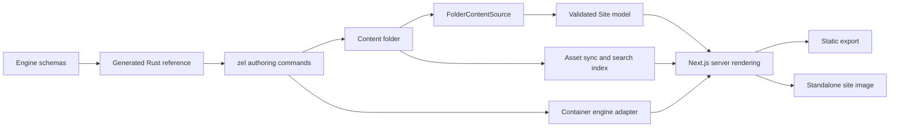

# Zellij — durable project context

Last studied: **2026-10-16**. Baseline: local `main` at
`6356b05deaddf5421b24d7c8a1e30f868d4923c0`.

This is the starting point for future Zellij conversations in this checkout.
The companion [audit](specs/zellij-audit-2026-10-16.md) contains reproducible
defects, remaining work, evidence, and verification limits. Recheck dated facts
before acting. The initial review created documentation only; subsequent authorized work is
recorded below.

### Implementation update — 2026-10-16

The user subsequently authorized implementation and the repository setup.
`mylife-inc/Zellij` is now **public**, with **main** as its default branch.
Before the visibility change, Gitleaks 8.30.1 scanned all 134 reachable commits
and reported no detected leaks. No historical rewrite was performed.

The first milestone merged in [PR #1](https://github.com/mylife-inc/Zellij/pull/1)
as `6950589`. Commit `1a2e26b` adds shared output-path/collision
checks, conversion source containment, protected page/guide creation, staged
static exports, and streamed image Dockerfiles. `deda7a0` restores the browser
job's engine-build prerequisite; `bd6b6c6` bounds file-descriptor use during
large conversions and tests the CLI against an image built from its checkout.
See the audit's implementation record for the resolved finding IDs.

Verification established: **99 Rust tests**, warnings-denied Clippy, formatting,
**227 engine tests**, workspace typechecking, and the engine/showcase production
builds pass. Hosted browser run `39000366953` passed **294 tests**, with 114
existing conditional skips across desktop/mobile Chromium and mobile WebKit.
The CI workflow additionally exercises initial static export, failed-build
preservation, and successful replacement using a real container. Consult the
PR's latest checks and merge status before relying on a particular revision.

Compatibility change: conversion requires a new/empty destination outside its
source tree. Static export requires a new/empty directory outside content, or
an export previously created with the `.zellij-output` ownership marker.
Existing unmarked exports need a new/empty output on their first build with the
new CLI; never mark an authored directory as generated output.

A clean `npm ci` restored the missing local packages. `npm audit` also reported
19 advisories (3 critical, 6 high, 6 moderate, 4 low). Next.js and Vitest upgrades
need a separate compatibility-tested change; no automatic audit fix was applied.
This was the dependency baseline before the second milestone below.

### Dependency and template update — 2026-10-16

The user authorized continuing. Commit `17d5a23`, tracked in
[PR #2](https://github.com/mylife-inc/Zellij/pull/2), removes the 19 reported
npm advisories and fixes the invalid section scaffolds (audit R4). The locked
tree and a freshly generated standalone app with all features both report
**zero npm advisories** at this date; this is not a claim that all bugs are gone.

- Next.js is `16.4.2`; Vitest resolves to `4.1.12`, Vite `7.3.7`, Mermaid
  `11.17.2`, KaTeX `0.18.10`, esbuild `0.28.2`, and XML DOM `0.9.12`.
- Scoped dependency overrides keep optional math/diagram chains patched.
  The engine manifest carries the production overrides; `zellij init` and
  feature changes copy them to the app root, where npm actually enforces them.
  Manual wrappers must carry that map too. The repository additionally
  overrides tsup's esbuild. Tests keep the shared constraints in agreement.
- `src/content/frontmatter.ts` replaces gray-matter, using the existing YAML
  package for guides, prose, and search. Metadata must be a YAML mapping with
  a closing delimiter; executable language tags are rejected. BOM, Windows
  newlines, nested values, and multiline scalars are tested.
- `src/cli/section-templates.ts` generates YAML from schema shapes and bounds,
  chooses valid media alternatives, and validates the serialized result with
  the complete Zod schemas. `context --json` embeds `sectionTemplates`; Rust
  copies those strings instead of guessing nested types and list lengths.
  Templates contain TODO text and explicit replaceable media paths. The
  command writes only YAML; authors supply their actual assets.
- CI audits dependencies, validates and statically exports all 23 templates
  emitted by the actual Rust binary, and tests formulas/Mermaid math labels
  in browsers. Browser failures retain traces and the job has a time limit.

Local verification: **260 engine tests**, **99 Rust tests**, formatting,
warnings-denied Clippy, workspace typechecks, engine packaging, all four
example content checks, and all 23 Rust-generated template checks pass.
The showcase production build passes with webpack. Local Turbopack hits the
execution sandbox's helper-process port restriction; the normal Turbopack
build and container/browser acceptance are hosted CI gates. Consult PR #2's
latest checks for their results. No new native CLI release is issued here.

Hosted run `39004471983` at `d8c9f5d` passed all four jobs: engine, schema sync,
CLI/container acceptance, and browsers. The normal Turbopack build and all 23
template static exports passed; **297 browser tests passed**, with **114
conditional skips and no retries**. A minimal (`--features none`) fresh wrapper
also audited clean. Its lockfile still includes Mermaid, remark-math and
rehype-mathjax through the engine's optional dependencies; audit follow-up S11
tracks that feature-selection/package-size defect separately.

CI reliability history: after PR #1, run `39001111736` initially stalled on
repeated mobile-WebKit navigation timeouts. Its fresh-runner retry passed all
294 tests (114 conditional skips). This is not a diagnosed/fixed browser bug.
The separate automated security-review plugin failed its PR #2 commit review
with HTTP 400; that review must not be represented as passed.

### Conversion update — 2026-10-16

The next authorized milestone is [PR #3](https://github.com/mylife-inc/Zellij/pull/3).
Source commit `4196e6b` addresses R5's ordinary Markdown document links and
referenced assets for both MkDocs and Docusaurus. A shared parser-based pass
rewrites links to canonical engine routes, expands reference-style links,
preserves query/fragment text and code examples, and copies binary assets into
`assets/imported/docs/` or `assets/imported/static/`. Docusaurus's default
`static/` paths are supported; unlisted documents remain unpublished.

Assets participate in the same complete output preflight/staging as text.
Escaping references, symlinks, case-only file conflicts, hidden document names,
and duplicate public routes are rejected before writing. Missing or ambiguous
references and HTML/JSX attributes are reported. Markdown images under the
public asset prefix now receive the site's basePath in the MDX component map.

R5 still has explicit migration limits: source-specific/custom heading IDs,
fragments targeting a removed leading H1, HTML/JSX attributes and imports,
custom static folders and source route overrides require manual work. Fragment
text is retained, not universally validated or translated. Do not describe
this milestone as full-fidelity migration of arbitrary MkDocs/Docusaurus sites.

Local verification: **109 Rust tests**, **261 engine tests**, warnings-denied
Clippy, formatting, all workspace typechecks, engine packaging and the updated
documentation content check pass. `scripts/check-conversion.mjs` runs the real
CLI and engine to check routes, an actual heading anchor, rendered image URLs
under `/products/docs`, and copied binary bytes. Hosted CI adds static exports
of both imports and checks actual HTML links, fragments and asset files. Read
PR #3's latest checks before claiming hosted acceptance; no native CLI release
is part of this milestone.

Integration review exposed a separate prefix-configuration gap: generated
Next config does not mirror `site.yaml`'s basePath. The CI fixture configures
both explicitly using `scripts/fixtures/conversion.Dockerfile`. The existing
showcase `verify-basepath.mjs` also replaces strings no longer present in its
configuration, so it must not be trusted as current prefix acceptance (S12).

PR #2 merged as `3408f37`; main run `39005197060` passed all checks, and base
image run `39005197029` published all four feature variants for AMD64/ARM64.

### Scaffolding and discovery update — 2026-10-16

Commit `fe4240c` resolves the reproduced content-authoring findings **R6–R8**.
Rust content scaffolds and converters share a JSON-backed YAML string scalar
serializer, including explicit escapes for YAML's extra Unicode line breaks and
characters its parsers reject literally.
The Node initializer uses the same representation. Names, copyright text,
page identifiers, section references, guide titles and front matter preserve
punctuation, implicit YAML values and multiline text. This covers generated
content metadata; it does not validate arbitrary npm package names or workflow
inputs as package identifiers, GitHub expressions or shell commands.

Plain/minimal starters omit the guide CTA unless `--guide` creates its target.
All CLI commands that resolve a content root now use `Project::discover`:
`./content`, current root, `./docs`, then `./documentation`. Explicit paths
retain their existing exact-directory behavior. Marker files, a sections
directory, and guide-only roots are recognized; hidden/reserved guide folders
and markers of the wrong filesystem type are excluded. Discovery never walks
upwards. This selects a root; the engine still owns semantic validation.

Local verification: **117 Rust tests**, **262 engine tests**, warnings-denied
Clippy, formatting, workspace typechecks, engine packaging, documentation
content validation, and both conversion fixtures pass. The new
`scripts/check-scaffolds.mjs` checks exact metadata and rendered Hero links
for **40 Rust starters, 10 Node content starters and 10 guide titles**. Hosted
CI additionally exercises four guide-only discovery locations and a menu-only
root through the real container engine. Hosted results are pending at this
record; consult the PR before claiming acceptance. No native release is made.

The separate security-review plugin failed to read its model response during
the source commit, although the commit itself succeeded. That review did not
complete and must not be described as passed.

Prior milestone completion: PR #3 merged as `dd99c2c`. Main CI `39007109533`
and image run `39007109576` passed, publishing all four variants for Linux
AMD64/ARM64. Browser acceptance had 296 initial passes plus one successful
retry, with 114 conditional skips. The retry was a mobile-WebKit navigation
error at `/guide/quickstart`; PR CI had a different FAQ interaction retry.
These flakes remain undiagnosed, not repaired by the conversion changes.

## 1. Product and user's intentions

Zellij turns an authored folder of YAML, Markdown, MDX, and assets into a
product website with marketing pages and documentation. A shared Next.js engine
owns rendering, themes, components, navigation, and validation. A product's
content should not contain a fork of the engine or hand-maintained React for
ordinary content. The Rust binary is **`zel`**; the engine's Node helper is
**`zellij`**. Neither is the unrelated Zellij terminal multiplexer.

The user's outstanding intentions, stated on 2026-10-16:

- Give the sticky top bar more menu space: company logo at the left, search and
  theme controls at the right. The logo should link to the owner's website.
- Finish `zel`, including the desired operating-system coverage, explicitly
  including Linux, macOS, and Windows.
- Develop using a public `mylife-inc/Zellij` repository to avoid the current
  private-repository Actions billing constraint. Do not use `Zellij-Sealed`:
  its code is old and encrypted, and development should avoid encryption steps.
- Eventually use CodeSeal for long-term encrypted GitHub storage after the
  product is finished. The final distribution/secrecy model needs a separate
  decision: current public engine images intentionally carry source.
- The current request was research and brainstorming, not implementation.
  This restriction describes that request; future explicit implementation
  requests can authorize work.

## 2. Read these sources in this order

1. This file and the [dated audit](specs/zellij-audit-2026-10-16.md).
2. [Content-model design](specs/zellij-content-model-design.md): current folder
   model, names, routing, ownership of navigation, and migration decisions.
3. [Engine specification](specs/zellij-engine-spec.md): architecture and quality
   bar. Some inventory counts and milestone text are historical.
4. [CLI specification](specs/zellij-cli-spec.md): desired surface, not a reliable
   statement that each command exists.
5. [Product documentation](examples/zellij-docs/content): authoring guide,
   quickstart labs, CLI reference, and section examples. Read status callouts,
   but check implementation: some pages contradict the current code.
6. Source paths below. Schemas and command dispatch are stronger evidence of
   current behavior than prose claiming a feature is available.

Root [README](README.md), [engine README](engine/packages/zellij/README.md), and
the generated [CLI content reference](cli/crates/zellij-core/generated/context.md)
are useful supporting material. `zel context` describes how to author content;
it does not replace this architectural and development-status context.

## 3. Repository map

| Location | Responsibility |
| --- | --- |
| `engine/packages/zellij` | `@shebka/zellij`: Next/React rendering engine, schemas, build-time tools |
| `cli/crates/zellij-cli` | Clap command surface and orchestration; binary `zel` |
| `cli/crates/zellij-core` | Errors, project discovery, embedded schemas and reference |
| `cli/crates/zellij-scaffold` | Content/section/page/guide/project and GitHub workflow generators |
| `cli/crates/zellij-convert` | Converter registry, MkDocs and Docusaurus readers, MDX/Material normalization |
| `cli/crates/zellij-engine` | Container runtime detection, check/dev/build, Dockerfile and image operations |
| `docker/base.Dockerfile` | Distributable wrapper/engine builder image |
| `scripts/install.sh`, `scripts/publish.sh` | POSIX binary installation and release/image publishing |
| `.github/workflows` | CI, base-image publishing, tagged releases |
| `examples/showcase` | Visual demonstration and Playwright browser suite |
| `examples/zellij-docs` | Zellij's own documentation website |
| `examples/payos`, `examples/codeseal-docs` | Real product integration examples |
| `specs` | Product contracts, design history, and audit |

There are **five Rust crates, four example apps, 23 section types, 14 themes,
and four page layouts**. Older references to 12/18/19 sections, 10 themes, or
three apps should not guide new work.

## 4. Architecture and execution



The separate prepare/index path is an important weakness: it does not share all
the canonical content resolver's rules. The audit reproduces resulting route
and custom-content-directory discrepancies.

- npm workspaces: `engine/packages/*` and `examples/*`; committed npm lockfile.
- Engine package version `0.1.0`; Rust workspace version `0.1.3`.
- Examples now pin Next `16.4.2`, React/React DOM `19.2.8`; TypeScript
  `5.9.3` range. Engine peer ranges are Next `~16.4.2`, React `19.2.x`.
- Manifests declare Node `^20.19.0 || >=22.12.0`; `.nvmrc`, CI and Docker use Node 24. Audit used Node
  `24.19.0`. Rust declares edition 2024 / minimum 1.85; audit used Rust 1.99.0.
  Minimum-version compatibility was not tested.
- Local package exports point at source, consumed through Next's
  `transpilePackages`. tsup also emits ESM/CJS/types and bundles the Node CLI.
  Build verification checks that client directives survive packaging.
- React Server Components are the default. Interactive leaves include the nav,
  search, theme controls, tabs/accordions, carousels, and motion.
- Static export and standalone server/image are the principal outputs.
  `withZellij()` configures Next; the wrapper delegates to the engine factories.

### Key source entry points

| Concern | Start here |
| --- | --- |
| Public API | `engine/packages/zellij/src/index.ts` |
| Next configuration | `engine/packages/zellij/next-config.mjs` |
| Runtime loading/cache | `src/config/runtime.ts` |
| Config and content schemas | `src/config/schema.ts`, `src/content/model-schema.ts` |
| Folder/legacy loaders | `src/content/folder-source.ts`, `src/content/legacy-source.ts` |
| Site assembly and validation | `src/content/site.ts` |
| Names/routes/assets | `src/content/naming.ts`, `paths.ts`, `asset-href.ts` |
| Route factories/metadata | `src/render/page.tsx`, `root-layout.tsx`, `seo.ts` |
| Section registry/schemas | `src/sections/registry.ts`, `schemas.ts` |
| Section rendering/layout | `src/render/section-renderer.tsx`, `sections-page.tsx` |
| Guide rendering | `src/render/guide-page.tsx`, `src/guide`, `src/mdx` |
| Header and branding | `src/chrome/nav-bar.tsx`, `nav-bar-client.tsx`, `src/styles/chrome.css` |
| Themes/motion | `src/themes`, `src/motion`, `src/styles/sections.css` |
| Search | `src/search`, `src/cli/write-search-index.ts` |
| Build-time operations | `src/cli/check.ts`, `sync-assets.ts`, `context.ts`, `init.ts` |
| Rust command truth | `cli/crates/zellij-cli/src/main.rs` — enum AND dispatch |
| Release truth | `.github/workflows/release.yml`, `scripts/install.sh` |

Paths beginning `src/` above are relative to `engine/packages/zellij`.

## 5. Content model and invariants

```text
content/
  site.yaml              identity, brand, theme, behavior, footer
  menu.yaml              optional explicit top navigation
  pages.yaml             section-composed pages
  sections/              reusable YAML or Markdown/MDX sections
  assets/                authored media
  01-guide/
    _sidebar.yaml        ordering, title, optional route override
    index.mdx
    installation.mdx
  02-reference/           another independent guide tree
    _sidebar.yaml
  examples/              optional YAML for SectionPreview
```

- These top-level files are optional; a guide-only site is valid to the engine.
- Numeric prefixes establish order and are stripped from public routes.
  `_sidebar.yaml` and page frontmatter can customize routes. A guide without
  an index redirects its root to its first listed page.
- `pages.yaml` references section files. Presentation overrides are limited to
  `background`, `id`, `motion`, `padding`, and `titleGradient`.
- `home` selects the home destination. Menus derive from content when absent;
  explicit menus can contain ordinary links, dropdowns, or mega-menu groups.
- `menuOverflowAfter` folds excess items into More by **count**, not width.
- Menu `page:` and footer references are resolved/validated. Literal `url:`
  entries deliberately bypass content lookup. Do not accidentally remove that
  deliberate escape hatch while expanding link validation.
- Unlisted guide pages still generate routes, with warnings; do not assume
  removing a sidebar entry hides or unpublishes a document.
- A `marketing/` directory selects the legacy loader. Compatibility remains,
  despite the design's original one-release migration window.
- Runtime memoization lasts for the process in production, 250 ms in dev.
  Its cache is global and not keyed by runtime options.

### Rendering inventory

Sections: `bento-grid`, `card-carousel`, `code-cards`, `cta-banner`, `faq`,
`feature-grid`, `gallery`, `hero`, `hero-split`, `logo-strip`, `markdown-prose`,
`matrix`, `media-panel`, `pricing-table`, `promo-grid`, `showcase`, `stats-band`,
`steps-panel`, `team-grid`, `testimonial`, `timeline`, `video-embed`, `zigzag`.

Themes: `midnight`, `paper`, `terracotta`, `mono`, `aurora`, `slate`, `forest`,
`sunburst`, `carbon`, `porcelain`, `cupertino`, `studio`, `iris`, `meridian`.
Layouts: `stack`, `stack-narrow`, `stack-sidebar`, `landing`.
Motion: `none`, `subtle`, `expressive`, with reduced-motion overrides.

MDX uses next-mdx-remote/RSC, GFM, Shiki, and heading slugs. Built-in components
include Callout, Steps, Tabs, CodeGroup, Card/CardGrid, Screenshot,
SectionPreview, Theorem, and Proof. Optional math renders MathJax SVG at build
time; Mermaid loads in the browser; YAML mindmaps render through D3 at build
time. Do not conflate installed optional packages with implemented Rust feature
selection: the latter is incomplete.

Assets are copied to `public/_zellij/assets` with fingerprint query hashes.
Guide search is a static FlexSearch index fetched when search first opens;
marketing sections are intentionally not indexed.

## 6. What `zel` actually does

An implemented dispatch branch does not imply all flags or edge cases are
complete; see the audit before using writers on valuable content.

| Status | Commands |
| --- | --- |
| Implemented native operations | `new docs`, `new section`, `new page`, `new guide`, `new project`, `explain`, `list sections/formats/targets`, `context` (Markdown), `detect`, `convert`, `doctor` |
| Implemented container orchestration | `check`, `dev`, `build` static/image; `image build/run/push/dockerfile` |
| Implemented workflows | `migrate` = detect/convert/check; `ci init github`; `ci publish` dispatches an existing workflow |
| Declared but returns “not implemented yet” | `new app`, `list themes`, `deploy`, `serve`, `fmt`, `publish`, `ship` |
| Specified but not registered | `watch`, `eject`, `pull`, `upgrade`, `completions`, `version` subcommand (`--version` works) |
| Accepted globals without behavior | `--json`, `--verbose` |

Converters: MkDocs and a limited Docusaurus implementation. Computed JS/TS
sidebar configurations are not executed. Other formats in the spec are plans.
`new page` prints the `pages.yaml` entry for a person to paste; preserving
comments by avoiding a rewrite is deliberate.

No CLI config-file loader, deployment-provider crate, complete machine-readable
diagnostics, or broad feature/build-option plumbing exists. Docs disagree on
`zel.toml` versus the spec's `zellij.toml`; settle the name before implementation.
Generated GitHub workflows support validation, GHCR images, and Netlify through
its own CLI, despite the separate `zel deploy` command being a stub.

Docker, Podman, and nerdctl are probed; Colima socket handling exists.
`ZELLIJ_IMAGE` overrides the default `ghcr.io/mylife-inc/zellij-base:latest`.
Build/dev install app dependencies inside the container. A pulled base image
alone is therefore not a guarantee of offline builds. Dev rereads content on
reload, but preparation of assets/search is not a complete file-watch loop.

## 7. Where development stopped at the initial audit

The following is the historical baseline, superseded where indicated by the
implementation update above.

Local `main` is three commits ahead of both the tracking ref and the live remote
`main` observed on 2026-10-16:

| Commit | Work |
| --- | --- |
| `e97099f` | Reject successful-looking static builds that wrote no output, including Colima mount failures |
| `5001c37` | More faithful MkDocs/Material conversion, MDX escaping, generated React version constraints, clearer build-failure classification |
| `6356b05` | Apply `menuOverflowAfter` to authored menus as well as derived menus |

The last commit, dated 2026-09-25, explicitly leaves width-aware menu overflow
unfinished. The local `content-model` branch is contained in `main`; its one
commit ahead of its own tracking branch is not additional unmerged work.

Live repository facts on the audit date:

- `origin`: `git@github-mylife-inc:mylife-inc/Zellij.git`.
- **`mylife-inc/Zellij` already exists and is private**; default branch is
  `content-model`. Remote main is `70fc7c3`; remote content-model is `b34a8c3`.
- Recent Actions jobs were blocked before execution by billing/spending limits.
  That is separate from the local Clippy failure.
- Public binary releases live in `mylife-inc/releases`; latest observed release
  is `zellij-v0.1.3`, with macOS and GNU/Linux, each x86_64 and arm64.
- Native Windows was deliberately removed in commit `6a44d37`; WSL is the
  current documented Windows route. User's desired native support reopens that
  decision. No native Windows installer/release target currently exists.
- The live **base image `latest` contains both linux/amd64 and linux/arm64**.
  Do not repeat the older publishing-script comment saying it is amd64-only.
  Feature-tag variants and the relationship to unpublished local changes were
  not independently verified.

In the follow-up discussion on 2026-10-16, the user accepted reusing the existing
`mylife-inc/Zellij` repository and changing it to public during development.
Creating a replacement repository is no longer the proposed path. The user
then authorized work to begin; the implementation update above records the
resulting repository changes. Standard public GitHub-hosted runners avoid
minute charges, but normal usage/concurrency limits still apply. Later
encryption cannot retract plaintext copies already obtained while public.

## 8. Verification baseline and next work

At the audited commit: 227 engine unit tests passed, 82 Rust unit tests passed,
workspace typechecking passed, engine package build passed, Rust formatting
passed, and generated schema/reference matched their committed versions.
All four local example content roots passed the engine check.

Clippy with `-D warnings` failed at `zellij-convert/src/material.rs:29`.
Showcase production build was blocked by the local missing
`@tailwindcss/postcss` dependency; browser tests, Lighthouse, and current
production visual acceptance were not completed. Passing content validation
does not prove MDX compiles or all links/images work.

Remaining order after the scaffolding milestone, subject to the user's v1 scope decision:

1. Header placement and width-aware overflow: company logo on the left,
   search/theme controls on the right; then the reproduced search/route bugs.
2. Shared routing/preparation and validation (R10–R13), remaining advanced
   migration cases (R5), and basePath configuration/acceptance (S12).
   R4 and R6–R8 now have implementation records above.
3. Finish the agreed CLI subset, configuration, and truthful help/docs.
4. Exercise releases and installers on every supported platform, including
   native Windows if chosen. Repository visibility/default branch are settled;
   the restored CI baseline must remain green.
5. Close browser/accessibility/SEO/performance acceptance and define a finite
   release gate: no known blocking defects, rather than a promise that
   undiscovered bugs cannot exist.

Versioned docs, i18n, remote content, CMS, comments, and A/B testing are explicit
v1 non-goals in the engine spec; do not turn them into release blockers without
a new product decision.

### Useful checks for the next session

```sh
git status --short
git log -6 --oneline
npm run typecheck
npm test
npm run build -w @shebka/zellij
cargo fmt --manifest-path cli/Cargo.toml --all --check
cargo clippy --manifest-path cli/Cargo.toml --workspace --all-targets -- -D warnings
cargo test --manifest-path cli/Cargo.toml --workspace
```

Then perform clean dependency installation/build/browser/release checks in an
appropriate environment. Do not claim a green full suite based on unit tests.
On the audit machine, `/usr/local/bin/node` was broken by a missing dynamic
library. Verification used Codex's bundled runtime; discover its path afresh
with `load_workspace_dependencies` if necessary. Do not silently repair the
user's system Node as part of an unrelated project task.

When returning to this project, refresh the dated repository/release facts,
read the relevant audit finding, inspect its source, and then implement only
the work the user has authorized.
