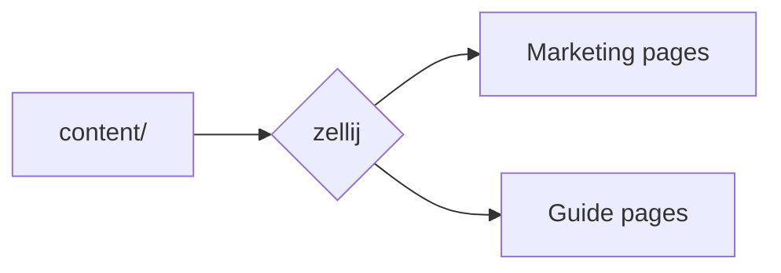
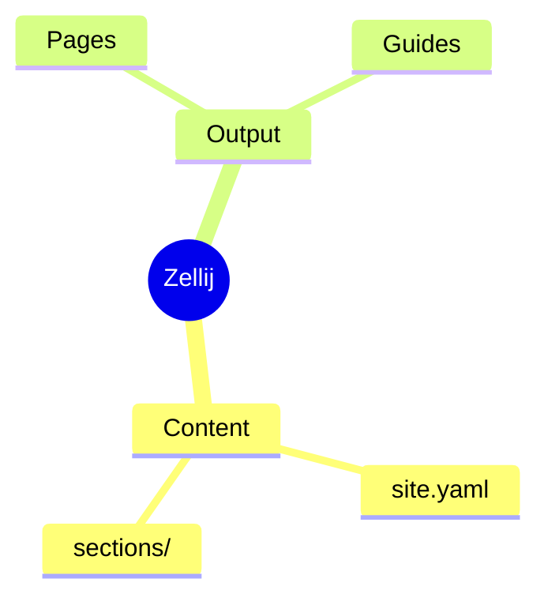
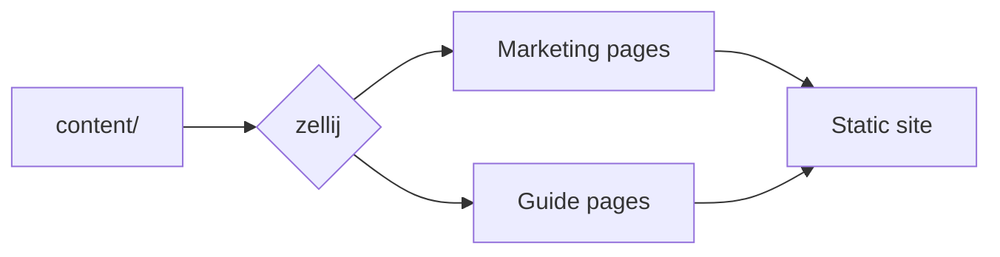
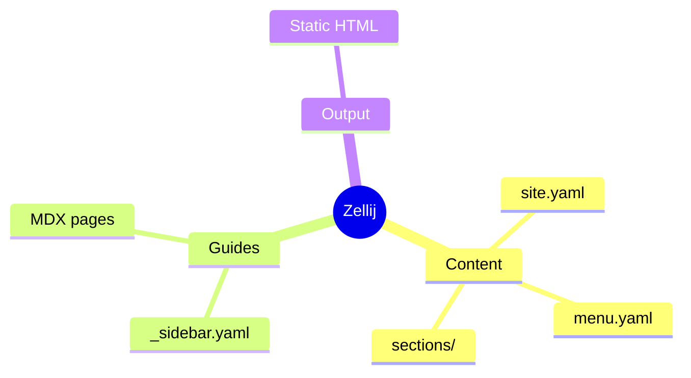
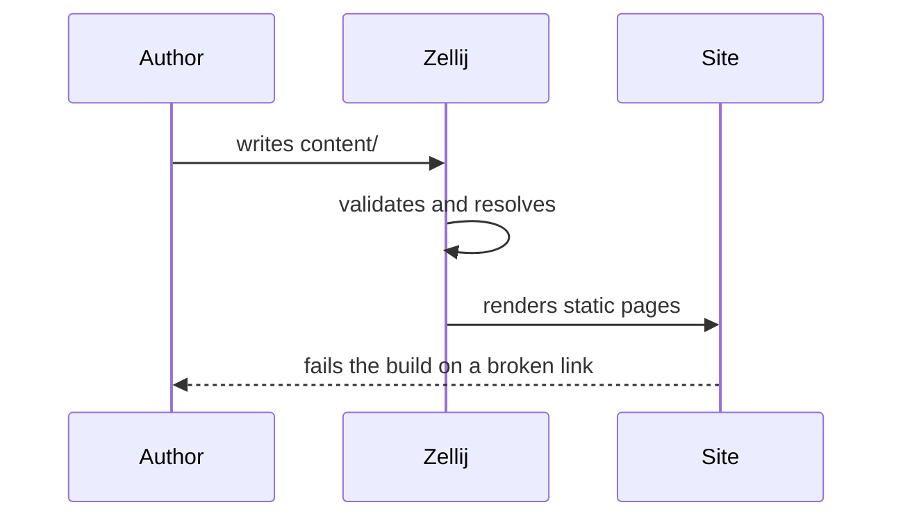

Guide pages carry mathematics and diagrams without any setup: the syntax is
part of the MDX pipeline, and nothing needs enabling in `site.yaml`.

## LaTeX

Inline maths goes between single dollars, display maths between double ones.

```md
The sum $\sum_{k=1}^{n} k = \frac{n(n+1)}{2}$ is Gauss's, and in display form:

$$
\int_{-\infty}^{\infty} e^{-x^2}\,dx = \sqrt{\pi}
$$
```

The sum $\sum_{k=1}^{n} k = \frac{n(n+1)}{2}$ is Gauss's, and in display form:

$$
\int_{-\infty}^{\infty} e^{-x^2}\,dx = \sqrt{\pi}
$$

<Callout type="info" title="Rendered at build time, as SVG">
Formulas are typeset by MathJax during the build and shipped as inline SVG.
No maths library reaches the browser, there is no stylesheet to load and no web
fonts to wait for — and because the glyphs are drawn in `currentColor`, a
formula follows the theme into dark mode like any other text.
</Callout>

A wide derivation gets its own scrollbar rather than widening the page:

$$
\left( \sum_{k=1}^{n} a_k b_k \right)^{\!2} \leq \left( \sum_{k=1}^{n} a_k^2 \right) \left( \sum_{k=1}^{n} b_k^2 \right)
$$

## Theorem environments

`<Theorem>` covers the usual environments — `theorem`, `lemma`, `corollary`,
`proposition`, `definition`, `example` and `remark` — and `<Proof>` is the one
you write most often.

```mdx
<Theorem kind="theorem" number="1" title="Cauchy–Schwarz">
For all real $a_k$ and $b_k$, the inequality above holds.
</Theorem>

<Proof>
Consider the quadratic $q(t) = \sum (a_k t - b_k)^2 \geq 0$.
</Proof>
```

<Theorem kind="theorem" number="1" title="Cauchy–Schwarz">
For all real $a_k$ and $b_k$, the inequality above holds, with equality exactly
when the two sequences are proportional.
</Theorem>

<Proof>
Consider $q(t) = \sum_k (a_k t - b_k)^2 \geq 0$. A quadratic that is never
negative has non-positive discriminant, and expanding $q$ gives precisely the
claim.
</Proof>

<Theorem kind="definition" number="1" title="Inner product">
A map $\langle \cdot, \cdot \rangle$ that is linear in its first argument,
symmetric, and positive definite.
</Theorem>

### Numbering is yours

`number` is written, not counted. MDX compiles each page on its own with no
shared render pass, so a counter would restart wherever a component happened to
re-render — and a theorem whose number moves is worse than one with no number.
Omit `number`, or pass `unnumbered`, for a one-off.

## Mermaid diagrams

A `mermaid` fence is drawn rather than highlighted. Every diagram type in the
grammar works, mindmaps included.

<CodeGroup>

````md title="Flowchart"

````

````md title="Mindmap"

````

</CodeGroup>



A mindmap, from the same fence:



And a sequence, since documentation explains protocols more often than it
explains trees:



<Callout type="tip" title="Only pages with a diagram pay for one">
Mermaid lays a diagram out by measuring text, so it needs a browser and cannot
run during the build the way the maths does. The library is imported the moment
a diagram appears and never otherwise, and until it arrives the fence's source
stands in — so a reader without JavaScript still gets the definition.
</Callout>
