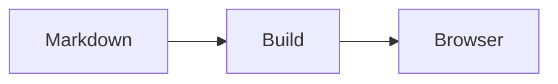

<Callout type="tip" title="Available in source">
The portable target runs entirely inside `zel`. It needs no Docker, Node, or
network connection. The existing `static` and `image` targets use the container
engine. Native release packages may lag the current source; check `zel list targets`.
</Callout>

```bash title="terminal"
zel build                               # configured site → docs/zellij/site
zel build docs/manual                   # custom configured site → docs/manual/site
zel build ./docs                        # legacy plain Markdown → ./docs-site
zel build ./docs --out ./published-docs  # choose an output outside the input
zel build ./docs --target portable --name "Acme docs" --theme forest
zel build ./content --target static --out ./dist
zel build ./content --target image --tag acme-docs:v2
```

## Choose the output

| Target | Input | Output and requirements |
| --- | --- | --- |
| `portable` | A plain Markdown folder | HTML with relative links and local support files. Double-click `index.html`; no server required. |
| `static` | Structured Zellij YAML/MDX content | A Next static export for an HTTP static host. Requires a container runtime to build. |
| `image` | Structured Zellij YAML/MDX content | A container that serves the website on port 3000. Requires a container runtime. |

With no directory, the [site resolver](/cli/config#site-layout-and-discovery)
selects `./zel.yaml` or `./docs/zellij/zel.yaml`. A versioned config selects its
renderer and reads `content/`; output defaults to its `site/` or `build.out`.
An explicit target must match a versioned site's renderer (`image` uses hosted).

For explicit legacy inputs, a flat `zel.yaml` selects portable Markdown;
otherwise recognized hosted markers select `static`, and plain Markdown selects
`portable`. An explicit target can override raw-folder inference. Portable
legacy input is read directly and outputs to a sibling `<folder>-site` by default.

## Portable Markdown

Start a new site with [`zel new portable`](/cli/new), or build an
existing Markdown folder directly. `zel new portable --minimal` creates
`zel.yaml` and `content/index.md` in `docs/zellij`.

A folder of `.md` or `.markdown` documents is enough. No `_sidebar.yaml`,
`site.yaml`, JavaScript project, or MkDocs configuration is required. Hidden
entries and `node_modules` are excluded. Symbolic links inside the folder are
rejected. MDX needs the hosted target and is rejected by portable builds.

```text
docs/                         published-docs/
├── README.md                 ├── index.html
├── guide/                    ├── guide/
│   ├── index.md              │   ├── index.html
│   └── install.md            │   └── install.html
└── images/logo.svg           ├── images/logo.svg
                              └── _zellij/…
```

The generated folder can be moved, copied to another computer, opened directly,
or served by an ordinary HTTP file server. Keep the complete folder together.
Navigation, breadcrumbs, previous/next links, heading anchors, offline search,
local images, bundled fonts, syntax highlighting, and all 14 Zellij themes work
without an HTTP server. Content and ordinary navigation remain available with
JavaScript disabled; search and theme controls need JavaScript.

### Pages, navigation, and titles

Documents keep their relative folders and change extension to `.html`.
`index.md` becomes the directory's `index.html`. A `README.md` becomes
`index.html` when that directory has no index document; otherwise it remains
`README.html`. If there is no root home document, `zel` generates a home page
listing documents, or the explicit navigation when configured.

By default, home comes first and other pages sort by optional numeric `order`,
then by output path. Add [portable configuration](/cli/config#portable-markdown)
in `zel.yaml` for nested navigation, explicit labels/order, site name/theme, and
a company logo/link. The sidebar and previous/next links follow that navigation.
MkDocs, hosted Zellij YAML, and Docusaurus navigation formats are not read by
this target.

Optional YAML front matter controls the page's navigation title, HTML title,
summary metadata, and order:

```markdown
---
title: Install the application
description: Local setup instructions.
order: 10
---
# Installation
```

Without `title`, the first H1 supplies the title, then the filename. A page
without an H1 receives a title heading. The visible authored H1 is retained even
when front matter supplies a different navigation title.

### Links and assets

Use ordinary Markdown links such as `[Install](guide/install.md#setup)` and
``. Reference-style links also work. The builder rewrites
local document links to their real HTML files, retains queries and fragments,
validates heading/footnote fragments, and copies referenced local assets.
References into hidden paths or `node_modules` are rejected, matching the folders
excluded from discovery and watch mode. Put published assets in a normal source
folder such as `assets/`.
Directories with a home document can be linked as `guide/`. Root-relative
Markdown paths resolve inside the input folder and become portable relative
links. All referenced local files must be inside that folder.

Heading IDs derive from lowercase heading text with spaces replaced by hyphens
and punctuation removed. Repeated headings receive `-1`, `-2`, and so on.
Explicit IDs such as `## Setup {#install}` are supported and checked for
collisions. Missing links, bad anchors, output collisions, and filenames that
cannot be copied to Windows fail the build before replacing the previous site.

Explicit `https:`, `http:`, `mailto:`, and `tel:` links remain external. Remote
images are not downloaded or bundled, so they still require network access.
Unused local files are not copied.

### Markdown support and current limits

The renderer supports headings, paragraphs, lists, emphasis, links, images,
quotes, tables, task lists, strikethrough, footnotes, and fenced/indented code.
Code highlighting is generated during the build and needs no browser library.

Raw HTML is displayed as literal text and produces a warning. MDX components,
MkDocs plugins/extensions and custom HTML widgets are not supported by this target.
Built-in YAML mindmaps, optional native math, and opt-in Mermaid diagrams are
described below. Hosted Zellij sites retain their existing MDX, math, and
diagram features. Portable build is the first part of the documentation
workflow; [`serve`](/cli/serve) previews the result and [`view`](/cli/view)
combines the build, server, and browser launch. Add `view --watch` to rebuild
and reload the HTTP preview after source edits.

### Mathematics

Enable `markdown: {math: true}` in `zel.yaml` to render LaTeX math into MathML
during the build. For example:

```markdown
Inline energy: $E=mc^2$.

$$
\frac{1}{2} + \sqrt{x}
$$
```

Math and the bundled STIX Two Math font work through `file://`, HTTP, and with
JavaScript disabled. Only pages with equations load the math stylesheet; sites
without equations omit the math assets. The export contains the font license.
There is no CDN, Node, TeX installation, or browser math library to run for these
native equations. Enabled Mermaid pages also include this local font and stylesheet
for formulas inside diagrams.

Use common LaTeX formulas such as fractions, roots, sums, and matrices. This
uses `math-core` 0.9.0 rather than the hosted MathJax renderer; arbitrary LaTeX
documents and full command parity are not supported. Unsupported commands,
malformed expressions and unresolved equation references fail `check` and
`build`, retaining the previous export. The diagnostic names the source file
and expression number. Definitions, equation numbering and references are local
to each expression; cross-expression equation references are not supported.

With math enabled, escape literal dollar signs as `\$`, or put examples in
inline/fenced code. Delimiters follow pulldown-cmark's Markdown math syntax;
`\(...\)` and `\[...\]` are not equation delimiters. Unmatched delimiters remain
ordinary Markdown. Math in image descriptions remains plain LaTeX text.
Headings and search keep the LaTeX source as their text; rendered equations
include that source in a MathML annotation. The original Markdown is unchanged.

Current Chromium and WebKit are covered by automated offline tests. This does
not establish exhaustive LaTeX layout, older-browser or screen-reader support.

### Mindmaps

A `mindmap` fence renders a YAML hierarchy to SVG during the native build.
No configuration, extra tool, download, or browser library is needed:

````markdown
```mindmap
Documentation:
  Author: [Markdown, Assets]
  Build:
    Output: Static HTML
  Read: [Double-click index.html, HTTP preview]
```
````

Use exactly one root key. Mappings define nodes and children; lists define
siblings; string, finite number, and boolean values become leaf labels. A key
with no value is a leaf. Mapping keys must be strings; quote keys such as
`"true"` or `"2026"`. Quote punctuation as needed for valid YAML. Whitespace
inside labels is collapsed to spaces, and HTML-like labels remain literal text.
Duplicate keys, custom tags, multiple roots, null list items, and directly nested
lists are rejected. Put nested children under a named mapping key instead.

The SVG uses the site's colors and a scrollable viewport for wide trees. Focus
the diagram and use Left/Right or Home/End to scroll with JavaScript enabled.
Native keyboard scrolling varies by browser when JavaScript is disabled; open
**Text outline** below it to read the same hierarchy as nested lists. The SVG
and outline both work with JavaScript disabled, directly from disk or over HTTP.
Label layout uses conservative width estimates; complex text shaping and the
hosted renderer's exact geometry or branch palette are not promised.

Each diagram supports up to 512 nodes, 32 levels including the root, 256 Unicode
characters per label, and 64 KiB of YAML source. YAML expansion is bounded before
layout. Invalid diagrams fail `check` and `build` with the source filename and
diagram number. Failed watch rebuilds retain the last good site and recover
after an edit. Only pages with mindmaps load their small stylesheet, and it is
removed from the export when the last mindmap is removed.

This is Zellij's YAML `mindmap` syntax. Mermaid's `mindmap` grammar belongs inside
a `mermaid` fence, which remains source code in the portable target.

### Mermaid diagrams

Enable `markdown: {mermaid: true}` in `zel.yaml` to draw fenced Mermaid source:

````markdown

````

The export includes a local Mermaid runtime, its dependencies, and their license
notices. Flowcharts, sequences, state diagrams, pie charts and Mermaid mindmaps
work when opening a nested HTML file directly or moving the entire output folder.
No HTTP server, Node, Docker, CDN or build-time browser is required. Diagrams redraw
for the selected theme and light/dark mode, including system appearance changes.
Formulas inside supported diagram labels use bundled KaTeX MathML and local fonts.

Drawing requires browser JavaScript. Each diagram keeps a source disclosure;
without JavaScript, or if the runtime cannot load, that source stays visible.
Invalid Mermaid syntax shows a browser error and the source, without preventing
other diagrams on the page from rendering. `zel check`, including `--strict`,
validates nonempty source, at most 64 KiB per fence, and at most 32 diagrams per
page. It does **not** run the Mermaid parser or guarantee a successful drawing.
The browser additionally limits graphs to 500 edges.

Mermaid uses strict security; author directives cannot weaken that setting or
enable the legacy external math stylesheet. Explicit remote images or other
remote resources in authored diagrams still need network access. Referenced
diagram images are not discovered/copied by the native Markdown asset resolver;
use ordinary Markdown images for portable local assets. Mermaid plugins, remote
icon packs, and server-side rendering are not part of this target.

Only pages containing enabled diagrams load the approximately 3.5 MB runtime.
Sites without diagrams omit it; removing the last diagram removes it on the next
build. Its shared math font is retained if native equations still need it.
`view --watch` reloads changes to the source and the opt-in setting. Native input
limit failures preserve the previous export; syntax errors appear after the
successful rebuild, in the browser.

## Hosted static website

`--target static` renders structured YAML/MDX content through the container
engine. The result includes one HTML file per route, `_next` support files,
search data, and copied assets. Serve it over HTTP with an appropriate static
host. Its router and asset URLs assume HTTP; opening its `index.html` directly
is not the portable workflow.

Static export serves images as authored rather than using a running image
optimizer. Configure the content's `site.yaml` for branding, theme, site URL,
and deployment prefix. See [configuration](/cli/config) for the distinction
between content configuration and planned CLI configuration.

## Container image

```bash title="terminal"
zel build ./content --target image --tag acme-docs:v2
docker run -p 3000:3000 acme-docs:v2
```

The image includes the Next application and runtime and serves on port 3000.
Use this target when your deployment uses containers or needs server-side image
optimization. `zel image build` is also available; see [image commands](/cli/image).

## Output ownership

Both file targets require output outside the content source (`content/` for a configured site). It must be new, empty,
or a previous Zellij export containing its `.zellij-output` ownership marker.
Keep authored files outside generated output: rebuilding replaces the export
as a whole and removes obsolete generated pages.

Builds stage in a temporary sibling directory. Validation or rendering failures
leave the previous export intact. For an older unmarked export, choose a new
output directory; do not add the marker by hand.

## Options

| Option | Meaning | Default |
| --- | --- | --- |
| `[dir]` | Configured site or explicit legacy input | `./zel.yaml`, then `./docs/zellij/zel.yaml` |
| `--target <portable\|static\|image>` | Explicit output target | Configured renderer; legacy inference otherwise |
| `--out <path>` | Output folder for `portable` or `static` | Configured `build.out` or `site/`; legacy portable: sibling `<input-name>-site`; legacy static: `./dist` |
| `--name <text>` | Portable site's header name | `zel.yaml` name, otherwise input folder name |
| `--theme <name>` | Portable theme; see `zel list themes` | `zel.yaml` theme, otherwise `cupertino` |
| `--tag <name:version>` | Image tag, image target only | Existing image naming policy |

Options that do not apply to the selected target are rejected. `--base-path`,
`--site-url`, `--features`, `--platform`, and `--no-check` are not implemented
Rust build flags. `--json` is currently limited to inspection commands.
